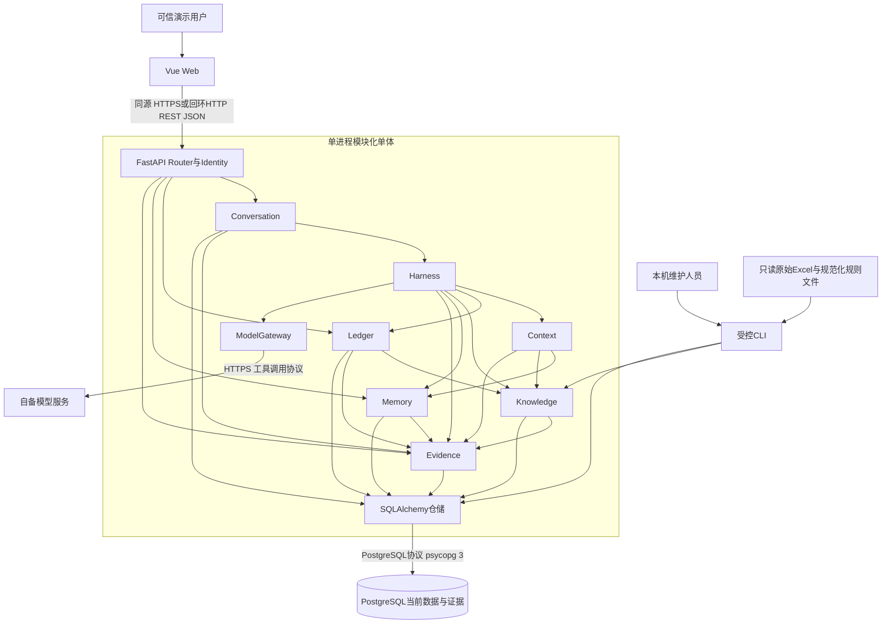

# 系统总体架构设计

版本：1.1｜日期：2026-11-01｜上游：[架构需求](01_架构需求与约束.md)；需求基线1.3，本轮按用户指定采用PostgreSQL。

## 1. 推荐架构与适用理由

采用**前后端分离开发、同源应用部署、模块化单体后端、PostgreSQL关系型持久化、外部模型适配**。前端Vue 3/TypeScript，后端FastAPI。后端所有业务模块在一个进程内调用，不形成网络微服务。PostgreSQL是独立数据库服务，不是业务微服务拆分。模型是可替换的外部能力，不承载权限、金额运算或持久数据权威。

按用户明确技术要求使用PostgreSQL 18维护系列，统一开发、测试和演示数据库；通过Compose管理app与db两个服务。两企业、40票、48流水仍不足以要求业务微服务拆分、读写分离或集群。与纯CLI相比，网页符合已确认S7/S8；前端构建包由FastAPI直接托管，保留一个应用入口。服务/仓储边界利于故障测试和规则管理。

不用Kubernetes、微服务、Redis、消息队列、向量库或Agent框架。知识仅五版本，结构化条件查询+正文足够；Harness使用普通Python有限工具循环。若未来出现多实例写入、需独立任务服务或大规模语义检索，再按[ADR](03_技术选型与架构决策.md)的重评条件处理。

## 2. 系统组件

| 组件 | 职责 | 运行形态与数据 |
| --- | --- | --- |
| Web | 聊天、默认范围、发票搜索引用、记忆与证据查看 | 浏览器；草稿引用仅内存，服务端状态为准 |
| Identity | Bearer演示凭证映射可信用户，检查企业读写与资源所有权 | 后端基础能力；权限表，凭证来自环境 |
| Conversation | 会话默认企业、消息、轮次、明确指代线索、切换事件 | 进程内服务；sessions/messages/turns |
| Harness | 统一模型决策循环、范围验证、工具分派、结果约束 | 进程内编排；不直接发SQL |
| Context | 构建按需输入、材料隔离、记忆失效过滤、预算控制 | 进程内纯处理及受控读取 |
| Ledger | 当前发票/流水查询、汇总、用途检查、受控保存回读 | 进程内服务；invoices/bank_transactions/write_operations |
| Knowledge | 规则元数据筛选、正文版本管理、结构化检查策略 | 进程内服务；rules/rule_companies |
| Memory | 本人企业任务、明确偏好、管理与恢复线索 | 进程内服务；tasks/preferences |
| Evidence | 实际模型输入、选择依据、工具、回读、失败与UI事件 | 进程内记录；evidence_events |
| ModelGateway | HTTP传输、工具协议转换、超时、用量与限制 | 外部模型端点；密钥只用于请求头 |
| Persistence | SQLAlchemy仓储与连接池、psycopg 3驱动、短事务、Alembic迁移 | PostgreSQL单实例独立db服务；PGDATA用命名卷持久化 |
| 本机CLI | 首次数据准备、知识管理、备份/只读检查 | 与后端共用服务代码；无网络管理API |

模块规范见[04](04_模块与分层架构设计.md)，实体见[05](05_数据库与数据架构设计.md)。

## 3. 总体架构图

图中箭头表示调用或数据写入方向，HTTP响应沿原连接返回。Evidence是叶子业务依赖，仅访问自己的仓储，不回调其他模块；避免循环。原始资料只在准备流程进入当前库，不参与运行期金额计算。

## 4. 通信与请求生命周期

浏览器到后端使用REST JSON。MVP每次发送消息保持一个HTTP请求，`await`真实模型和必要工具后返回最终答复。界面显示处理中及当前轮标识，证据状态可查询；本版不提供逐token输出，因此不使用SSE或WebSocket。选择轮询恢复状态只为断连/刷新，不能由轮询重新启动执行。

每个会话同一时刻最多一个运行轮；后端全局模型并发默认1。不同会话争用时返回明确忙碌而不引入后台队列。模型HTTP异步等待；SQLAlchemy同步Session配合psycopg 3，同步数据库访问在短线程池任务内完成，Session不得跨线程/跨await共享。一次事务不跨外部网络等待。连接池、事务隔离和冲突处理见05，数据库能力不自动放开应用并发。

没有长批处理任务、独立Worker或FastAPI BackgroundTasks业务执行。已保存的轮次、写操作账本与任务记忆分别解决观测、防重复与业务续办。请求断连后仍可能已提交写入：用户以原轮ID查询状态；不得自动再次发送不同ID。进程终止后未完成轮标interrupted，操作先查账本与当前数据，不能宣称恢复运行。

## 5. 核心数据流与信任边界

1. Identity从凭证取user_id；任何客户端/模型传入的user_id、can_write均不采信。
2. Conversation接收文字、复合引用、client_turn_id；校验所有权、引用权限、去重和运行互斥，持久化轮与消息。
3. Harness先用本轮文字和最小上下文让模型提出操作范围与意图；程序验证企业候选、引用冲突及证据来源。未定位前不加载企业专属正文记忆/规则。
4. 确定本次操作企业后，Context获取该用户该企业允许的记忆、必要历史、规则和当前工具结果。默认甲而本次查乙时不注入甲任务或甲规则。
5. 模型选择查金额、规则、检查、修改、记忆管理等工具。Dispatcher使用可信上下文验权和验证参数，Ledger计算/保存，Knowledge选择规则；模型不能任意执行SQL、文件或HTTP。
6. 写入仅在本轮明确意愿和目标已验证时执行；事务内同时更新票据和操作账本，提交后新Session回读。操作结果与刷新检查进入Evidence，成功必须具有核验事实。
7. Memory根据实际结果更新任务；模型生成简短答复，程序用结构化结果约束金额、引用和完成状态，Web展示事实卡片、自然语言和证据入口。

可信部分是后端身份、权限表、验证器、执行器与当前库；模型、浏览器参数、票面文本、备注、规则正文和历史消息均不能自行升级权限。规则元数据与可执行策略由维护人员明确维护，正文不具备执行权限。记忆只承接进度，不保存可重放的写授权。

## 6. 范围与状态必须分开

| 概念 | 权威来源 | 可否为空/变更 | 禁止混用 |
| --- | --- | --- | --- |
| 可访问企业集合 | 可信用户+user_company_permissions | 权限配置改变 | 不由默认企业扩大 |
| 会话默认企业 | sessions.default_company_id | 可空；界面/明确指令变更 | 单次乙查询不改默认甲 |
| 本次操作企业 | 本轮文字/引用/明确指代/默认的经验证结果 | 歧义时未定 | 不用默认覆盖明确乙引用 |
| 任务归属企业 | tasks.company_id | 任务创建后不转移 | 切换/清除默认不迁移任务 |
| 当前待补清单 | 当前票据+当前适用规则 | 每次检查重新算 | 历史补过不代表现在仍已填 |
| 写授权 | 本轮明确请求，限定目标和内容 | 仅本轮；不能跨会话复用 | 引用、选择和恢复均非授权 |

新会话开场始终可选或跳过。明确长期默认企业偏好只显示为“建议选择甲”的可见提示，不偷偷替用户选择；跳过后仍为空。已经明确本轮请求乙时绝不由偏好覆写。

## 7. 系统外部与交付边界

唯一外部业务服务是自备模型端点；PostgreSQL另为必须声明的运行基础设施。模型不可用而数据库可用时可做规则、金额、记忆的只读诊断，但不能作为AI主链路验收通过；数据库不可用时相关功能明确失败。原始文件、源码与规范化seed分开，当前数据保存在PostgreSQL命名卷，应用容器可替换而数据保留。DEL-006提供可恢复的pg_dump逻辑备份与查看说明，不交付PGDATA裸目录。

部署拓扑与环境见[10](10_部署与运行架构设计.md)，开发顺序及阻塞项见[11](11_架构评审与开发交接.md)。
