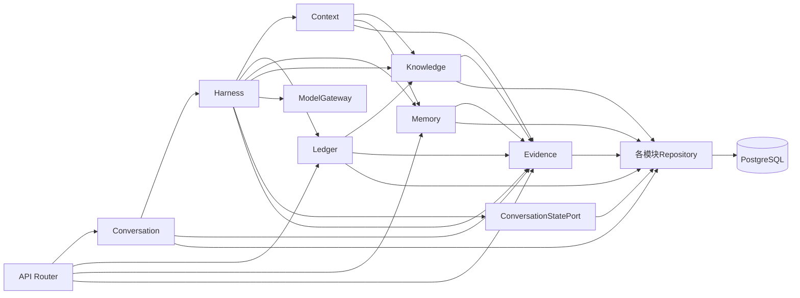

# 模块与分层架构设计

版本：1.2｜日期：2026-11-01｜关联：[总体架构](02_系统总体架构设计.md)、[数据设计](05_数据库与数据架构设计.md)、[接口契约](06_API接口设计.md)；持久化统一PostgreSQL。实施接口/DTO/事务细节补足见[12 §2](12_开发实施契约补充.md#2-模块最小实施接口)。

## 1. 分层与依赖规则

采用Router→Application Service→Repository三层；复杂的金额、日期、用途判定与状态机放纯函数/类型，不构建聚合根、领域事件总线或通用工作流引擎。

| 层 | 允许职责 | 不允许职责 |
| --- | --- | --- |
| API/Router | Pydantic输入输出、可信身份依赖、HTTP映射、资源所有权检查 | 拼SQL、算金额、相信客户端权限、直接执行模型参数 |
| Application | 用例编排、企业范围验证、工具分派、事务边界、事实结果与任务更新 | 使用任意模型文本当SQL/规则代码，发明业务事实 |
| 业务纯逻辑 | 日期区间、整数分、用途空白、策略匹配、授权约束、状态转换 | 网络、磁盘、全局可变会话 |
| Repository | 显式条件SQL、复合键查询、CAS、持久化 | 模型调用、自然语言意图判断、HTTP异常 |
| Infrastructure | 数据库连接/迁移、HTTP模型适配、环境配置、运维日志 | 反向决定业务权限、依赖API路由 |

Composition root在main.py装配服务与适配器。服务间传类型化DTO与可信ExecutionContext，不传FastAPI Request或SQLAlchemy ORM对象跨模块。共享仅放错误枚举、ID/日期/金额值类型及身份上下文；不建立能做所有事的BaseService。数据库Session每个短操作独立管理，绝不穿过模型await。

## 2. 业务模块契约

### MOD-01 Identity

- 需求：FR-001/006/010/011/015，NFR-002，DR-006。
- 负责：`authenticate(token)->Principal`、`require_company(principal, company, read|write)`、会话所有权、证据scope校验。
- 不负责：从聊天切身份、用户注册、让模型更改权限。
- 数据：users、user_company_permissions；令牌验证材料来自环境变量，user_id由服务端绑定。ExecutionContext含user_id/session_id/turn_id，不能由工具参数覆盖。
- 依赖：权限仓储；其他模块调用本模块基础函数，不由Identity调用业务模块。
- 错误：UNAUTHENTICATED、FORBIDDEN；拒绝不附带受限金额、记录是否存在或其他用户记忆。

### MOD-02 Conversation

- 需求：FR-001/002/004/016；BR-012。
- 负责：欢迎与企业列表所需会话契约、默认企业选择/跳过/切换/清除、消息引用持久化、轮次幂等与互斥。`create_session`、`set_default_company`、`submit_turn`、`get_turn`、`request_cancel`。
- 不负责：把默认企业当权限、默认补月份、切换时取消/迁移任务、把引用复制到未来每条消息。
- 输入/输出：用户文字、去重复合引用、session_version、client_turn_id→ConversationState/TurnResult。
- 数据：sessions、turns、messages；引用存message.invoice_refs_json，草稿仅浏览器内存。result_focus_json只保存已验证对象、业务月、来源轮次，不保存可执行授权。
- 依赖：Identity、Harness、Evidence、会话仓储。明确自然语言切换由Harness验证后调用注入的ConversationStatePort实现；该端口只更新会话仓储与事件，不回调Conversation.submit_turn，避免运行时循环。
- 错误：SESSION_NOT_FOUND、SESSION_VERSION_CONFLICT、TURN_IN_PROGRESS、IDEMPOTENCY_CONFLICT；更新失败保持旧默认状态。

### MOD-03 Harness

- 需求：FR-002/006/007/014/016；IF-001。
- 负责：有限模型工具循环，类型化决策、ScopeResolver、AuthorizationGuard、ToolDispatcher、ResultGuard；所有场景用同一循环。
- 输入：可信ExecutionContext、当前消息与已验证引用、会话默认与有效指代线索。输出：自然语言+结构化facts、引用、写结果、失败/待核验状态。
- 不负责：自己算金额、直接写表、按关键词匹配固定场景、把模型声称“授权”当程序事实。
- 内部模型：IntentProposal、ResolvedScope、CurrentTurnEditIntent、ToolCall、FactBundle。编辑意图记录当前user message中的动作证据位置、字段、内容字面来源或明确清空意图；模型解释仍需对抗测试，详见08。
- 依赖：Context、Ledger、Knowledge、Memory、Evidence、ModelGateway、ConversationStatePort。调用层显式传入user_id，模型工具schema没有该字段。
- 错误：MODEL_UNAVAILABLE、MODEL_PROTOCOL_ERROR、CONTEXT_BUDGET_EXCEEDED、TOOL_LIMIT_REACHED、AUTHORIZATION_REQUIRED。参数非法最多给模型一次纠正机会，不能借重试重复写；已保存结果在最终模型失败时仍显示程序事实卡片。

### MOD-04 Ledger

- 需求：FR-003—FR-007、DR-002—DR-005。
- 负责：当前明细/授权搜索、独立金额汇总、用途检查、白名单写、操作账本、提交后回读。服务：`query_totals`、`search_invoices`、`get_invoice`、`list_bank_transactions`、`check_purpose`、`apply_edit`、`verify_operation`。
- 输入/输出：复合键、业务月、允许字段与期望值→金额/列表/CheckResult/WriteResult。金额输出字符串；CheckResult含当前缺失清单和RuleRef。
- 不负责：模型意图生成、长期偏好、猜用途、付款关联、银行/金额写接口。
- 内部数据：InvoiceKey、MoneyCents、PurposePolicy、WriteOperation；只更新purpose/note和row_version。多个同企业引用可逐票调用，单票独立事务，逐项报告；跨企业写集合拒绝并要求拆轮，不新增跨企业批量修改。
- 依赖：Identity、Knowledge、Evidence、账务仓储。用途检查从当前规则策略计算；保存本身不以“必须填”作为前提，乙低额/8月合法字段仍可明确补充。规则变化使检查需重选依据，不把停用策略继续用于判断。
- 错误：RESOURCE_NOT_FOUND、AMBIGUOUS_TARGET、INVALID_MONTH、ILLEGAL_FIELD、STALE_DATA、RULE_NOT_FOUND/RULE_CONFLICT、WRITE_FAILED、VERIFY_PENDING/MISMATCH；无记录与查询失败分开。

### MOD-05 Knowledge

- 需求：FR-012/013、DR-007；本机CLI与运行期查询共用逻辑。
- 负责：五版本导入、按编号版本管理查看、修订正文/策略、停用；按企业/业务时间/状态/主题选择。`resolve_rule`、`import_rules`、`revise_rule`、`disable_rule`、`list_rules`。
- 不负责：普通聊天改知识、恢复停用版、按版本字符串取最大、自动理解并执行任意法规。
- 输入/输出：有来源的规则元数据与受控策略→RuleDocument/RuleRef/管理结果。相同编号版本导入同hash为幂等，相异内容须显式修订；正文与策略同事务保存，revision递增并留证据。
- 数据：rules、rule_companies；初始五条策略及生效日见05。R001/R004都关联两企业，不用null假装“所有企业”。
- 依赖：Identity（业务查询验权）、Evidence、规则仓储。CLI执行OS文件权限边界，不通过业务用户token自授维护权限。
- 错误：INVALID_RULE_METADATA、RULE_VERSION_CONFLICT、RULE_NOT_FOUND、RULE_CONFLICT、UNSUPPORTED_POLICY；管理可查看停用版，业务依据排除它。

Ledger.check_purpose需要规则/票据同一快照时，Knowledge.resolve_rule接受只读TransactionPort并复用调用方事务，不能另开连接；Evidence可经TransactionPort加入调用方短事务。端口由基础设施封装，不跨层传ORM Session，依赖方向仍为业务服务→叶子能力/仓储。

### MOD-06 Memory

- 需求：FR-008—FR-011、DR-008/009。
- 负责：任务合并/冲突、更正删除、明确偏好、跨会话候选与恢复线索。`list_memory`、`upsert_task`、`correct_task`、`delete_task`、`set_preference`、`correct_preference`、`delete_preference`、`find_task_candidates`。
- 不负责：把待办当当前票据状态、恢复旧授权、删除记忆回滚发票、从“这次/切换”推测长期偏好。
- 输入/输出：可信用户、实际企业、目标业务月、明确意愿与工具事实→Task/Preference或Conflict。企业未定只可查询本人授权范围的候选摘要，不把任务正文混入模型；只有用户表达继续再加载任务正文并查现状。
- 数据：tasks、preferences、users.memory_revision。处理中/等待补充/待核验均占未完名额；纯只读查询可结束任务，不强制跟踪补齐。
- 依赖：Identity、Evidence、记忆仓储。缺填重算由Harness调用Ledger后将结果提交Memory，Memory不反向调用Ledger。
- 错误：TASK_CONFLICT、MEMORY_NOT_FOUND、MEMORY_VERSION_CONFLICT、AMBIGUOUS_SCOPE。每次更正/删除递增memory_revision，旧摘要和旧记忆工具结果不得重新注入。

### MOD-07 Context

- 需求：FR-014、NFR-007，关联FR-010/011。
- 负责：两阶段输入、最小相关历史、引用状态刷新、规则/记忆选择、token预算、实发payload脱敏。`build_scope_input`、`build_business_input`、`count_budget`。
- 不负责：模型自由权限判断、以搜索快照/历史缺填清单作现状、全量拼接会话/证据记录。
- 数据：ContextBundle含身份、授权企业、可空默认、本次企业及来源、任务归属、明确年月、更正、带revision的材料引用。
- 依赖：Memory、Knowledge、Evidence及会话只读仓储；Ledger事实由Harness传入，避免Context再实现查询业务。
- 错误：CONTEXT_BUDGET_EXCEEDED；必要材料过大采用分页/分步调用，不能无声裁掉身份与最新更正。

### MOD-08 Evidence

- 需求：FR-015、DR-010、NFR-009。
- 负责：append_event、record_model_request/response、record_tool、record_verification、record_session_scope、read_turn_evidence。为最终结果提供session/turn/event关联。
- 不负责：推断未发生模型调用、暴露隐藏思维链、默认导出其他范围、把运行记录注回Context。
- 数据：evidence_events，记录payload hash、规则revision、记忆revision、请求状态及实发脱敏输入；运维日志另存stdout/轮转文件。
- 依赖：自身仓储与SecretRedactor；访问检查由API/Identity执行，无反向业务调用。写证据失败时尚未修改则中止写；业务提交后记录失败仍不得重写，write_operations保留最小原子事实。
- 错误：EVIDENCE_UNAVAILABLE；历史记录不可读不等于没有执行，必须暴露证据缺口。

## 3. 模块依赖图

Identity是所有入口与工具的共同前置依赖，图中省略重复连线；它只读身份权限仓储。ConversationStatePort实现在conversation/state.py，只管理状态，不调用Harness。依赖关系不存在Memory→Ledger或Evidence→业务模块的反向边。编码时用import边界和组合根保证此约束。

## 4. 前端页面与路由

| 路由/区域 | 业务组件 | 状态与API |
| --- | --- | --- |
| `/` | DemoCredentialPanel、SessionList、WelcomeScopePicker | token只放内存；读取me和授权企业。新会话显示单选/跳过，不以企业未选禁用聊天 |
| `/chat/:sessionId` | ScopeBar、MessageList、Composer、TurnStatus | 后端session_version/default_company为准；切换/清除成功才显示，失败保留旧值 |
| 聊天内搜索弹层 | InvoiceSearchDialog、InvoiceReferenceChip | ＋添加发票；关键词/可选企业月；结果必须显示企业、票号、日期、金额；草稿Map以复合键去重 |
| 聊天内记忆抽屉 | TaskMemoryPanel、PreferencePanel | 查看、更正、删除两类；操作需明确企业，任务月份更正不改发票 |
| `/chat/:sessionId/turns/:turnId/evidence` | EvidenceTimeline、ModelInputViewer、ToolResultCard | 从轮结果进入；懒加载，分别显示UI事件、模型、工具、回读，敏感凭证不呈现 |

Router仅承载页面状态，不以路由company_id认定权限。Pinia分identityStore、sessionStore、draftStore，当前服务端实体由API响应更新；不另建复杂服务器状态库。credentials不进localStorage，不进路由和日志，刷新后重新输入；草稿与未发送引用也不跨身份保留。退出清空所有store并取消观察。

fetch统一包装Bearer、JSON、AbortSignal、request_id、错误映射；401要求重新提供凭证，403显示权限拒绝，409刷新版本/轮状态，不自动重试写请求，网络断开用既有turn_id查状态。加载态区分搜索、发送、切换、记忆操作；空结果只在成功读取后显示。引用发送成功持久化到该消息，草稿清空；传输不确定先查轮，再决定是否清草稿，不能重复产生执行。

## 5. 范围解析与工具权限实现要点

ScopeResolver保留`source=explicit_text|invoice_reference|explicit_reference|session_default`与来源message_id/工具结果标识。本轮文字与引用冲突不按优先级强压；先澄清。不存在冲突时，明确本轮对象/引用/有效指代可覆盖省略情况下的默认。企业确定不代表业务月已确定；引用日期仅当用户确实围绕该票提问时提供月份，不把别票日期套给整月任务。

工具注册表提供schema、handler、权限级别、是否写、需不需要当前轮意图。模型可选择查明细/规则；写工具必须持有服务端构造的CurrentTurnEditIntent。该对象不能由工具JSON中的`authorized=true`生成；其目标、字段、期望值必须匹配已验证的本轮请求和引用/有效对象。匹配不清就澄清。对规则正文/备注等非可信内容始终标为数据，不能成为授权证据。

任务归属与会话默认隔离；企业切换事件仅改session。任务月份可更正但company_id不可直接迁移，换企业需管理对应任务，不静默转移。新会话选择企业只提示任务摘要，明确“继续”后查现状；只说“继续”且有多个候选时询问目标。
