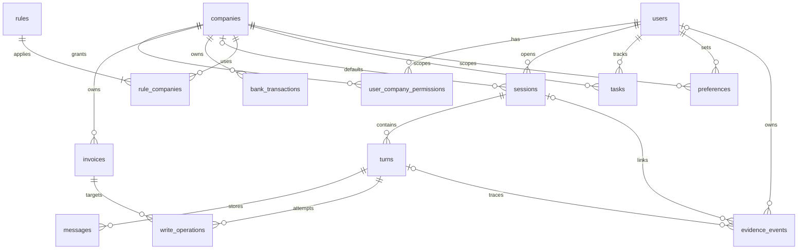

# 数据库与数据架构设计

版本：1.2｜日期：2026-11-01｜依据：DR-001—DR-011、用户指定PostgreSQL；[模块设计](04_模块与分层架构设计.md)。以下表和新增字段为架构设计，尚未创建实际业务库；本次补足的状态/权限/迁移契约见[12 §6](12_开发实施契约补充.md#6-数据库状态及迁移补充)。

## 1. 数据库与类型约定

采用PostgreSQL 18维护系列，SQLAlchemy 2.0同步Session+psycopg 3，Alembic迁移。连接URL使用`postgresql+psycopg`；SQLAlchemy管理连接池，不再叠加psycopg_pool。工程初值为pool_size=5、max_overflow=0、pool_timeout=5秒、pool_pre_ping=True、连接超时5秒、lock_timeout=5秒、statement_timeout=15秒，均可配置且非官方指标。连接时设置UTC时区，生产配置禁止回显带密码的URL。依据见[技术文档查证](03_技术选型与架构决策.md#2-官方文档查证与版本策略)。

默认写/管理短事务使用READ COMMITTED，保持外键和部分唯一索引由数据库原生执行。一次月金额三口径汇总或用途检查需要一致快照时，用短只读REPEATABLE READ事务读取当次规则和业务数据，不跨模型调用；提交后的核验必须另开事务从主库读取，不使用原快照、只读副本或ORM身份映射缓存。同步数据库用例整体在线程池中执行，一个Session只属于该次线程任务，不跨await共享。

| 类型记号 | SQLAlchemy/PostgreSQL落地 | 统一含义 |
| --- | --- | --- |
| ID | String/TEXT | 内部UUID以文本保存；C001/U001/F002等原业务编号原样文本，避免混合编号强转UUID |
| TEXT | Text/TEXT | UTF-8文本；不猜填、不以“未填”代空值 |
| INT | Integer/INTEGER；金额与event_id使用BigInteger/BIGINT | 整数分做64位范围校验；计数、版本按各字段范围验证，不用浮点 |
| BOOL | Boolean/BOOLEAN | 原生true/false，不用整数大小比较表达权限约束 |
| DATE | Date/DATE | 业务日期；API为YYYY-MM-DD，应用做真实日期校验 |
| UTC | DateTime(timezone=True)/TIMESTAMPTZ | UTC会话时区读写，API统一带Z的RFC3339，不能保存无时区datetime |
| JSON | PostgreSQL JSONB | Pydantic先验证形状；数组/对象默认值分别为'[]'::jsonb/'{}'::jsonb，不用未验证JSON实现权限或动态SQL |

表中`NN`为不可空，`NULL`明确可空；未列默认值则必须显式提供。所有FK为RESTRICT，删除有子项的记录需显式清理；不配置会悄悄级联删除业务票据的关系。业务发票/流水不开放删除。

## 2. ER图



messages内嵌invoice_refs_json保存消息复合引用，不单独建引用业务表；与发票关联在应用逐条校验，保留发送时辨识标签供历史展示，但标签不是当前事实。seed_meta与alembic_version为技术表，不加入业务ER主图。

## 3. 基础与业务表

### 3.1 companies、users、user_company_permissions

| 表.字段 | 类型/空性/约束 | 含义 |
| --- | --- | --- |
| companies.company_id | ID NN PK | 原企业编号 |
| companies.name | TEXT NN | 企业全名 |
| companies.short_name | TEXT NN UNIQUE | 常用简称，用于定位 |
| users.user_id | ID NN PK | 原用户编号 |
| users.name | TEXT NN | 演示用户名称 |
| users.memory_revision | INT NN DEFAULT 0 CHECK≥0 | 任一记忆变更后递增，失效控制 |
| user_company_permissions.user_id | ID NN FK users，联合PK | 权限用户 |
| user_company_permissions.company_id | ID NN FK companies，联合PK | 权限企业 |
| user_company_permissions.can_read | BOOL NN | 可读 |
| user_company_permissions.can_write | BOOL NN，CHECK (NOT can_write OR can_read) | 可改合法发票字段 |

初始U001对C001/C002均(true,true)，U002对C001(true,false)、C002(false,false)。不存明文凭证；服务端环境中的随机token绑定user_id，API无法修改权限表。SQL查询应在授权company集合内执行，不先全读再由模型过滤。应用数据库账号只获所需DML：基础权限/银行/规则只读；invoices仅允许更新purpose、note、row_version、updated_at，不允许运行时INSERT/DELETE或更新金额等列。会话/轮次/记忆/账本/证据按服务需要授权；迁移与初始装载由独立维护账号执行，不在Web中提供提升权限入口。

users仅允许SELECT和UPDATE(memory_revision)，不授予身份/名称/用户编号的修改权；companies与user_company_permissions仅SELECT。harness schema归finance_tax_migrator所有，finance_tax_app只获USAGE及显式表/列/序列权限。授权逻辑由受控grant-runtime维护命令统一实现，首次迁移及逻辑备份恢复后幂等执行，避免恢复时因--no-acl遗漏应用授权。

### 3.2 invoices

| 字段 | 类型/空性/约束 | 含义 |
| --- | --- | --- |
| company_id | ID NN FK companies，联合PK | 发票归属 |
| invoice_id | TEXT NN，联合PK | 原发票编号 |
| invoice_date | DATE NN | 开票日期 |
| seller | TEXT NN | 销售方，仅定位线索 |
| item_name | TEXT NN | 票面项目，仅定位线索 |
| amount_cents | BIGINT NN CHECK≥0 | 价税合计的整数分；不拆税率 |
| purpose | TEXT NULL | 用途，空白合法且仍算未填 |
| note | TEXT NULL | 发票备注，不替代用途 |
| row_version | INT NN DEFAULT 1 CHECK≥1 | 乐观版本；有效业务改变才递增 |
| updated_at | UTC NN | 当前行最近有效修改时间，seed时写初始装载时间 |

联合PK(company_id,invoice_id)。索引`ix_invoices_company_date(company_id,invoice_date,invoice_id)`支撑月筛选。40票的模糊搜索用ILIKE/包含匹配，转义`%`/`_`并绑定参数；无需FTS或索引每个文本字段。用途空白判定采用Python `purpose is None or purpose.strip()==''`，覆盖Unicode空白，不只依赖数据库trim。

金额入库只在准备边界转换：从明细单元格取原数值，用`Decimal(str(value))`验证有限、非负及最多两位有效小数，再乘100转整数；不得用`int(float_value*100)`。意外精度、非数字或BIGINT溢出应定位原行并拒绝准备，不无声四舍五入。PostgreSQL `SUM(bigint)`返回精确numeric，仓储确认结果无小数后转Python int；API以Decimal或整数格式化到元两位字符串。成功无记录才将SUM的null转换为零，查询异常不得归零；说明页公式缓存不进入业务计算。

### 3.3 bank_transactions

| 字段 | 类型/空性/约束 | 含义 |
| --- | --- | --- |
| company_id | ID NN FK companies，联合PK | 企业 |
| transaction_id | TEXT NN，联合PK | 原流水编号 |
| transaction_date | DATE NN | 交易日期 |
| direction | TEXT NN CHECK IN('income','expense') | 原收入/支出规范化枚举 |
| amount_cents | BIGINT NN CHECK>0 | 正数金额分，不对支出再取负 |
| counterparty | TEXT NN | 对方名称 |
| note | TEXT NULL | 原备注 |

联合PK(company_id,transaction_id)；索引`ix_bank_company_date_direction(company_id,transaction_date,direction)`。无invoice_id外键，不设计付款关系表。运行仓储只暴露读操作。

## 4. 会话、轮次与引用

### 4.1 sessions

| 字段 | 类型/空性/约束 | 含义 |
| --- | --- | --- |
| session_id | ID NN PK | 会话 |
| user_id | ID NN FK users | 所有者 |
| default_company_id | ID NULL FK companies | 会话默认，可跳过/清除 |
| result_focus_json | JSON NULL | 最近明确对象/月/来源；若派生于任务，还带task_id/task_row_version/memory_revision，任务变更后失效，不当授权 |
| row_version | INT NN DEFAULT 1 | 默认范围与焦点更新的并发控制 |
| created_at | UTC NN | 建立时间 |
| updated_at | UTC NN | 最近有效状态变更 |

服务强制default_company_id为该用户可读企业；确定使用(user_id,default_company_id)到权限复合键的FK保证范围记录存在，can_read仍由程序检查。索引(user_id,created_at,session_id)。`default_company_id=NULL`不表示全部企业。创建会话/切换/清除仅写此表和事件。

### 4.2 turns

| 字段 | 类型/空性/约束 | 含义 |
| --- | --- | --- |
| turn_id | ID NN PK | 客户端client_turn_id，重试须复用 |
| session_id | ID NN FK sessions | 所属会话 |
| request_hash | TEXT NN | 规范化文字+引用+提交会话版本的SHA-256，检测同ID异内容 |
| status | TEXT NN CHECK枚举 | running/completed/failed/interrupted/cancelled |
| cancel_requested | BOOL NN DEFAULT false | 用户请求停止后续步骤 |
| session_version | INT NN | 接收时会话版本快照 |
| scope_json | JSON NULL | 实际对象、source、依据消息、业务月、任务归属；未明确可空 |
| scope_company_ids | JSON NN DEFAULT [] | 本轮实际返回数据涉及企业集合，历史结果序列化前检查当前权限 |
| memory_revision | INT NN | 本轮使用的用户记忆版本 |
| result_json | JSON NULL | 终态TurnResult，含facts/写结果/错误，不含凭证 |
| error_code | TEXT NULL | 失败类别，非敏感堆栈 |
| started_at | UTC NN | 接收并占用执行名额时间 |
| finished_at | UTC NULL | 运行中为空，终态必须有值 |

部分唯一索引`ux_turns_one_running(session_id) WHERE status='running'`；索引(session_id,started_at,turn_id)，status与finished_at满足running当且仅当finished_at为空。启动先取得单实例advisory锁再将遗留running变interrupted，具体见12 §7，不能误伤仍运行的另一实例。保留相关操作供只读核验，不自动重放。全局模型并发1由进程信号量控制，满额在接收新轮前返回BUSY。

### 4.3 messages

| 字段 | 类型/空性/约束 | 含义 |
| --- | --- | --- |
| message_id | ID NN PK | 消息ID |
| turn_id | ID NN FK turns | 关联轮次，经turns关联会话 |
| role | TEXT NN CHECK IN('user','assistant') | 对话角色，工具过程在Evidence |
| content | TEXT NN | 原用户文字或最终可见答复 |
| invoice_refs_json | JSON NN DEFAULT [] | 仅用户消息，复合引用数组；assistant必须为空 |
| memory_refs_json | JSON NN DEFAULT [] | 本消息涉及的task/preference ID与revision，用于未来输入失效过滤 |
| scope_company_ids | JSON NN DEFAULT [] | 本消息正文/引用标签实际涉及的数据范围，owner校验之外还须当前read权限 |
| created_at | UTC NN | 时间 |

UNIQUE(turn_id,role)，一轮一用户消息，最多一最终助手消息。引用元素`{company_id,invoice_id,label_snapshot}`；复合去重，label_snapshot来自后端，客户端自带金额/用途一律丢弃。原记录后续改变不修改历史标签；展示时标历史引用，可另查当前值。未发送草稿不入库、不创建任务。

## 5. 规则表与结构化策略

### 5.1 rules、rule_companies

| 表.字段 | 类型/空性/约束 | 含义 |
| --- | --- | --- |
| rules.rule_id | TEXT NN，联合PK | R001等规则编号 |
| rules.version | TEXT NN，联合PK | 1.0/2.0等文本，不作数值排序 |
| rules.name | TEXT NN | 完整名称，用于引用 |
| rules.topic | TEXT NN CHECK枚举 | amount/purpose/bank |
| rules.effective_from | DATE NN | 生效日，使用业务时间 |
| rules.status | TEXT NN CHECK IN('enabled','disabled') | 当前启用状态 |
| rules.body | TEXT NN | 规则正文 |
| rules.policy_json | JSON NN | 维护者显式指定的有限策略 |
| rules.revision | INT NN DEFAULT 1 | 同版本内容维护修订，不与version混淆 |
| rules.source_ref | TEXT NN | 原文标题/定位或后续维护来源 |
| rules.content_hash | TEXT NN | 正文+策略+范围等内容指纹 |
| rules.updated_at | UTC NN | 最近维护 |
| rule_companies.rule_id | TEXT NN，联合PK | 联合FK rules(rule_id,version)第一项 |
| rule_companies.version | TEXT NN，联合PK | 联合FK第二项 |
| rule_companies.company_id | ID NN FK companies，联合PK | 明确适用企业 |

rules复合PK(rule_id,version)；rule_companies复合PK(rule_id,version,company_id)。索引rule_companies(company_id,rule_id,version)与rules(topic,status,effective_from)。没有effective_to；如未来加入结束日须迁移并重新验收，不虚构原文已有字段。

| 初始规则 | 范围/生效日/状态 | policy_json |
| --- | --- | --- |
| R001 1.0 金额统计说明 | C001/C002，2026-01-01，enabled | `{"kind":"independent_totals"}` |
| R002 1.0 甲企业发票用途规则 | C001，2026-08-01，disabled | `{"kind":"amount_gte","threshold_cents":100000}` |
| R002 2.0 甲企业发票用途规则 | C001，2026-09-01，enabled | `{"kind":"all"}` |
| R003 1.0 乙企业发票用途规则 | C002，2026-08-01，enabled | `{"kind":"amount_gte","threshold_cents":100000}` |
| R004 1.0 银行资料说明 | C001/C002，2026-01-01，enabled | `{"kind":"bank_readonly"}` |

查找：join明确企业→topic匹配→enabled→effective_from≤业务日期。月检查仅支持2026-09；规则须覆盖查询月整段。若将来出现月中生效或多版本可能覆盖同月，报告RULE_CONFLICT/不支持并停止判定，不取月末最新。0条为RULE_NOT_FOUND，>1条同主题有效候选为RULE_CONFLICT，即使版本号更大也不擅选。初始R002停用旧版只用于管理查看。

CLI修订同版本内容时必须expected_revision和明确来源，正文/策略/适用企业一起提交，revision递增并记录旧新hash/差异；新业务版本新建记录，不覆盖旧版本。未知策略拒绝自动执行，正文自由变更不自动编译为规则代码。语义一致性由维护者核对与回归用例保证，不宣称程序能自动证明任意正文策略等价。

## 6. 任务与偏好

### 6.1 tasks

| 字段 | 类型/空性/约束 | 含义 |
| --- | --- | --- |
| task_id | ID NN PK | 任务 |
| user_id | ID NN FK users | 所属用户 |
| company_id | ID NN FK companies | 创建后不随默认切换而变 |
| goal | TEXT NN | 用户需要持续处理的目标 |
| business_month | TEXT NULL | YYYY-MM；正在追问月份时可空，服务校验年月 |
| status | TEXT NN CHECK枚举 | active/awaiting_input/verify_pending/completed/cancelled |
| progress_json | JSON NN DEFAULT {} | 操作历史线索、当前剩余快照及其as_of/rule_refs；不是实时权威 |
| row_version | INT NN DEFAULT 1 | 更正冲突控制 |
| source_turn_id | ID NN FK turns | 创建时明确意愿来源，创建后固定，UI更正不伪造新轮 |
| last_change_origin_json | JSON NN | ChangeOrigin：kind为chat/ui、request_id、turn_id可空；最近修改来源 |
| created_at | UTC NN | 建立 |
| updated_at | UTC NN | 更新 |

部分唯一索引如下，保证待核验也占未完名额：

```sql
CREATE UNIQUE INDEX ux_tasks_one_open
ON tasks(user_id, company_id)
WHERE status IN ('active', 'awaiting_input', 'verify_pending');
```

索引(user_id,company_id,updated_at)。不相容新目标需澄清继续/替换，确认替换时旧任务cancelled与新任务创建同事务；不能先删后建留下空窗。更正同企业月份清空旧待补快照，不复制旧写授权；goal无继续处理意图时不强制创建任务。删除记忆用硬删任务行；业务数据和write_operations不依赖task_id，故不回滚发票。证据中的task_id只是历史标识，无强FK阻碍删除。

### 6.2 preferences

| 字段 | 类型/空性/约束 | 含义 |
| --- | --- | --- |
| preference_id | ID NN PK | 偏好 |
| user_id | ID NN FK users | 本人 |
| company_id | ID NN FK companies | 企业范围 |
| preference_key | TEXT NN | 如response_order/default_company/custom_style；非任意执行指令 |
| content | TEXT NN | 用户明确长期意愿的内容 |
| source_turn_id | ID NN FK turns | 创建时明确长期意愿来源，创建后固定 |
| last_change_origin_json | JSON NN | 最近变更的ChangeOrigin，UI变更turn_id为空并记录request_id |
| row_version | INT NN DEFAULT 1 | 更正版本 |
| created_at | UTC NN | 建立 |
| updated_at | UTC NN | 更新 |

UNIQUE(user_id,company_id,preference_key)。长期默认企业偏好content只能指本company_id；同一用户最多一个default_company偏好，用部分唯一索引(user_id) WHERE preference_key='default_company'。已有不同企业默认偏好时询问是否更换，不自动新增矛盾项。该偏好可在开场显示建议，不改变本轮对象/授权/任务归属。

所有任务/偏好新增、更正、删除和替换均与users.memory_revision递增同事务。无独立摘要表；Context每轮按当前revision重建。旧消息中涉及已删/旧版记忆的整块管理对话不回放；历史Evidence永不作模型上下文。最新用户重新主动表达相同意愿可视为新请求，但不能靠旧消息恢复已删记忆。

## 7. 操作账本与证据

### 7.1 write_operations

| 字段 | 类型/空性/约束 | 含义 |
| --- | --- | --- |
| operation_id | ID NN PK | 服务端由轮+票复合键生成的稳定ID |
| turn_id | ID NN FK turns | 当前授权轮 |
| user_id | ID NN FK users | 操作用户，服务检查与轮所有者一致 |
| company_id | ID NN，复合FK invoices | 目标企业 |
| invoice_id | TEXT NN，复合FK invoices | 目标票号 |
| request_hash | TEXT NN | 规范化目标+字段+期望值hash，同ID不同内容拒绝 |
| expected_row_version | INT NN | 写前读取版本 |
| authorization_json | JSON NN | 当前message_id、动作/内容证据位置、对象来源；不含可复用token |
| changes_json | JSON NN | 字段白名单purpose/note的期望值，省略字段不在其中 |
| before_json | JSON NN | 仅被改字段原值 |
| after_json | JSON NULL | 实际回读值，未回读时为空 |
| state | TEXT NN CHECK枚举 | prepared/committed/verified/already_current/failed/verify_pending |
| error_code | TEXT NULL | 失败或待核验原因 |
| created_at | UTC NN | 准备时间 |
| committed_at | UTC NULL | 确认事务提交时间；未知时可空 |
| verified_at | UTC NULL | 实际独立回读时间 |

UNIQUE(turn_id,company_id,invoice_id)，同轮同票合并为一次目标编辑，禁止模型重复生成新的写操作绕过去重。索引(user_id,created_at)、(company_id,invoice_id,created_at)。`already_current`表示写前读到目标值且没有有效修改，不伪称本次已改；`verify_pending`表示无法确定提交/回读结果，不标任务完成。

### 7.2 evidence_events

| 字段 | 类型/空性/约束 | 含义 |
| --- | --- | --- |
| event_id | BIGINT NN GENERATED BY DEFAULT AS IDENTITY PK | 顺序事件，用作游标，序列允许空洞、不假定连续 |
| session_id | ID NULL FK sessions | 会话事件/轮次事件；CLI可空 |
| turn_id | ID NULL FK turns | UI选择/CLI可空，不能伪造模型轮 |
| user_id | ID NULL FK users | 业务用户；CLI操作不冒充U001 |
| actor_label | TEXT NN | user/harness/operator等来源标签 |
| scope_company_ids | JSON NN DEFAULT [] | 本事件涉及企业集合；访问须全部有权限 |
| kind | TEXT NN | session_scope/model_request/model_response/tool_call/tool_result/write_verify/memory_change/rule_change/error等 |
| correlation_id | TEXT NN | 模型调用ID/工具调用ID/operation_id，关联同一步 |
| payload_json | JSON NN | 实发脱敏payload、材料ID/revision、结果或错误等 |
| payload_hash | TEXT NN | 规范化payload完整性hash，不宣称防篡改审计 |
| created_at | UTC NN | 事件时间 |

索引(turn_id,event_id)、(session_id,event_id)、(user_id,created_at)。业务读取必须属于本人会话且scope全部在当前授权集合内；权限缩减后的混合事件整条不可见，不能先返回全文再UI遮挡。CLI事件仅本机维护入口读取。当前用户看不到其他用户历史证据，即便同属C001。

## 8. 原子性、幂等与回读边界

1. **轮次接收事务**：互斥校验→插入turn及user message→提交。相同turn_id相同request_hash只查原状态；不同hash返回409。已存在轮的查询不受后来session_version改变阻挡。
2. **写准备事务**：校验本轮授权和身份→插入prepared（固定operation_id）→提交。写前读取/版本、允许字段必须记录；prepared不能自动作为成功证据。
3. **单票写事务**：再查权限/取消标识→按固定顺序锁定本次write_operations记录（SELECT FOR UPDATE）并检查状态和payload→SQLAlchemy绑定参数执行`UPDATE ... WHERE company_id=:company_id AND invoice_id=:invoice_id AND row_version=:expected_version`，只SET指定字段与版本/更新时间→同时将操作标committed→COMMIT。已有目标值走already_current，不递增版本。CAS更新0行返回STALE_DATA，需重查/澄清，不能自动覆盖他人修改。同一操作行锁避免两个执行者重复处理同一prepared记录，锁不跨模型调用。
4. **核验事务**：释放写Session，新的Session按复合键SELECT，对比指定字段，成功标verified并保存after_json；不一致/不可读标verify_pending。提交异常时开新连接先查操作账本和当前值，绝不盲发UPDATE。
5. **任务刷新事务**：有续办意图时重新查当前清单后更新任务。票据提交不能与网络模型请求绑成一个大事务；任务更新失败不撤销已保存票据，回复显示“保存已核验，进度更新失败”，下次重算。

进程在prepared后崩溃：若原子写没提交，原发票仍存在并保留写前值，prepared记录可能已持久化，但不存在committed状态；若已提交，目标字段变化与committed账本同时存在。重启不自动重写，先核对账本/现值。新轮用户重复同值请求也先读当前值，already_current避免第二次有效修改。回读值相同但账本缺失只能说明“当前已为此值，原执行归属未证实”。多票每票单事务，不能一票失败回报整体成功。状态转换、锁顺序和UI并发记忆变更检查统一按12 §5/6执行。

PostgreSQL冲突处理：部分唯一索引/操作ID冲突（SQLSTATE 23505）先回滚，再新事务查询原记录，映射TASK_CONFLICT、TURN_IN_PROGRESS或幂等结果；不得在已中止事务内继续查。锁超时（55P03）、语句超时（57014）、死锁（40P01）与序列化失败（40001）需记录阶段并回滚；写入提交不确定时仍按账本/现值先核验，不通用自动重试整轮。seed在事务中取得约定的pg_advisory_xact_lock，检查标记后一次装载，避免并发首次装载互相覆盖。应用仍限定单进程，不能把数据库锁当多实例Harness完整协调方案。

## 9. 数据生命周期与血缘

| 层 | 存放及来源 | 生命周期/失败处理 |
| --- | --- | --- |
| 原始层 | 根目录官方docx/xlsx，只读 | 不被业务修改；记录SHA-256，不从汇总缓存提供运行结果 |
| 规范化层 | 建议`data/seed/business.json`与`rules.json` | 一次转换核对后入版本管理；带source文件hash、表名/行区间或规则标题，非用户导入功能 |
| 验证层 | 准备报告JSON/CLI输出 | 数量、类型、复合键、企业权限、日期、金额/缺填预期；失败整次回滚，不强行补值 |
| 当前层 | PostgreSQL业务/规则/记忆表 | 所有查询权威；重启保留。修改来源可追溯operation_id/turn_id |
| 中间层 | 内存Context/工具结果；必要证据入库 | 不作跨轮事实缓存；输入失败显式返回，单条工具结果可分页 |
| 结果层 | turns.result_json与消息 | 终态可查询，写状态由账本/回读支撑 |
| 证据层 | evidence_events与受控运维日志 | 记忆删除不自动清历史证据；默认无自动过期，提交只取必要模拟证据 |

`seed_meta`技术表：dataset_id TEXT PK、source_hashes_json JSON NN、normalized_hash TEXT NN、schema_revision TEXT NN、loaded_at UTC NN。空业务库首次seed一次事务写入全部数据与标记；相同hash再次执行只验证退出，已有任何业务数据且无标记/不同hash则拒绝，不能UPSERT覆盖当前用途。初始规范化失败重跑整个小数据集，不实现断点恢复平台。

规范化文件最小契约：business.json顶层为`{dataset_id,companies,users,permissions,invoices,bank_transactions}`，各数组按本文件同名表的原始业务字段命名，金额使用amount_cents；row_version/updated_at/memory_revision由seed赋初值。每条可带`source_ref`供manifest归集，不写不存在的业务列。rules.json为`{dataset_id,rules:[...]}`，元素含rule_id/version/name/topic/company_ids/effective_from/status/body/policy/source_ref，policy入库映射policy_json，company_ids拆入rule_companies。CLI revise文件使用同一单条规则形状，编号版本必须与命令目标一致；revision由服务管理，客户端不能自行跳号。manifest保存原文件hash、表名/行区间、规范化hash及核验报告，不能把schema_revision或hash冒充官方原始字段。

## 10. 初始化、迁移与备份

Alembic通过独立finance_tax_migrator维护账号创建表/约束/部分唯一索引及finance_tax_app所需列级/表级权限；数据库建库/角色初始化由运维bootstrap完成，不由Web执行。数据库使用UTF-8、独立harness schema与固定search_path，REVOKE public schema的公共CREATE权限；不引入尚无需求的RLS框架，企业隔离继续由服务和受限仓储落实。应用启动只验证连接、schema版本与seed完整性，不持有DDL凭证、不自动迁移或seed；维护阶段先显式迁移再seed。迁移前做逻辑备份，升级失败保持不可就绪并提示恢复，不带病启动。DDL迁移在独立测试数据库验证后再用于演示库。

备份采用同主版本PostgreSQL客户端`pg_dump -Fc --no-owner --no-acl`，包含本项目schema、表、数据、序列与alembic_version；角色与运行凭证不进备份，按bootstrap/迁移授权方案在目标环境重建。`pg_restore --exit-on-error --no-owner --no-acl`只恢复到新建空的独立目标数据库，再执行受控权限配置和inspect核对，不对正在服务的库盲目覆盖。不复制运行中PGDATA或命名卷当作跨机器交付。

测试使用真实 PostgreSQL 18 独立 finance_tax_test，首轮串行，不自动允许 worker 后缀。重置须 APP_ENV=test，测试 app/维护连接解析后实例和库相同、角色分别为 finance_tax_app/finance_tax_migrator，且不等于开发/演示连接目标；拒绝 DSN query/service/hostaddr/多主机绕过，认证后核验 current_database/session_user/current_user 与服务器版本/地址/端口及角色属性。测试连接必须显式提供，禁止回落 DATABASE_URL；tax_db 在建 engine 前拒绝。提交回读用真实 COMMIT 和新 Session。原始 seed 与当前逻辑备份分开，备份恢复留 D6。

2026-11-04 D1 部署命名与测试保护补充已获批准，完整边界见[本轮批准记录](../../Documentation.md#d1-正式实施批准--2026-11-04)。本节名称调整不变更正式业务需求或机器接口。
