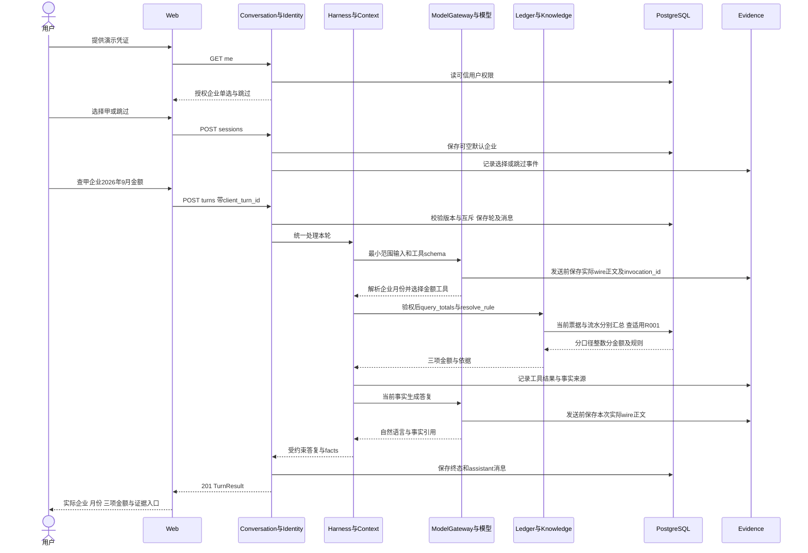
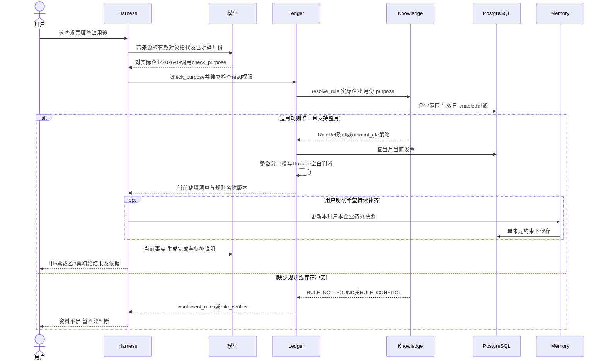
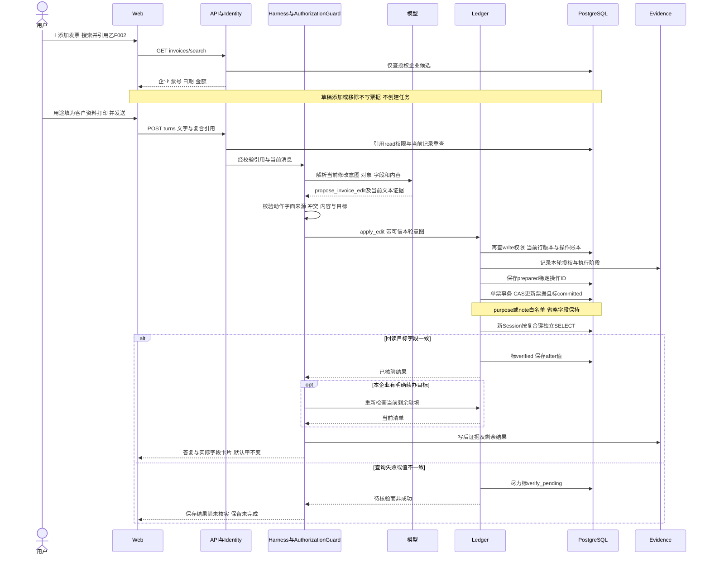
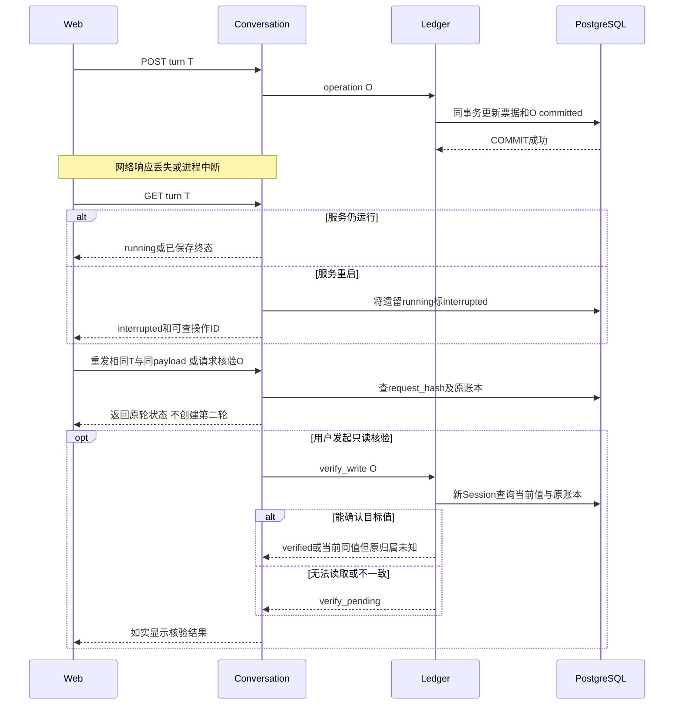
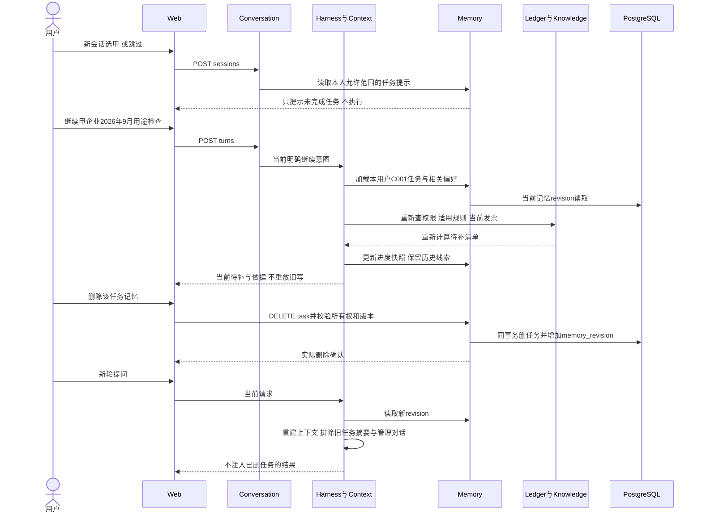
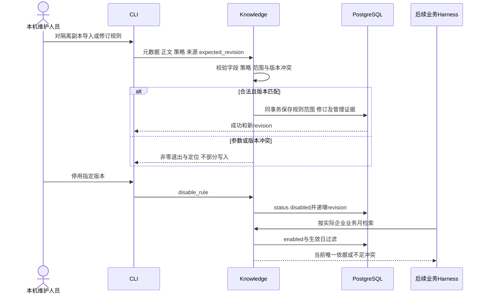

# 关键业务流程设计

版本：1.2｜日期：2026-11-01｜依据：[API](06_API接口设计.md)、[数据事务](05_数据库与数据架构设计.md)、[实施契约](12_开发实施契约补充.md)。业务服务内部调用在同一后端进程；数据库调用通过psycopg 3访问PostgreSQL，模型调用通过HTTP访问自备服务。所有流程的实际模型输入由Gateway在发送前记录，图中省略的共用wrapper仍必须执行。

## 1. 开场选择/跳过与金额查询

覆盖FR-001—FR-003/013—FR-016，UC-001/002/014；AC-003—AC-007/046/049。

缺企业或年月时模型只追问缺项；轮completed/outcome=needs_input，不调用金额工具。只有默认企业仍不能补月份；“9月”无可靠年份要追问。跳过后明确甲企业年月可直接查。成功无记录三项可为0.00并说明无记录；任一查询故障不能把该项替成零。请求只需单项就只返回该项，组合请求可继续调用check_purpose，沿同一Harness执行。

## 2. 适用规则与用途检查

覆盖FR-005/008/013/014/016，UC-003/004；AC-009—AC-011/019/026/027/048。

8月检查在调用规则判定前返回unsupported，不恢复R002 1.0。当前9月规则缺失不回退停用版本；规则冲突不能按版本大小取最新。乙999.99元空用途不报必填，1000.00/1000.01纳入。purpose空白即未填，note有内容也不消除。纯查询检查动作完成可结束，只读用户不被强制挂补写任务。

默认甲而上一轮明确查乙，`这些发票`在已验证乙结果焦点上解析，取R003 1.0。无明确乙指代且省略企业时可用默认甲，不将“最新说过任何企业”泛化为永远切换默认。

## 3. 搜索引用、当前授权、保存与独立回读

覆盖FR-004/006/007/008/015；UC-005/013；AC-012—AC-018/042—AC-045/049。

写前若当前值已经等于期望值，记录already_current并说明无新增有效修改；若write权限不足、白名单外字段、文字与引用冲突、多票内容不清或旧引用不可读，在UPDATE前拒绝/澄清。只发送引用无动作也不写。先前选甲但明确引用乙，写乙票、甲票与默认甲均不变。

用途明确清空可存null/空串，但不能说已补齐；只补备注保持用途原值。非指定字段、金额、日期与另一企业同号必须保持不变。乙低额允许用户主动补用途；8月单票合法补充不因此产生8月用途检查结论。规则被停用时若用户只明确保存合法字段，保存权限依据仍可成立；若要求“按规则补齐/判断已齐”而依据不足，则先说明规则问题，不自动猜内容或给出检查结论。

多条同企业引用明确相同内容时逐票执行并回读，逐项给verified/already_current/failed/verify_pending。跨企业写集合不执行批量写，提示拆轮，不能部分静默完成后声称全部成功。单企业多票不是一个大事务，一项失败不会伪装整体成功。

## 4. 提交后响应丢失、重复请求和取消

覆盖FR-007与NFR-003，UC-010；AC-017/018/033；FR-017完整自动续跑本版不实现。

明确失败指事务确定未提交；若COMMIT返回异常而结果不确定，先重新读取账本/现值，不能直接标failed后自动重写。核验不一致时保留期望与实际差异，不以模型解释抹平。

取消仅登记cancel_requested；下一安全点停止尚未提交步骤，模型HTTP在可中止时取消，已提交单票继续尽力回读并返实际事实。浏览器关闭不构成回滚，重启也不重放prepared写。多票执行中取消，已有成功项保留并逐项报告。

## 5. 新会话续办、更正与记忆删除

覆盖FR-008—FR-011/014；UC-007/008/015；AC-019—AC-024/028/038/047。

只说“继续”且两企业均有候选任务时先问目标；不能加载所有任务正文后让模型随意混用。范围为空但明确“甲企业”仍可管理记忆。更正月份清旧快照，后续按新月查询；更正为8月只能正常查金额，不能用当前规则检查用途。

同用户企业不兼容新目标，先澄清继续/替换；确认替换时旧任务取消和新建同事务。切换默认到乙、清除默认、新开会话均不改变甲任务归属和名额。曾经补两张后有人明确清空一张，恢复时以当前重查计数，不能沿用历史“已补两张”。偏好删除同样触发revision和旧上下文失效；发票保存不随记忆删除回滚。

## 6. 规则维护与后续检索

覆盖FR-012/013、UC-009，AC-025—AC-027/035。

维护入口不调用模型；后续实际查询才记录真实模型输入。普通用户说“把旧版恢复”不能获得维护权限。正文与策略由维护者显式同步，不允许只更新显示文案而继续运行过期门槛。演示主基准库不被规则故障试验污染。
