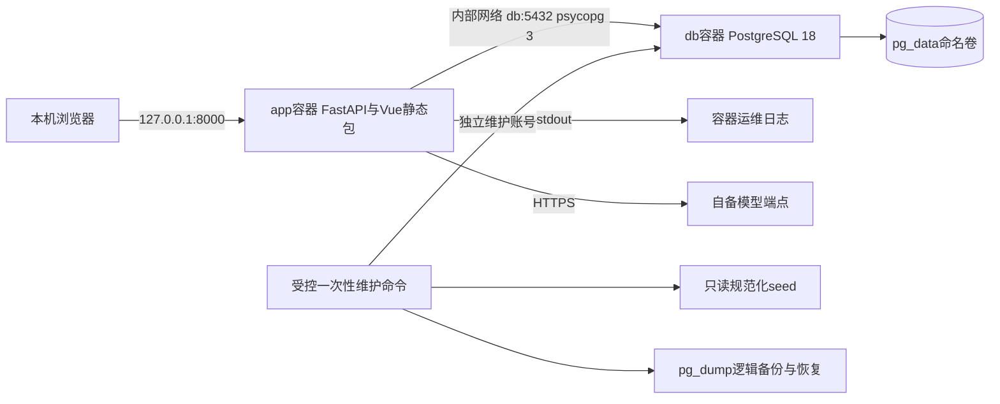

# 部署与运行架构设计

版本：1.2｜日期：2026-11-01｜依据：[推荐技术栈](03_技术选型与架构决策.md)、[工程规划](09_工程目录结构设计.md)、[实施补充](12_开发实施契约补充.md)，统一PostgreSQL。以下命令为待实现运行契约，**尚无Dockerfile、Compose、CLI或应用，不是已测试的启动步骤**。CLI数据库设置独立加载，模型账号不阻断build/up db/迁移/seed。

## 1. 三类环境

| 环境 | 运行方式 | 数据/模型边界 |
| --- | --- | --- |
| 本地开发 | Windows PowerShell，Node 24构建/开发，Python 3.13后端；Vue开发服务器代理/api至127.0.0.1:8000 | PostgreSQL 18本机服务或Compose db；原生后端连接回环端口，账号与目标明确 |
| 自动/集成测试 | 同主版本PostgreSQL独立测试库、固定seed；Vitest/Playwright；真实模型合同显式启用 | 每worker专属harness_test_库，不连接演示库，不用其他数据库替代集成测试 |
| 演示复验 | Docker Compose app+db两个服务，FastAPI托管Vue dist；浏览器同源访问 | db命名卷pg_data；外部模型账号/网络必须实测 |

无Docker时原生启动同一Python后端并挂载已构建静态包，连接本机安装或明确可访问的PostgreSQL 18，仍按角色配置/锁依赖/迁移/seed/模型探针执行。当前只确认本机Python 3.13.9和Node v24.8.0可执行，Docker/uv/PostgreSQL/模型可用性均未验证，发布前需锁定维护补丁并测设备。

## 2. 部署拓扑



模型不是Compose内默认启动服务；若供应商是主机本地模型，端点必须是容器可达地址，容器内localhost不能代表宿主机。实际地址、GPU/内存需求只有选择本地模型后才能确定，本版不虚构硬件配置。

## 3. 环境变量契约

不在架构示例中放真实密钥或看似有效的凭证。配置schema启动时校验范围和必填项；SecretStr等仅用于内存表示，禁止dump整个配置。

| 变量 | 作用/建议默认 | 必填与校验 |
| --- | --- | --- |
| APP_ENV | development/test/demo | 必填；非法枚举拒绝 |
| DATABASE_URL | `postgresql+psycopg://harness_app:<URL编码密码>@db:5432/harness`为结构示例 | 应用必填敏感值；原生开发host改127.0.0.1；只向app注入应用账号，禁止日志输出完整URL |
| MIGRATION_DATABASE_URL | 同一目标、harness_migrator账号 | 仅显式维护命令使用，不注入常驻app；迁移/seed/规则维护/恢复前核对脱敏连接目标 |
| POSTGRES_IMAGE | 实测PostgreSQL 18维护补丁tag及发布digest | Compose db使用；不选候选版或latest，当前未验证具体镜像 |
| POSTGRES_DB / POSTGRES_USER | harness / postgres | db容器bootstrap；超级用户不作Web连接用户 |
| POSTGRES_PASSWORD | 自备bootstrap强密码 | 仅db容器；不进入app、模型正文、记录或提交包 |
| APP_DB_PASSWORD / MIGRATION_DB_PASSWORD | 运维分别生成的账号密码 | 仅db初始角色脚本，须与相应URL密码一致；不能由普通对话修改 |
| DB_POOL_SIZE / DB_MAX_OVERFLOW / DB_POOL_TIMEOUT_SECONDS | 5 / 0 / 5 | SQLAlchemy连接池初值，pool_pre_ping=True；不叠加另一连接池 |
| DB_CONNECT_TIMEOUT_SECONDS | 5 | psycopg连接初值 |
| DB_LOCK_TIMEOUT_MS / DB_STATEMENT_TIMEOUT_MS | 5000 / 15000 | 数据库会话锁/语句超时初值，不是业务SLA |
| BACKUP_DIR | 原生`./var/backups`，容器`/backups` | 只存逻辑备份/清单，不存PGDATA；维护时挂载可写路径 |
| STATIC_DIR | 容器`/app/static`，开发可空 | 演示必须有index.html；/api/health路径不能被SPA fallback吞掉 |
| MODEL_MODE | disabled/live/test_stub | 开发无模型可disabled，APP_ENV=test才可test_stub；demo默认live。disabled只读诊断不算AI验收 |
| MODEL_ADAPTER | 首个实际供应商适配器名 | 仅live/probe必填；不能动态导入任意代码 |
| MODEL_BASE_URL | 自备服务地址 | 仅live/probe必填，校验HTTPS；本机模型例外显式配置 |
| MODEL_API_KEY | 模型鉴权 | 按供应商需要；敏感，不入日志/正文/镜像 |
| MODEL_ID | 实际模型标识 | 仅live/probe必填；probe验证，不预写不可用模型 |
| MODEL_CONTEXT_LIMIT | 经服务证据核实的上限 | 仅live/probe必填，必须有实际依据 |
| MAX_INPUT_TOKENS / MAX_OUTPUT_TOKENS | 本次模型预算 | 仅live/probe必填；与上限/工具开销/安全余量一致；disabled不解析空数值 |
| MODEL_CONNECT_TIMEOUT_SECONDS | 5 | 工程初值，可调整 |
| MODEL_READ_TIMEOUT_SECONDS | 45 | 工程初值，非SLA |
| TURN_TIMEOUT_SECONDS | 120 | 总轮预算，实际演示需调整 |
| MAX_MODEL_CALLS / MAX_TOOL_CALLS | 6 / 12 | 防无限循环初值 |
| MAX_MODEL_CONCURRENCY | 1 | 本版仅单进程，不可只调大当扩容完成 |
| MAX_MESSAGE_CHARS / MAX_REFERENCES | 8000 / 20 | 可配置，超限拒绝而不截断 |
| MAX_EDIT_FIELD_CHARS / MAX_REQUEST_BYTES | 4000 / 131072 | API和内部工具同时校验 |
| DEMO_U001_TOKEN / DEMO_U002_TOKEN | 运维生成随机值 | 必填且不同；不能使用U001等可猜编号作token |
| LOG_LEVEL | INFO | 不允许把HTTP头/环境调试dump打开 |
| ALLOW_REAL_MODEL_TESTS | false | 测试显式开关，避免CI默认外发 |

运维日志轮转大小/份数可在代码集中常量或配置声明，默认10MiB×3；Evidence没有默认自动删除。日志保留政策见08与Q-007，不能用轮转运维日志代替持久运行证据。

`.env.example`只放空的模型/数据库凭证与非敏感默认值；DATABASE_URL中的特殊字符需URL编码，不得把示例尖括号当实际密码。README引导生成独立数据库密码和演示token。Compose用.env作插值来源，不将整份.env通过env_file无差别注入app；bootstrap密码/迁移凭证不进入常驻应用。运维维护命令从受保护配置导出环境，禁止在终端命令/日志中打印密码，提交包白名单排除.env。

## 4. 首次数据准备与启动顺序

1. 开发人员读取原始明细，生成规范化business.json、rules.json和manifest，核对2企业2用户40票48流水、五版本、金额/日期/权限；不改原材料。该步骤不是日常用户导入功能。
2. 按锁安装构建前后端，记录运行时与锁文件hash；配置自备模型与演示凭证。
3. 启动PostgreSQL并完成空卷bootstrap：创建harness_migrator（无SUPERUSER/CREATEDB，维护项目数据库/schema）与harness_app（无DDL、仅业务所需DML），撤销public schema公共CREATE。持维护账号显式Alembic upgrade head，再seed并授予运行角色必要权限；一次装载事务成功才写seed_meta。同hash重跑只验证，不覆盖用途；不一致/部分库拒绝并说明。初始化脚本只在空PGDATA执行，已有数据库修改账号/权限须受控维护，不靠重启容器生效。
4. probe-model实际测试鉴权、网络、工具调用、JSON结构、预算和用量；失败保留诊断，不能用固定结果代替。
5. 恢复应用账号DATABASE_URL，启动单worker API与静态包；入口检查连接、schema、seed与必填配置，不执行DDL或seed。启动将遗留running轮标interrupted，不自动续写。PostgreSQL数据库可并发连接不代表可把应用直接改成多worker。
6. 浏览器提供演示凭证，选企业或跳过，完成查询→检查→明确补充→独立回读→续办/记忆知识管理。

下一阶段实现后的本地开发命令约定（分别在对应目录执行；已启动PostgreSQL、完成角色初始化，并在当前受控终端导出应用与维护连接变量。原生后端连接127.0.0.1，容器内连接db）：

```powershell
# frontend目录：仅第一次装依赖需要npm ci，后续npm run dev
npm ci
npm run dev

# backend目录：维护阶段显式使用维护连接，随后恢复应用连接
uv sync --frozen --group prepare
$appDatabaseUrl = $env:DATABASE_URL
$env:DATABASE_URL = $env:MIGRATION_DATABASE_URL
uv run alembic upgrade head
uv run python -m app.cli seed --business ../data/seed/business.json --rules ../data/seed/rules.json
uv run python -m app.cli grant-runtime
$env:DATABASE_URL = $appDatabaseUrl
uv run python -m app.cli probe-model
uv run uvicorn app.main:app --host 127.0.0.1 --port 8000 --workers 1
```

不要在相同终端连续前台启动两个服务；开发人员使用两个终端或实现明确进程管理的dev.ps1。热重载仅开发可用；演示禁用reload，保证一个执行进程和一套信号量。

## 5. Docker Compose应用与数据库双服务示意

构建阶段Node安装锁依赖并生成dist；Python阶段按uv.lock安装含psycopg 3的依赖，复制后端/迁移/规范化seed与dist，非root运行。维护CLI需同主版本PostgreSQL 18的pg_dump/pg_restore客户端，Dockerfile需显式安装并验证，不能假定Python镜像自带。基础镜像和PostgreSQL补丁/digest实施时锁定验证，不捏造digest。

```yaml
services:
  db:
    image: ${POSTGRES_IMAGE:?set_verified_postgres18_image}
    environment:
      POSTGRES_DB: harness
      POSTGRES_USER: postgres
      POSTGRES_PASSWORD: ${POSTGRES_PASSWORD:?required}
      APP_DB_PASSWORD: ${APP_DB_PASSWORD:?required}
      MIGRATION_DB_PASSWORD: ${MIGRATION_DB_PASSWORD:?required}
    volumes:
      - pg_data:/var/lib/postgresql
      - ./deploy/postgres/init-roles.sh:/docker-entrypoint-initdb.d/10-init-roles.sh:ro
    healthcheck:
      test: ["CMD-SHELL", "pg_isready -U $${POSTGRES_USER} -d $${POSTGRES_DB}"]
      interval: 5s
      timeout: 3s
      retries: 10
      start_period: 10s
    restart: "no"
  app:
    build:
      context: .
      dockerfile: deploy/Dockerfile
    environment:
      APP_ENV: demo
      DATABASE_URL: ${DATABASE_URL:?application_role_url_required}
      DB_POOL_SIZE: ${DB_POOL_SIZE:-5}
      DB_MAX_OVERFLOW: ${DB_MAX_OVERFLOW:-0}
      DB_POOL_TIMEOUT_SECONDS: ${DB_POOL_TIMEOUT_SECONDS:-5}
      DB_CONNECT_TIMEOUT_SECONDS: ${DB_CONNECT_TIMEOUT_SECONDS:-5}
      DB_LOCK_TIMEOUT_MS: ${DB_LOCK_TIMEOUT_MS:-5000}
      DB_STATEMENT_TIMEOUT_MS: ${DB_STATEMENT_TIMEOUT_MS:-15000}
      BACKUP_DIR: /backups
      STATIC_DIR: /app/static
      MODEL_MODE: ${MODEL_MODE:-live}
      MODEL_ADAPTER: ${MODEL_ADAPTER:-}
      MODEL_BASE_URL: ${MODEL_BASE_URL:-}
      MODEL_API_KEY: ${MODEL_API_KEY:-}
      MODEL_ID: ${MODEL_ID:-}
      MODEL_CONTEXT_LIMIT: ${MODEL_CONTEXT_LIMIT:-}
      MAX_INPUT_TOKENS: ${MAX_INPUT_TOKENS:-}
      MAX_OUTPUT_TOKENS: ${MAX_OUTPUT_TOKENS:-}
      MODEL_CONNECT_TIMEOUT_SECONDS: ${MODEL_CONNECT_TIMEOUT_SECONDS:-5}
      MODEL_READ_TIMEOUT_SECONDS: ${MODEL_READ_TIMEOUT_SECONDS:-45}
      TURN_TIMEOUT_SECONDS: ${TURN_TIMEOUT_SECONDS:-120}
      MAX_MODEL_CALLS: ${MAX_MODEL_CALLS:-6}
      MAX_TOOL_CALLS: ${MAX_TOOL_CALLS:-12}
      MAX_MODEL_CONCURRENCY: ${MAX_MODEL_CONCURRENCY:-1}
      MAX_MESSAGE_CHARS: ${MAX_MESSAGE_CHARS:-8000}
      MAX_REFERENCES: ${MAX_REFERENCES:-20}
      MAX_EDIT_FIELD_CHARS: ${MAX_EDIT_FIELD_CHARS:-4000}
      MAX_REQUEST_BYTES: ${MAX_REQUEST_BYTES:-131072}
      LOG_LEVEL: ${LOG_LEVEL:-INFO}
      DEMO_U001_TOKEN: ${DEMO_U001_TOKEN:?required}
      DEMO_U002_TOKEN: ${DEMO_U002_TOKEN:?required}
    depends_on:
      db:
        condition: service_healthy
    ports:
      - "127.0.0.1:8000:8000"
    volumes:
      - ./var/backups:/backups
    command: ["python", "/app/deploy/entrypoint.py"]
    healthcheck:
      test: ["CMD", "python", "-c", "import urllib.request; urllib.request.urlopen('http://127.0.0.1:8000/api/v1/health/ready', timeout=2)"]
      interval: 10s
      timeout: 3s
      retries: 3
      start_period: 10s
    restart: "no"
volumes:
  pg_data:
```

app仅依赖db健康，不引入Redis/Worker。数据库服务默认无宿主ports，app以db:5432连接；本机原生开发可用compose.dev.yaml仅映射127.0.0.1:5432。PostgreSQL 18官方镜像命名卷挂载/var/lib/postgresql，默认PGDATA为/var/lib/postgresql/18/docker，详见03官方镜像来源。init-roles.sh仅在空卷执行，以安全参数绑定/引用创建角色，禁止shell trace泄露密码；已有卷不得重建来“应用”账号变更。

entrypoint只检查连接→schema/seed→启动uvicorn 0.0.0.0:8000 workers1，缺数据/版本不符则提示先维护；不持有迁移凭证。PostgreSQL默认fsync与同步提交保持启用，不为演示速度关闭耐久性。应用备份挂载目录需非root可写，PGDATA由db镜像管理；不通过改宿主PGDATA文件修业务数据。

首次容器运行契约（PowerShell示意；操作者已从受保护配置导出MIGRATION_DATABASE_URL，其容器目标host为db；.env供Compose插值不会自动导入终端变量）：

```powershell
docker compose build app
docker compose up -d --wait db
$env:DATABASE_URL = $env:MIGRATION_DATABASE_URL
docker compose run --rm --no-deps --env DATABASE_URL app uv run alembic upgrade head
docker compose run --rm --no-deps --env DATABASE_URL app uv run python -m app.cli seed --business /app/data/seed/business.json --rules /app/data/seed/rules.json
docker compose run --rm --no-deps --env DATABASE_URL app uv run python -m app.cli grant-runtime
Remove-Item Env:DATABASE_URL
docker compose run --rm --no-deps app uv run python -m app.cli probe-model
docker compose up -d app
docker compose logs app
```

一次性run在Dockerfile层面不设置覆盖命令的ENTRYPOINT，默认检查启动命令由上方command提供，因此维护命令不会被应用ready检查拦截。容器WORKDIR例如/app/backend，使app.cli、alembic.ini和迁移路径可定位；uv按已冻结依赖运行，不能每次启动联网更新。维护连接只通过一次性run的环境覆盖传入，结束后清除终端覆盖，让常驻app从.env读取应用连接；bootstrap与迁移密码不进入其环境。实际执行脚本应try/finally恢复环境并检查每步退出码，迁移或seed失败立即停止。

后续docker compose up -d只启动并检查，不覆盖当前数据；升级时先备份、停止app、显式迁移再启动。停止服务用compose stop或保留卷的compose down；禁止把compose down -v/删除pg_data作为正常重启。PostgreSQL大版本升级需官方升级流程，不能直接替换镜像主版本沿用旧PGDATA。

## 6. 健康、日志、备份与恢复

live只说明进程响应；db的pg_isready只说明服务器可接连接，不能证明应用账号授权/schema已正确。app ready校验真实应用角色连接、schema与seed完整、静态包和必需配置，未就绪503。健康检查不付费调用模型；模型是否可用由显式probe与最近运行结果报告，ready成功不等于真实模型已验收。

运维日志走stdout，可选原生轮转文件；业务证据在PostgreSQL，网页按turn查看。数据库服务日志与app日志分别查看，禁止打印完整连接URL、密码或记录绑定参数中的敏感正文。关键失败阶段包括scope/context/model/tool/write_commit/readback/task_update/evidence/finalize，记录耗时与关联ID。不记密钥、token、鉴权头和隐藏思维链。

备份CLI将DATABASE_URL解析为原生libpq参数，调用PostgreSQL 18客户端pg_dump -Fc --no-owner --no-acl，直接写BACKUP_DIR中的.dump文件并生成schema/seed/服务器客户端版本/业务状态清单。密码用受控子进程环境或受保护passfile，不能出现在argv/日志；不通过PowerShell文本管道保存二进制归档，不复制运行中PGDATA或命名卷。升级与关键演示前备份，至少一次实际恢复验证。

恢复到新建空的独立数据库，使用pg_restore --exit-on-error --no-owner --no-acl，补运行角色授权后inspect核对schema/seed/数量/当前字段/证据，再显式切换应用连接并启动；原先库与备份保留，不默认覆盖。测试reset只允许APP_ENV=test和harness_test_名前缀，且连接目标不得等于演示库。若从初始状态重新演示，另建数据库显式seed，不删除原有保存证据、不重灌运行库。原始材料不受恢复影响。

逻辑备份使用--no-acl，恢复后必须以维护账号执行grant-runtime，验证应用账号可读写被允许字段且仍不能修改金额/银行/权限，再切换服务连接。

## 7. 断网、模型不可用与演示

本地规则/当前数据/记忆可读，UI和证据可诊断；自然语言真实决策必须依赖已选模型。断网而没有实测本地模型时如实失败，不伪装成功。可准备已实际运行的关键记录供复验，但不能当实时模型响应。替换备用模型必须重新执行工具/语义合同，不能仅改MODEL_ID就认定兼容。

五分钟演示沿需求追踪矩阵提纲，至少展示追问更正、三场景、跨会话明确继续、适用版本、真实保存与日志，并演示S7/S8关键交互。网络往返多可能超时，提前真实排练并记录耗时；录屏/现场载体及压缩包大小截止按Q-001/010核验。

模型配置分层和事务取消/单实例恢复按12实施。上方uv run示意命令在依赖锁与uv sync完成后统一使用`uv run --frozen --no-sync ...`，Docker运行环境也不得因CLI自动补装dev依赖。scripts/manage.ps1须检查每步$LASTEXITCODE，并用try/finally恢复DATABASE_URL原值（区分原来不存在与原来有值），维护失败不得继续启动app。该封装在D1实现并验证，现有手工示意不作为已验证脚本。

## 8. 交付复验与包内容

DEL-001源码、DEL-002锁依赖/PostgreSQL配置/启动说明、DEL-003短设计说明、DEL-004必要真实证据、DEL-005演示、DEL-006清理后的模拟当前库逻辑备份与恢复查看方式、DEL-007白名单压缩包。当前11篇架构Markdown是开发依据，不等同这些软件交付均已产生。

干净复验流程：新目录解压→按锁准备依赖/镜像→配置数据库角色/自备模型/新演示凭证→启动db→显式迁移/seed，或在独立空库恢复附带逻辑备份并重设权限→启动app→两用户权限与三场景→记忆/知识管理→重启保留→查看真实数据证据。两种数据库起点必须选定并注明，禁止恢复当前快照后自动seed覆盖。

排除.env、真实密钥/个人输入、.venv、node_modules、缓存和大体积依赖，镜像是否附带由正式通知与网络条件决定，不自行假设允许大小。使用假秘密标记扫描源码、镜像构建上下文、证据与包；Docker可用性、干净启动与真实模型连通尚待下一阶段实际验证。
