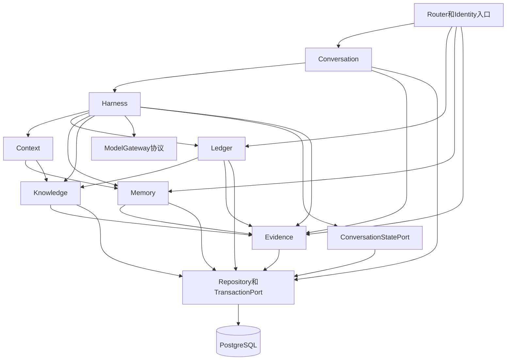
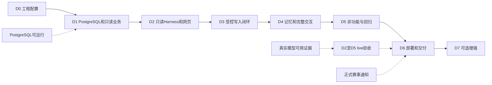

# 模块依赖与阶段划分

版本：1.0｜日期：2026-11-01｜接口细节见[架构12](../architecture/12_开发实施契约补充.md)，阶段状态见[progress](progress.md)。

## 1. 代码依赖

Identity读取权限仓储，被各入口/工具使用，省略重复连线。Evidence是叶子，不调用业务；Memory不反向调Ledger。ConversationStatePort实现只改状态，不能回调submit_turn。TransactionPort封装共享短事务，不把SQLAlchemy Session/ORM实体传入Router或模型；模块之间只交换DTO。

## 2. 阶段依赖与外部门

实线是后继开发所需本地门；虚线是运行/发布验收条件。模型不可用不阻断D0/D1，也不阻断已具本地依赖的D3—D5实施，但不能把它们宣称真实闭环通过。D6可提前准备Docker/runbook/候选包，最终MVP门仍等待live/部署/通知。图不表示自动创建子代理或额外基础设施。

## 3. 功能归属与测试门

| 需求 | 首次落地阶段 | 完整验收阶段与测试 |
| --- | --- | --- |
| FR-001 | D2基础选择/跳过 | D4切换/清除/实际对象隔离；TC046/047/048 |
| FR-002 | D2统一runner/Gateway/追问 | D5语义/工具协议，D6真实整体验证；TC003/004/037 |
| FR-003 | D1当前汇总 | D2模型调用，D6演示；TC005/006/007 |
| FR-004 | D1明细、D2普通查询 | D4搜索引用；TC008/042—TC045 |
| FR-005 | D1纯策略、D2实际检索检查 | D3写后刷新、D5冲突；TC009/010/011/026/027 |
| FR-006 | D3意图/权限/白名单 | D5真实反例；TC012/013/014/015/037/059 |
| FR-007 | D3账本/CAS/回读/断连 | D5并发/重启；TC016/017/018/033/058/060 |
| FR-008 | D4任务服务/唯一/进度 | D5变更故障；TC019/020/054 |
| FR-009 | D4明确长期偏好 | D5输入隔离；TC021/022 |
| FR-010 | D4两类管理/UI来源 | D5并发删除；TC022/054 |
| FR-011 | D4提示/明确恢复 | D5跨用户隔离；TC023/024 |
| FR-012 | D2知识CLI | D5管理/说明；TC025/035 |
| FR-013 | D2规则主题/状态/时间 | D5更新/冲突；TC026/027 |
| FR-014 | D2最小输入 | D5预算/revision/长历史；TC028/038/054 |
| FR-015 | D2最小真实输入/工具证据 | D5全链/失败/权限；TC029/039/055/060 |
| FR-016 | D2FinalPlan/事实渲染 | D5部分/不足/自然衔接；TC030/049 |
| FR-017/018及FR-003 Should | D7未默认启用 | TC040/041/050独立验收 |
| DR-001—DR-011 | D1全schema/seed，D3/D4各服务使用 | TC001/002/005/012/019/022/052 |
| NFR-001—NFR-009、DEL-001—DEL-007 | 各阶段持续落实 | D5回归、D6发布门；TC028—TC039/051—TC061 |

第一阶段D0只依赖已存在的文档和可用开发环境，不依赖真实模型账号；环境缺失进入其本地阻塞记录，不能跳成已通过。D1必须真实PostgreSQL，纯单元或JSON Schema通过不能替代数据库门。
