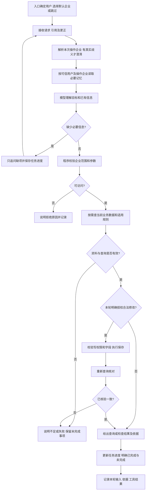

# 财税 Agent Harness 初赛业务需求分析

版本：1.3｜日期：2026-11-01｜依据：[官方要求登记表](01_赛题要求提取.md)。本文件描述业务目标与边界，不指定框架、数据库或算法。

## 1. 业务背景与问题

【官方明确要求】系统面向模拟企业财税资料协作，数据已整理为Excel。用户需要先了解指定月份金额和填写要求，再补充真实用途或备注，并在后续对话继续检查。它不执行真实财税交易。

【依据材料推导】实际困难集中在三类信息的生命周期不同：记忆保存用户偏好和任务进度，知识库保存适用规则及版本，当前数据保存真实票据状态。若把三者混为一谈，就会引用停用规则、把旧缺填清单当现状、把上次补充当新授权。跨企业重号和用户权限差异又要求每次工具执行都有明确边界。

| 痛点 | 可观察的错误结果 | 业务目标及来源 |
| --- | --- | --- |
| 用户逐轮补充信息 | 重复追问已明确企业/月，丢失待办 | 持续处理且只问缺项；OR-022—OR-027、OR-030 |
| 企业规则不同、保留旧版 | 甲企业漏查低额票，乙企业多报低额票 | 使用正确企业、时间、状态的规则；OR-008、OR-011—OR-013 |
| 保存结果不可验证 | 口头成功但数据未变，重复修改 | 明确授权、保存、重查并区分失败；OR-014、OR-019—OR-020 |
| 业务编号跨企业相同 | 修改另一企业同编号发票 | 复合定位、独立权限校验；OR-017—OR-018 |
| 金额口径混用 | 用净额当支出或宣称未付款 | 三项分算且不做付款推断；OR-004—OR-006、OR-016 |

## 2. 目标用户与参与主体

| 主体 | 目标和职责 | 权限边界 | 来源类别 |
| --- | --- | --- | --- |
| U001测试用户一 | 查询两企业，补充用途/备注，续办任务，管理本人的记忆 | 可读两企业；仅能修改合法发票字段 | 【官方明确要求】OR-015、OR-017、OR-023 |
| U002测试用户二 | 查询甲企业及相关要求，保留自身查询任务/偏好 | 只读C001；不能写C001或访问C002 | 【官方明确要求】OR-017、OR-024 |
| 参赛开发与演示人员 | 初始化材料，使用简单入口维护知识，启动并说明作品 | 是交付和维护参与主体，不等于新增业务管理员角色；知识管理权限边界待确认 | 【依据材料推导】OR-010、OR-033、OR-039—OR-042 |
| 评委 | 依说明启动，检查结果和证据 | 验收参与者，无须建设评审账号系统 | 【依据材料推导】OR-034—OR-042 |
| 模型、业务工具与持久数据 | 模型理解决策；工具执行校验计算保存；数据提供当前事实 | 非用户角色，不由模型自行提升权限 | 【官方明确要求】OR-002、OR-007、OR-017 |

不增加报税员、付款审批人、超级管理员、租户运营员等缺少材料依据的角色。知识维护可用开发演示入口实现，不要求业务用户通过自然语言更改规则或用户权限。

依据用户后续澄清，U001进入系统后可见甲乙两企业，U002仅可见甲企业；企业列表和操作入口按程序预置权限呈现，后端工具同样检查，不能靠隐藏界面实现全部访问控制。Excel业务样例由开发人员在开发、测试和首次部署时一次性准备到当前存储，不纳入日常用户业务流程。规则知识管理仍需支持运行中的导入、更新与停用。

## 3. 业务需求登记

| 编号 | 业务需求及成功结果 | 来源类别与依据 | 优先级 |
| --- | --- | --- | --- |
| BR-001 | 同一AI助手完成查询、保存和多轮检查，模型根据真实输入决定下一步 | 【官方明确要求】OR-001—OR-002 | Must |
| BR-002 | 用户取得指定企业月份的当前金额及正确资料明细，分清无记录、拒绝和故障 | 【官方明确要求】OR-003—OR-007、OR-018 | Must |
| BR-003 | 用户获得适用规则和9月用途缺填结果，能看到依据，材料不足不强判 | 【官方明确要求】OR-008—OR-013、OR-021 | Must |
| BR-004 | 用户明确补充后，系统只修改授权票据的合法字段，结果可重新查询验证 | 【官方明确要求】OR-014—OR-021 | Must |
| BR-005 | 用户补充、更正、切换对话后仍能继续任务，并能控制本人任务/偏好记忆 | 【官方明确要求】OR-022—OR-027、OR-030 | Must |
| BR-006 | 每个用户只访问授权企业，权限、业务数据、记忆相互一致地隔离 | 【官方明确要求】OR-017—OR-018、OR-024 | Must |
| BR-007 | 开发演示人员维护有来源的规则版本，检查回复和操作证据 | 【官方明确要求】OR-010、OR-028—OR-029 | Must |
| BR-008 | 评委可启动、复验并在规定演示中观察三个场景及自主设计选择 | 【官方明确要求】OR-033—OR-043 | Must |
| BR-009 | 运行失败后快速定位并继续未完成工作，减少人工排查 | 【建议增加】关联OR-020、OR-037；完整自动恢复非初赛要求 | Should |
| BR-010 | 演示人员按会话集中导出脱敏证据，减少整理负担 | 【建议增加】关联OR-028、OR-042；可用手动整理替代 | Could |
| BR-011 | 用户通过网页聊天输入区“＋”搜索授权发票并加入消息引用，减少票号输入与跨企业重号歧义；在发送明确指令后按当前数据及权限处理 | 【建议增加，用户已确认】S7；业务关联BR-002、BR-004、BR-006及OR-017—OR-018，不冒充官方界面要求 | Must（本项目确认范围） |
| BR-012 | 用户可在开场选择单一默认企业或跳过，随时切换/清除；本轮请求、引用及明确指代决定实际操作对象，任务归属不随默认范围改变，只有真实歧义才追问 | 【建议增加，用户已确认】S8；关联BR-001—BR-006，非官方指定界面 | Must；明确跨企业金额查询是FR-003的Should子能力 |

## 4. 典型业务场景

| 场景 | 前提与用户动作 | 系统产生的业务结果 | 对应需求 |
| --- | --- | --- | --- |
| SC-001金额及规则查询 | 演示入口选定U001/C001；用户问“查2026年9月发票总额和银行收支，哪些需要补用途” | 三项金额分开；R001与R002 2.0；重新查询后列5张缺填 | BR-001—BR-003 |
| SC-002缺信息与更正 | 用户只说“查下金额”；后续说“9月”，再更正为“2026年8月” | 保留已确定企业；只补问缺少的年份/月/口径；使用更正后的日期 | BR-001、BR-002、BR-005 |
| SC-003明确补充并核验 | 用户说“把甲企业F002用途填为客户方案资料打印” | 检查U001权限及字段；只改C001/F002用途，重查一致；待办剩4张 | BR-004—BR-006 |
| SC-004跨会话续办 | U001在C001有9月未完成任务，新开对话说“继续检查” | 恢复企业月和待办线索，重新读当前票据与规则；不自动保存 | BR-003、BR-005 |
| SC-005跨企业与阈值 | U001切C002检查9月 | 使用R003 1.0，缺F002/F005/F006，低额空用途票不报违规 | BR-003、BR-006 |
| SC-006只读用户 | 选U002/C001，问金额后要求补F002，再询问乙企业 | 甲查询可用；写入拒绝；乙企业查询拒绝且不泄露金额或记忆 | BR-002、BR-006 |
| SC-007管理记忆与规则 | 用户查看/更正/删除本人记忆；维护人员更新/停用测试规则 | 后续不再使用已删除记忆；最新规则管理状态可查，停用版不进入当前依据 | BR-005、BR-007 |
| SC-008搜索并引用发票 | U001点击“＋→添加发票”，搜索C001/F002，加入草稿后输入“用途填为客户资料打印”并发送 | 草稿可移除且无业务写入；发送时校验引用和权限、重查当前数据，保存后回读；U002可查询甲票但不能通过引用获得写权限 | BR-002、BR-004、BR-006、BR-011 |
| SC-009开场选择与跳过 | U001开场选择甲或跳过，跳过后直接说“查甲企业2026年9月金额”；选甲后逐轮查询、检查、补充和续办 | 选择不是使用门槛，企业和月份可由请求提供；只问缺项，补F002后回读剩4票 | BR-001—BR-005、BR-012 |
| SC-010默认与实际对象区分 | 默认甲时单次查询乙，再说“这些发票哪些缺用途”，后明确切换/清除默认企业 | 单次查乙不改默认甲，明确指代仍按乙规则；切换不取消甲任务或保存偏好，新会话明确继续才恢复 | BR-003、BR-005、BR-006、BR-012 |

## 5. 端到端业务流程

【依据材料推导】“确认企业、发票、内容”是消除歧义与满足明确授权，不意味着每次写入都必须弹出二次确认。若本轮信息已明确且入口身份有写权限，可直接执行；有多张候选、内容指代不清或授权不足时才追问。流程的权限与数据校验不能由模型的自然语言判断替代。

【建议增加，用户已确认】可访问企业范围由权限决定，会话默认企业可以为空，本次操作企业由具体请求、消息引用、明确指代或默认信息确定。三者分别表达；文字与引用冲突则澄清。默认甲时单次查乙不更新默认，“切换到乙”才更新；查乙后的“这些发票”明确延续乙。选择不能补月份，跳过不自动查全部；欢迎语可由界面提供。默认状态持续可见，支持切换与清除，不改变权限、任务归属或长期偏好。

## 6. 业务规则与状态变化

| 编号 | 规则 | 来源类别与依据 |
| --- | --- | --- |
| BIZ-001 | 月份以业务日期确定；前文明确且未被更正的企业月可沿用，模糊“9月”若年份无依据需追问 | 【官方明确要求】OR-003；年份歧义处理为【依据材料推导】 |
| BIZ-002 | 发票、银行收入、银行支出分算，所有正数流水由方向区分，不进行付款推断 | 【官方明确要求】OR-004—OR-006、OR-016 |
| BIZ-003 | 规则先限制适用企业、业务时间、启用状态，再引用名称版本；没有适用规则不回退停用版 | 【官方明确要求】OR-008—OR-009；无匹配处理为【依据材料推导】 |
| BIZ-004 | 9月甲每票必填，乙仅≥1000必填；用途空白判定包含只有空白字符；备注不替代用途 | 【官方明确要求】OR-011—OR-013 |
| BIZ-005 | 仅明确要求可写用途/备注，使用企业与票号复合键，权限在执行时检查 | 【官方明确要求】OR-014—OR-018 |
| BIZ-006 | 当前数据以持久存储为准；成功需保存后重查一致；失败与状态不确定不能说成功或盲重试 | 【官方明确要求】OR-007、OR-019—OR-020 |
| BIZ-007 | ==每用户每企业最多一个未完成任务；偏好须为用户明确长期意愿；记忆不代表事实或授权== | 【官方明确要求】OR-022—OR-027、OR-014 |
| BIZ-008 | 已写入的历史事实与未完成任务分开表达；任务删除不等同撤销已保存业务数据 | 【依据材料推导】OR-007、OR-019、OR-023 |

【依据材料推导】任务可采用下列业务状态语义，具体实现由设计阶段决定：处理中→等待补充→处理中→已完成；工具失败或结果不确定时为待核验，不能标记已完成；用户放弃为已取消。同一用户企业创建新目标时，若已有未完成任务，先判断能否更新同一目标；无法兼容则询问继续旧任务或替换，不能静默覆盖。其他企业任务独立存在。

用途检查任务“完成”应区分：检查动作已经完成，与必填资料已全部补齐。只读用户完成一次检查即可结束查询任务，不应因为无写权限而强制建立待补写任务。有权限用户希望持续补齐时才跟踪剩余清单。单票补充完成也不表示整月资料已齐。

## 7. 系统边界与价值取舍

官方必须范围是三个场景、规则管理、记忆管理、受控工具、上下文选择、运行记录及可启动交付，官方允许命令行。本项目按用户S7/S8确认采用网页聊天入口、发票引用及会话企业范围管理；知识管理仍可使用简单入口，无须复杂账号后台。权限主体来自可信身份，自然语言不能改身份。

【建议增加】BR-009仅为失败诊断和受控恢复，能辅助OR-037但成本高于基础闭环，排在其后。BR-010仅为证据整理，帮助演示且成本较低，不创造新业务。创新展示优先使用已有“只问缺项、规则三要素筛选、保存后刷新待办”的组合示例，不额外引入知识图谱、多Agent或真实财税接口。

本次排除真实记账/付款/申报、OCR、税额拆分、发票流水匹配、历史规则恢复、真实外部企业系统集成。复赛长对话和复杂故障另行评估；但初赛所需输入长度控制、失败说明与不重复写入仍须实现。

用户确认的BR-011/012纳入网页聊天范围，作用是建立可选默认范围和明确的消息引用，不是上传原始数据或引入批量管理后台。引用乙企业票据只确定本次对象，不自动改变默认甲；文字与条目冲突先澄清。选择、跳过、切换、清除或发送引用均不能替代明确修改意图。多条引用不新增独立批量编辑页面，内容不明时追问；跨企业金额查询保留Should，分别显示各企业结果，不默认合并，不扩展跨企业批量修改。

功能、数据、非功能与验收详见[主说明书](03_软件需求分析说明书.md)，范围变更及未知条件详见[问题与风险](05_待确认问题与风险.md)。
