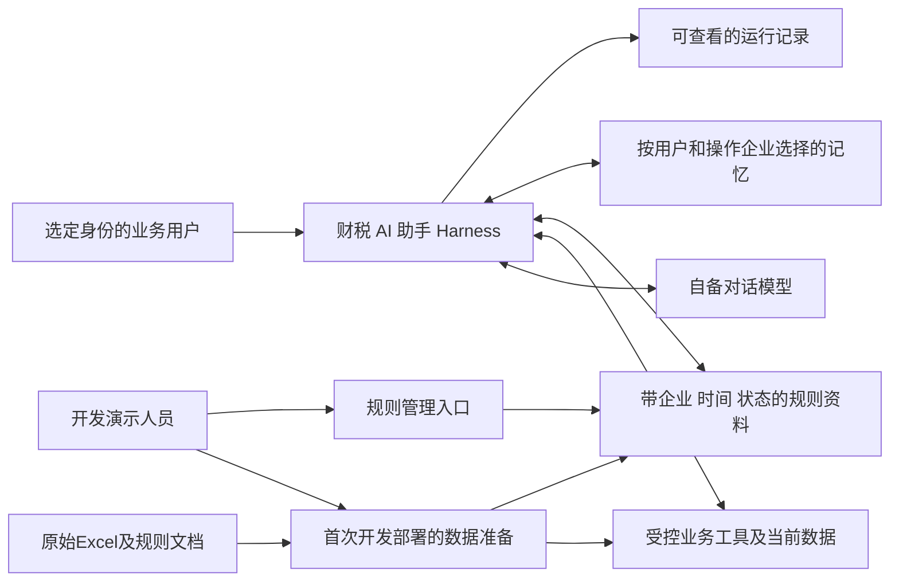

# 财税 Agent Harness 初赛竞赛项目软件需求分析说明书

版本：1.3｜编写日期：2026-11-01｜材料基线：1.1.0｜状态：需求分析基线，包含显式未决项。

本项目建设一个可查询模拟财税资料、按明确要求补充发票用途或备注、跨轮次和会话继续任务的AI助手。交付重点是可运行、可核对的三个场景，以及真正参与任务的记忆、知识和业务工具。本文供产品设计、架构设计、开发与测试使用，不包含项目实现代码，不预选框架、数据库、模型或检索算法。

一次性业务数据准备归入数据与部署要求。业务初始数据可在开发时预置到数据库等当前存储中，不需要开发业务用户使用的Excel导入功能；规则资料的导入、更新和停用仍按FR-012实现。FR-001描述会话企业选择与默认范围管理，不承担数据导入或完整账号系统。

1.3版按用户批准的完整修改稿，合入可跳过的企业单选、会话默认范围切换与清除、操作对象解析、任务记忆与当前状态区分及关联验收；保留1.2版已批准的“＋搜索并添加发票条目”。上述网页交互属于用户确认的项目需求，不转为官方指定界面。既有AC-042—AC-045保持为发票引用验收，新增会话相关AC-046—AC-049和可选跨企业查询AC-050，避免改写已有编号含义。

## 1. 文档概述

### 1.1 依据与信息等级

原始材料及46项官方要求见[赛题要求提取](01_赛题要求提取.md)，业务需求BR-001—BR-012见[业务需求分析](02_业务需求分析.md)。证据代号S1为参赛说明，S2为业务规则，S3为示例数据，S4为个人笔记，S5为本次分析指令，S6为此前用户澄清，S7为发票搜索引用方案，S8为用户批准的整套会话企业选择及关联修改稿。关键需求标记为【官方明确要求】【依据材料推导】【建议增加】【待确认】；设计推导不能作为官方强制条款。标注“建议增加，用户已确认”的条目纳入本项目范围，但不转为官方要求。

官方材料优先于个人笔记，初赛明确范围优先于自行扩展。没有提供官网通知、截止日期、团队配置、模型账号及预算。本说明书按一周左右开发的材料前提收敛实现范围，实际排期须结合人员条件确认。

### 1.2 术语

| 术语 | 定义 |
| --- | --- |
| Harness | 连接模型、记忆、知识与业务工具的运行程序 |
| 当前数据 | 系统已经导入并持久保存的当前发票与流水；不等同原始Excel |
| 任务记忆 | 用户、企业范围内的目标、业务月份、进度和未完成事项；不是实时票据事实 |
| 长期偏好 | 用户明确要求长期保留的行为偏好，不是程序推测 |
| 适用规则 | 符合企业、业务时间及启用状态的规则版本 |
| 明确授权 | 用户本轮明确要求执行某项合法修改，企业、票据、内容清楚；历史记忆或询问规则均不构成授权 |
| 核验成功 | 写后重新读取当前记录，实际值与本次明确要求一致 |
| 发票条目引用 | 用户通过输入区“＋”搜索并添加到消息中的发票对象引用，以企业编号和发票编号共同定位；不是上传文件，不是修改授权，也不是实时状态的替代物 |
| 可访问企业范围 | 当前用户有权查看或修改的企业集合，由程序预置权限确定；对各企业的读写权限可能不同 |
| 会话默认企业 | 用户为本次对话选择的默认业务对象，可为空、可切换、可清除；不改变用户权限，不自动构成长期偏好 |
| 本次操作企业 | 某次查询、检查或修改实际针对的企业，由本轮请求、发票引用、明确指代或会话默认企业确定；不必与默认企业相同 |
| Must/Should/Could/Won't | MoSCoW必须/应该/可以/当前不实现；“Must”可能包含实现闭环必要推导，不表示每个细节都是官方原文 |

### 1.3 编号与使用方式

OR为官方要求；BR为业务需求；FR为功能；DR为数据；NFR为非功能；IF为接口；UC为用例；AC为验收；DEL为竞赛交付。验收条目以第8章为唯一详细定义，其他章节仅引用，避免口径漂移。完整映射见[追踪矩阵](04_需求追踪矩阵.md)。

## 2. 赛题目标、评分与交付约束

【官方明确要求】三个场景共用同一处理流程，模型理解决策、程序计算校验保存。数据仅为比赛模拟资料，不执行真实记账、付款、申报。初赛只检查2026年9月用途，8月用于金额查询，不考历史规则恢复。

| 官方评分维度 | 权重 | 对本项目的要求解释 |
| --- | --- | --- |
| 基础任务完成度 | 40% | 三场景闭环、可核对保存、记忆与知识管理均可用 |
| AI技术应用合理性 | 25% | 模型实际理解决策，程序掌握计算与权限，不将演示脚本伪装成模型 |
| 问题理解 | 15% | 分清记忆、规则、当前数据；只追问缺项并说明完成状态 |
| 后续完善空间 | 10% | 说明当前不足及长对话、信息更新、任务恢复的后续方向 |
| 创新性 | 10% | 以具体设计和示例展示减少重复询问、规则误用或无关解释 |

未提供子项分数或扣分算法，本文不预测得分。语言、框架、模型不限，可本地存储与文本检索，不强制网页、向量库、多Agent、复杂运维。交付压缩包、设计说明、运行记录及≤5分钟演示，细目见第10章。比赛截止时间、提交入口和包大小限制仍待主办方通知。

## 3. 业务需求与总体需求

### 3.1 用户和场景

U001可读写C001/C002，U002仅可读C001。修改范围始终只有发票用途和备注。身份由登录会话或受控演示入口确定，不允许通过自然语言更改。程序按预置权限提供企业选项，后端查询和修改工具仍须逐次校验权限。登录会话是可选身份实现，不因此要求完整注册或账号管理系统。开发演示人员负责一次性数据准备、知识管理和交付，不据此新增完整管理员角色。业务场景SC-001—SC-010及BR定义以[业务文档](02_业务需求分析.md)为准。

【建议增加，用户已确认】网页打开聊天窗口后，展示欢迎信息、授权企业单选和跳过入口；选择只设置会话默认企业，跳过不等于选择全部企业。默认企业为空也可发消息，通过请求或引用定位业务对象，确有歧义才追问。默认企业持续显示，可通过界面或明确自然语言指令切换/清除，执行时仍以本次操作企业检查权限。

### 3.2 目标和边界

系统须具备：输入理解与缺项追问、当前资料查询、规则检索和维护、9月用途检查、受控保存与回读、多轮进度和长期偏好、记忆查看更正删除、按需组织模型输入、可查看的执行证据。

系统不承担真实财税合规判断。销售方或票面项目不代表用途；银行记录不代表具体发票已付款。发票金额为价税合计，三类金额独立统计。银行资料只读；不存在发票流水逐条匹配关系。

箭头表示需求层面的交互，不指定网络、服务拆分或存储产品。工具和持久数据可处于同一进程。

### 3.3 统一处理原则

【依据材料推导】当前轮显式更正优先于旧上下文；恢复记忆仅提供线索；工具执行前仍检查权限和参数。企业或月份已明确时不重复问，存在多个候选时才澄清。信息齐全且明确要求修改时可直接执行，无须机械增加二次确认。执行失败、无记录和无权限必须有不同结果语义。

【建议增加，用户已确认】用户可以通过自然语言或消息中的发票条目引用指定对象，不必同时重复口述企业与票号。引用对象明确且本轮文字未与其冲突时，按引用记录确定本次操作企业；引用乙企业发票不自动改变原会话选择的甲企业。文字与引用对象冲突时先澄清，不机械按任一来源执行。

【建议增加，用户已确认】会话默认企业是补足省略信息的辅助，不是全部请求的强制边界。默认甲时，“查乙企业9月金额”只查询乙，不自动改变默认甲；“接下来切换到乙企业”才更新默认企业。查询乙后“这些发票哪些缺用途”明确延续乙结果，不能机械套默认甲。企业选择不能补足缺失月份，切换或清除默认企业不改变任务归属、不取消旧任务、不自动保存偏好。官方演示按S3选择企业的路径覆盖；可跳过路径是本项目额外确认的交互。

## 4. 功能模块与总体清单

| 模块 | 功能编号及名称 | 优先级 | 主业务需求 |
| --- | --- | --- | --- |
| 会话交互与企业范围 | FR-001会话企业选择与默认范围管理 | Must（用户确认交互） | BR-006、BR-012 |
| 对话与决策 | FR-002统一模型决策；FR-016业务答复 | Must | BR-001、BR-005 |
| 当前数据查询与消息引用 | FR-003金额查询；FR-004资料查询、发票搜索与消息引用 | Must（条目引用为用户确认范围） | BR-002、BR-004、BR-011 |
| 用途检查与修改 | FR-005检查；FR-006受控写入；FR-007回读核验 | Must | BR-003、BR-004 |
| 记忆 | FR-008任务进度；FR-009长期偏好；FR-010记忆管理；FR-011跨会话恢复 | Must | BR-005、BR-006 |
| 知识 | FR-012规则管理；FR-013适用规则检索 | Must | BR-003、BR-007 |
| 上下文与证据 | FR-014模型输入选择；FR-015运行记录 | Must | BR-001、BR-007 |
| 增强 | FR-017受控恢复；FR-018证据导出 | Should / Could | BR-009、BR-010 |

以下全部功能条目具有输入、处理、输出、异常和验收，禁止只实现目录或静态回复。

## 5. 详细功能需求

### FR-001 会话企业选择与默认范围管理

- 模块、优先级：会话交互，Must（用户确认项目范围）。
- 描述、主体：已确定身份的业务用户打开网页聊天窗口，系统展示欢迎信息和有权访问的企业单选，可选择一家作为会话默认企业，也可跳过直接提问；对话过程中支持切换和清除。
- 前置条件：用户身份和权限可信，样例数据已在开发或首次部署准备完成；选择企业不是发送消息的前置门槛。
- 输入：可信用户身份、授权企业列表、企业选择、跳过、切换、清除操作及明确的自然语言范围变更指令。
- 流程：读取权限→展示欢迎语与企业单选和跳过入口→选择或跳过→建立有默认企业或默认为空的会话→持续显示当前状态→按界面操作或明确指令更新范围→每次业务操作按实际企业校验权限。
- 输出：可见企业选项；持续可见的默认企业或“未设置默认企业”状态；相应会话上下文；失败或拒绝时保留正确状态。
- 业务规则：U001可选甲乙，U002仅可选甲；开场单选，不提供企业多选。欢迎语及控件可由界面直接提供，无须调用模型生成。跳过不选全部企业，不阻止直接提问；默认企业不补足缺失月份。界面提供切换与清除入口，并支持明确自然语言指令，成功后显示同步更新。单次请求其他授权企业不自动切换默认企业。选择、切换和清除不改变权限、不自动保存长期偏好、不授权修改、不删除或转移原企业任务。默认企业信息不替代每次工具的权限检查。
- 异常与边界：非法身份或越权企业拒绝且不泄露数据，不以用户或模型声称替代身份；更新默认企业失败时不显示虚假切换成功。范围为空且本轮企业已明确直接处理，多个合理候选才澄清。当前数据未准备属于部署缺项，不引导业务用户导入。完整注册和账号管理不纳入本功能。
- 来源：【官方明确要求】OR-017、OR-024及S3“企业与用户”A3的演示安排；可跳过单选、状态展示及切换/清除等交互为【建议增加，用户已确认】S8、BR-012，不冒充官方界面规定。
- 验收：AC-013、AC-023、AC-032、AC-046—AC-049；初始数据另按DR-001、AC-001验收。

### FR-002 统一模型理解与决策

- 模块、优先级：对话与决策，Must。
- 描述、主体：业务用户提出自然语言任务，模型根据本轮信息和必要上下文决定查资料、追问、调用工具、修改或结束。
- 前置条件：用户身份及可访问企业范围已确定，模型和工具可用；会话默认企业可以为空。
- 输入：本轮消息及随消息发送的发票条目引用、已明确企业年月、允许使用的记忆规则和工具结果；引用由程序验证归属和权限并读取当前记录。
- 流程：识别目标及更正→检查所需信息→只追问缺项或选择工具→接收真实结果→继续必要步骤或答复。三个场景使用同一流程，支持用户组合请求。
- 输出：所需追问、受控工具调用或有事实依据的答复。
- 业务规则：模型负责意图和步骤，程序负责金额计算、权限、参数和保存；“今年/9月”等缺乏可靠年份依据时需澄清，不擅自套用系统当前月。
- 引用处理：用户可先添加发票条目，再输入“把这张用途填为客户资料打印”。模型结合文字与已校验引用识别目标和修改意图，不要求重复口述已明确的企业票号；添加引用本身不调用写工具。文字与引用不一致或多条引用的内容对应关系不清时追问。
- 企业解析：结合本轮明确请求、消息发票引用、明确上下文指代和会话默认企业确定本次对象；足以唯一定位时直接使用，存在冲突才澄清，不强制先选企业。默认甲时单次查乙不改默认；明确“切换到乙”才更新；刚查乙后“这些发票”仍明确指乙，不能因默认甲而串对象。
- 异常与边界：多张候选、指代不明时追问；模型不可用或输出非法参数时明确失败，不能切换到背好的场景结果冒充真实模型成功。合法的工具参数校验和业务规则判断可以是确定性程序。
- 来源：【官方明确要求】OR-001—OR-003、OR-030、OR-035；非法模型输出处理为【依据材料推导】；消息引用理解为【建议增加，用户已确认】S7、BR-011。
- 会话来源：企业解析与默认范围规则为【建议增加，用户已确认】S8、BR-012。
- 验收：AC-003、AC-004、AC-044、AC-046、AC-048—AC-049。

### FR-003 当前金额与收支查询

- 模块、优先级：当前数据查询，Must。
- 描述、主体：用户查询企业月份的发票总额、银行收入或支出，可单项或组合查询。
- 前置条件：企业、年份月份明确且有查看权限。
- 输入：本轮请求的企业、年份月份及查询口径；企业可来自明确表达、消息引用或有效会话上下文，无须通过企业控件提供。
- 流程：程序校验参数与权限→按相应业务日期筛当前记录→分方向汇总→将金额及查询状态交给模型表达。
- 输出：所请求的各项金额（元，两位小数）、企业月、必要的无记录说明与统计口径。
- 业务规则：使用全部匹配票据，不按是否填用途过滤；收入支出分算；使用十进制或整数分；不判断发票银行金额应相等。
- 会话规则：默认企业为空但请求明确企业时直接查询；企业仍有多个合理候选时只澄清范围，结果标明实际企业、月份与口径。单次查其他企业不改变默认范围。
- 可选扩展：Should，按用户明确要求同时查询甲乙等授权企业金额，逐企业校验、计算并分别展示，不默认合并。跳过选择不触发全部企业查询；未实现时说明当前单企业能力并允许用户分次请求。本扩展不增加跨企业批量修改。
- 异常与边界：缺年月走FR-002；成功无记录返回0.00；拒绝和查询失败不返回伪零；非法月份拒绝后请求更正；跨年筛选不得混入其他年份。
- 来源：【官方明确要求】OR-003—OR-007、OR-017、OR-027；省略企业解析及Should跨企业查询为【建议增加，用户已确认】S8。
- 验收：AC-005—AC-007、AC-046、AC-048；跨企业Should扩展另验AC-050。

### FR-004 资料查询、发票搜索与消息引用

- 模块、优先级：当前数据查询，Must。
- 描述、主体：用户可通过对话查询发票或银行明细；网页聊天输入区提供多功能条中的“＋→添加发票”，允许搜索授权发票并作为条目加入待发送消息，减少企业重号和自然语言指代歧义。
- 前置条件：用户身份及访问权限已确定，当前数据可读取；搜索仅在授权企业内执行，用户不必预先知道完整企业编号或票号。
- 输入：查询或搜索关键词、可选企业/月筛选、选中的发票复合标识、添加/移除操作、随条目发送的自然语言消息。搜索支持票号、销售方或票面项目等现有定位线索。
- 流程：对话查询沿用权限检查→查当前候选→唯一定位或澄清；界面引用路径为点击“＋”→选择“添加发票”→检索授权范围→展示企业、票号、日期、金额等辨识信息→选择并加入消息草稿→可继续添加或移除→连同文字发送→程序验证引用并重新读取当前记录→由FR-002理解请求。
- 输出：当前资料明细或搜索结果；草稿中可辨识、可移除的发票引用条目；发送后与该消息关联的引用；明确的无记录、拒绝或失败结果。
- 业务规则：企业+发票编号、企业+流水编号共同定位；引用必须包含发票复合标识，不能只传F002。搜索不越过权限，不能靠界面筛选替代后端校验。添加、移除或取消引用不修改业务数据，不创建补写任务，也不构成修改授权。条目随当前消息发送，发送后留作该消息的引用，不自动成为未来每条消息的选中对象；后续明确指代可结合对话解析。重复添加同一复合键不产生重复执行对象。引用乙企业票据不自动改变原会话选择的甲企业。销售方和项目只帮助定位，不生成用途，不推断付款。
- 企业补足：默认甲企业且本轮没有其他明确对象时，“查F002”定位甲票；消息引用或明确对话指代已定位乙票时按乙票处理，不重复问企业，也不机械套默认甲。默认为空且授权范围内存在跨企业同号候选时澄清，最终工具仍用复合标识。
- 异常与边界：搜索无结果、查询失败与无权限分别表达；关闭搜索或移除草稿条目后不产生业务操作；原记录不可读或权限变化时拒绝继续，不用旧展示值冒充现状。F002既无有效企业线索且有多个候选时澄清；文字指甲企业而引用乙企业、指定月份与记录日期冲突、多票内容对应不明时澄清。用户仍可不使用条目而直接提问。不扩展银行条目选择、文件上传或独立批量编辑页面。
- 来源：【官方明确要求】OR-016—OR-018、OR-021、OR-027支撑资料查询与复合定位；候选澄清为【依据材料推导】；“＋搜索并添加发票条目”及其消息引用交互为【建议增加，用户已确认】S7、BR-011，非官方界面要求。
- 会话来源：默认企业与明确指代的定位规则为【建议增加，用户已确认】S8。
- 验收：AC-008、AC-042—AC-045、AC-048—AC-049。

### FR-005 九月用途完整性检查

- 模块、优先级：用途检查与修改，Must。
- 描述、主体：用户检查指定企业2026年9月哪些发票按适用规则必须补用途。
- 前置条件：有查看权限，当前发票可查询，适用规则可取得。
- 输入：本次操作企业、2026-09及检查请求；企业来自明确请求、消息引用、有效指代或会话默认企业，月份可沿用前文已明确且未更正的业务月份。
- 流程：查询当前票据→经FR-013选规则→程序按该规则判定必填与用途空白→输出缺失编号及必要说明→用户需要续办时记录进度。
- 输出：必填缺用途清单、数量、规则名称版本；无缺失时明确当前检查未发现必填缺项。
- 业务规则：甲全部必填；乙≥1000.00元才必填；null、空串和仅空白字符均视为未填；备注不能替代用途；缺失清单不能来自记忆快照。
- 会话规则：选择企业不等于已提供月份；选择甲后查2026年9月金额，再问“哪些发票没填用途”，可沿用甲和2026-09，不重复询问。单次或指代检查乙时按乙规则，不被默认甲覆盖。
- 异常与边界：8月检查说明不在初赛支持范围，不能套旧版；资料不足或查询失败不输出“全部合规”；乙低额空用途不报必填缺失，但用户可主动补充。
- 来源：【官方明确要求】OR-008—OR-013、OR-021、OR-027；会话衔接为【建议增加，用户已确认】S8。
- 验收：AC-009—AC-011、AC-048—AC-049。

### FR-006 按明确要求受控修改用途或备注

- 模块、优先级：用途检查与修改，Must。
- 描述、主体：有写权限用户明确补充或更正指定发票用途/备注。
- 前置条件：企业和发票可由本轮请求、消息引用或有效上下文唯一确定，无须每次重复口述；目标字段、内容与本轮修改意图明确，执行时有写权限。
- 输入：企业编号、发票编号、字段及用户指定内容、本轮修改意图。
- 流程：校验身份权限→校验复合定位及字段白名单→必要时澄清→执行保存→交FR-007核验→按核验结果更新任务。
- 输出：实际修改目标和待核验状态；最终成功仅由回读支持。
- 业务规则：禁止改金额、日期、归属、编号、销售方、项目和任何银行数据；只改用户指定字段，未提及字段保持原值；不得由票面内容生成用途；查询、规则问答、历史任务均不构成写授权。
- 引用处理：经程序校验的消息引用可提供企业和发票定位，无须重复口述；修改字段、内容及本轮修改意图仍必须明确。提交引用时重新查询当前票据并校验写权限，不信任搜索时的金额、用途快照或前端声称的权限。多条引用只有在用户明确各票内容或明确对全部引用应用同一内容时才可逐项处理；不清楚时追问。引用取消或仅发送条目而无明确修改指令时不写入。
- 会话规则：企业单选、切换、引用条目、提示旧任务和恢复任务均不构成写授权；上下文已唯一定位且本轮明确要求修改时直接执行，有真实歧义才澄清。
- 异常与边界：无权限、找不到票、候选多、字段越界时不写入。用户要求清空字段时，空值是合法存储状态，但不能宣称已补齐；“把用途写成空格”仍属于未填。清空意图不明时先澄清。不要求批量编辑功能；如用户一次指定多票，应逐票核验并逐项报告，不能一项失败却整体报成功。
- 来源：【官方明确要求】OR-014—OR-018、OR-021；清空、未指定字段保持和多项结果语义为【依据材料推导】；引用写入路径为【建议增加，用户已确认】S7、BR-011。
- 会话来源：省略企业和授权边界规则为【建议增加，用户已确认】S8。
- 验收：AC-012—AC-015、AC-043—AC-045、AC-047、AC-049。

### FR-007 保存后回读与失败防重复

- 模块、优先级：用途检查与修改，Must。
- 描述、主体：写工具执行后程序核验，用户得知哪些已保存、未保存或状态不确定。
- 前置条件：存在FR-006写入尝试。
- 输入：本次目标、期望值、写入结果及可查询的当前数据。
- 流程：写后重新查询复合键→比对目标字段→一致则确认成功→有续办任务时重新检查剩余缺项；失败则记录具体阶段和未完成项。写入超时等结果不确定时，先查现状再决定是否仍需写入。
- 输出：已核验成功、明确未写入、或待核验三类可区分结果及剩余事项。
- 业务规则：不把已发出请求当成功；不盲目重复写；幂等约束、操作标识或写前比较等具体方案由设计选择。
- 异常与边界：写成功但回读失败时告知“保存结果尚未核实”，保留待核验；回读不一致不更新为完成；同一修改重复提交且目标值已一致时说明已为该值，不重复产生有效修改。基础故障语义必须实现，复杂自动恢复为FR-017。
- 来源：【官方明确要求】OR-019—OR-020、OR-027；三类状态及实现中立的防重复方法为【依据材料推导】。
- 验收：AC-016—AC-018。

### FR-008 任务进度与未完成事项记忆

- 模块、优先级：记忆，Must。
- 描述、主体：对话运行程序记录用户希望继续处理的任务，承接分轮补充、更正和待办。
- 前置条件：可信用户已确定，存在待继续的业务目标；建立或更新归属任务前须明确企业，无须先设置会话默认企业。
- 输入：目标、企业、业务月份、已完成步骤、缺少的信息或剩余事项。
- 流程：读取同用户企业任务→合并有效补充或更正→根据真实工具结果更新进度→完成/取消后不占未完成名额。
- 输出：可读取的当前任务进度，明确已完成与未完成。
- 业务规则：每用户每企业最多一个未完成任务；保存已补票号等进度不意味着它们永远是当前事实；只读用户完成查询后可结束，不强制创建补写任务。
- 会话与现状：默认企业和任务归属分别管理，切换/清除默认不取消、删除或转移任务；企业尚不明确时可先澄清，不能把任务随意归属。已补记录是操作历史线索，继续检查时重查当前发票并重新计算待补清单；已补用途后来被清空时重新计为缺失。任务状态可以用现有存储表达，不强制独立任务表。
- 异常与边界：同范围新目标与旧目标不兼容时澄清继续或替换，不能静默遗失；跨月更正不得继续按旧月操作；任务删除不回滚业务数据。
- 来源：【官方明确要求】OR-022、OR-025—OR-027、OR-030；冲突处理和任务状态语义为【依据材料推导】。
- 会话来源：范围与任务分离及进度刷新细化为【建议增加，用户已确认】S8；实时事实原则仍源自OR-027。
- 验收：AC-019、AC-020、AC-047、AC-049。

### FR-009 明确长期偏好保存

- 模块、优先级：记忆，Must。
- 描述、主体：用户明确要求长期使用某种回复偏好，例如“以后在甲企业查询先报总额”。
- 前置条件：身份明确，偏好内容及适用企业范围明确。
- 输入：用户长期意愿、内容、企业范围。
- 流程：区分长期偏好与单轮指令→保存明确偏好→后续相关轮按需使用。
- 输出：已保存的可查看偏好及相应回复行为。
- 业务规则：本基线按用户+企业范围保存以满足隔离；跨企业通用偏好未获明确支持前不自动扩展。偏好不能放宽权限或使系统省略必要依据、核验。
- 会话规则：本次选择、跳过、切换或清除企业不自动形成长期偏好；只有“以后默认使用甲企业”等明确长期意愿才按偏好规则保存，本轮明确指定其他企业时仍以本轮请求为准。未来会话如何使用偏好须可见，不改变访问权限。
- 异常与边界：“这次简短点”不自动长期保存；偏好相冲突或范围不清时澄清，不将模型猜测作为长期意愿。
- 来源：【官方明确要求】OR-022、OR-024；企业范围与冲突处理为【依据材料推导】，全局偏好见Q-006。
- 会话来源：短期范围与长期偏好分离为【建议增加，用户已确认】S8。
- 验收：AC-021、AC-047。

### FR-010 记忆查看、更正与删除

- 模块、优先级：记忆，Must。
- 描述、主体：用户管理本人有权访问且请求范围已明确的任务与偏好；入口可为对话或简单操作，不要求预先设置会话默认企业。
- 前置条件：可信身份及企业范围可验证。
- 输入：查看/更正/删除操作、目标记忆、必要的新值。
- 流程：范围校验→列出可管理记忆或定位目标→执行更正删除→后续输入选择按最新记忆生效。
- 输出：实际查看内容、修改结果或删除结果，保留业务数据不随任务删除回滚的说明。
- 业务规则：两个记忆类别均支持管理；只处理本人本企业；更正任务月份不直接修改票据；被删除内容不再通过旧摘要注入新轮模型输入。
- 会话规则：“查看我在甲企业的任务”可直接定位；“删除那个任务”只有在目标唯一时执行，否则追问。默认为空不阻止管理已明确企业的本人记忆，默认切换不扩大管理范围。
- 异常与边界：目标不存在如实说明；“删除它”不清楚指哪项时澄清；不能借管理记忆修改他人权限或业务数据。已存在运行历史的保留政策见Q-007。
- 来源：【官方明确要求】OR-023—OR-024；目标歧义、后续摘要失效及数据分离为【依据材料推导】。
- 会话来源：无默认企业时的记忆管理为【建议增加，用户已确认】S8。
- 验收：AC-022、AC-047。

### FR-011 跨会话恢复与隔离

- 模块、优先级：记忆，Must。
- 描述、主体：相同用户企业新开会话后合理使用任务进度与偏好，切换用户企业时严格隔离。
- 前置条件：对应记忆已持久保存，当前入口身份可信。
- 输入：新会话的用户、企业、继续请求或新目标。
- 流程：只检索匹配范围记忆→保留任务年月线索→按本轮目标重新查规则和数据→续办或追问新缺项。
- 输出：承接旧进度但依据当前数据的结果。
- 业务规则：用户新指令优先于旧记忆；恢复任务不自动写入，不重复执行旧修改；新开会话不提升权限。
- 会话规则：新会话选择企业后可提示本用户该企业存在未完成任务，表达继续意图后才恢复，不因企业选择重放操作。跳过后“继续甲企业9月用途检查”可直接定位；仅说“继续”且多个任务可能匹配时澄清。恢复后仍重查当前数据、规则与权限。
- 异常与边界：无任务如实说明；旧记忆指向不存在票据或不再适用规则时说明并更新待办；不得向U002展示U001记忆或乙企业结果。
- 来源：【官方明确要求】OR-014、OR-024、OR-027、OR-030。
- 会话来源：选择、跳过与恢复的衔接为【建议增加，用户已确认】S8。
- 验收：AC-023、AC-024、AC-047—AC-049。

### FR-012 规则导入、查找、更新与停用

- 模块、优先级：知识，Must。
- 描述、主体：开发演示人员通过命令行等简单入口维护规则，不要求完整管理后台。
- 前置条件：管理入口受控，规则正文及元数据可获取。
- 输入：规则编号、名称、版本、适用企业、生效日期、启用状态及正文；更新/停用目标。
- 流程：导入初始五个版本记录→按编号版本查找→更新正文或版本元数据→停用目标版本→验证后续检索状态。新版本与状态变化分开可查，不覆盖成只剩“最新正文”。
- 输出：管理结果、可查看的版本和状态；后续FR-013能取得更新后适用规则。
- 业务规则：保留R002 1.0停用版用于版本管理证明；初始清单5条而非4条；普通对话不能自授权更改规则。维护人员的具体鉴别方式为待确认项。
- 异常与边界：缺元数据、同编号版本冲突、企业不存在时不静默导入；对停用版的管理查看不等于允许其作为业务依据。测试更新需在隔离副本完成，避免改变正式演示基准。
- 来源：【官方明确要求】OR-008、OR-010；受控入口、版本冲突处理为【依据材料推导】。
- 验收：AC-025。

### FR-013 按企业、时间、状态检索依据

- 模块、优先级：知识，Must。
- 描述、主体：模型或业务工具需要解释金额口径、用途要求或银行规则时，查找当前适用资料。
- 前置条件：知识已导入，业务企业与时间明确。
- 输入：企业、业务时间、所需规则主题。
- 流程：限制企业和时间→排除停用版本→取相关规则→返回名称版本及正文→用于程序判断与模型解释。
- 输出：可追溯的适用依据，或不足/冲突说明。
- 业务规则：9月甲用R002 2.0、乙用R003 1.0；金额R001 1.0、银行资料R004 1.0；用业务月份而非聊天日期判断适用性。不把销售方等数据文本视为规则。
- 会话规则：规则检索使用本次操作企业和业务时间，默认甲但本次请求或明确指代乙时取乙规则，不机械使用会话默认企业。
- 异常与边界：无匹配不编造；存在同范围同时启用且冲突的多版，材料未定义优先级，应报告冲突，不能擅自按版本字符串大小选择；停用旧版不作降级。
- 来源：【官方明确要求】OR-008—OR-009、OR-013；冲突策略为【依据材料推导】，有效区间模式见Q-003。
- 会话来源：实际操作企业与默认企业区分为【建议增加，用户已确认】S8。
- 验收：AC-026、AC-027、AC-048。

### FR-014 模型输入选择与当前事实刷新

- 模块、优先级：上下文与证据，Must。
- 描述、主体：每次模型调用前，程序仅选择当前任务所需对话、记忆、规则与工具结果。
- 前置条件：已能区分信息来源，模型输入预算可以配置。
- 输入：本轮请求及消息发票引用、会话历史、匹配范围记忆、相关规则、所需工具返回。引用以经程序验证的企业和票号定位，当前字段来自重新查询。
- 流程：确定必要企业/月/未完成事项→选择相关材料→压缩或舍弃无关历史→长度检查→形成可查看输入；需要当前事实时先调用查询而非复用旧快照。
- 输出：长度受控且保留关键任务要素的模型输入。
- 业务规则：输入长度控制为官方要求，但未指定token数；预算不得高于已选模型限制；不能因裁剪而丢掉身份约束、用户最新更正、企业月或待办。
- 引用处理：明确区分消息引用标识、搜索时展示内容和实际执行时查询结果；只选择本轮相关引用和当前字段，不自动携带全部历史引用。引用乙企业时，按该次请求需要选择乙企业规则及本用户对应记忆，不把原会话企业专属材料误套到乙企业。引用不构成长期偏好或授权。
- 会话上下文：分别表达可信身份、可访问企业范围、可为空的默认企业、本次操作企业及任务归属，不能用一个含义模糊的“当前企业”替代全部信息。切换后不把原企业专属记忆和规则套用于新企业；保留理解指代所需历史时标明其企业归属。不强制新增独立存储表。
- 异常与边界：必要信息已超过预算时分步查询、减少无关结果或说明限制，不无声截断；删除或更正记忆后旧摘要不得继续注入。基础长度控制是Must，极长对话质量提升不强加为初赛指标。
- 来源：【官方明确要求】OR-026—OR-027；预算配置和必要信息超限处理为【依据材料推导】；引用上下文为【建议增加，用户已确认】S7、BR-011。
- 会话来源：范围语义与输入隔离细化为【建议增加，用户已确认】S8。
- 验收：AC-028、AC-044—AC-045、AC-047—AC-049。

### FR-015 本轮运行记录查看

- 模块、优先级：上下文与证据，Must。
- 描述、主体：开发演示人员或评委按会话/轮次查看模型输入及操作来源。
- 前置条件：存在实际对话或工具执行；日志入口访问受控。
- 输入：会话轮次定位信息，实际选用上下文及调用事件。
- 流程：记录本轮提交模型的输入、选用记忆规则、工具名称参数和结果→关联最终回复与写后核验→允许查看成功、拒绝和失败记录。
- 输出：足以核对答案与操作来源的运行证据。
- 业务规则：不得记录模型密钥；记录实际发送内容而非事后手写说明；不要求记录模型隐藏思维链。输入、响应等正文不应带鉴权头或环境密钥。
- 引用记录：可从消息追溯随其提交的企业和票号、实际解析的操作对象、引用校验与重新查询结果、实际写入及回读结果；区分界面搜索与模型业务决策，不为未调用模型的搜索伪造模型输入。未发送草稿不当作已执行请求。
- 会话记录：企业选择、跳过、切换、清除事件可关联会话和相关轮次；记录本次操作企业及其来源（本轮表达、引用、明确指代或默认企业），不记录模型隐藏推理。无模型参与的界面事件不伪造模型调用。
- 异常与边界：模型失败、参数拒绝、保存待核验也有记录；日志不可用应可诊断，不制造虚假记录；不向无权限业务用户开放他人/其他企业日志。
- 来源：【官方明确要求】OR-028—OR-029；轮次关联和访问约束为【依据材料推导】；引用证据关联为【建议增加，用户已确认】S7、BR-011。
- 会话来源：默认范围事件与企业解析证据为【建议增加，用户已确认】S8。
- 验收：AC-029、AC-044—AC-045、AC-046—AC-049。

### FR-016 自然、准确的业务答复

- 模块、优先级：对话与决策，Must。
- 描述、主体：每轮结果交给用户，直接回应当前目标，承接补充和更正。
- 前置条件：已得到工具事实、规则依据或明确缺失项。
- 输入：当前用户问题、实际结果、依据、完成和未完成事项。
- 流程：先回答主要问题→说明必要口径及规则→区分完成、未完成、待核验→仅在必要时追问缺项。
- 输出：金额口径清楚、状态准确、依据可查的自然语言回复。
- 业务规则：不能以“已调用工具”代替业务结果；不重复列全部历史；不把单票成功说成整月已齐；不把规则不足说成没有违规。
- 会话规则：金额、检查和保存结果标明实际企业；明确切换/清除默认企业时简短确认并与界面一致，单次查询其他企业时不声称已切换默认。缺省企业但当前请求已明确对象时不反复要求选择。
- 异常与边界：模型文本与工具结果冲突时不能对外报成功，需纠正或明确失败；少套话不等于省略错误原因和依据。
- 来源：【官方明确要求】OR-009、OR-020、OR-030、OR-036；冲突控制为【依据材料推导】。
- 会话来源：实际企业标注和默认范围提示为【建议增加，用户已确认】S8。
- 验收：AC-030、AC-047—AC-049。

### FR-017 失败任务的受控恢复

- 模块、优先级：增强，Should。
- 描述、主体：开发演示人员或原用户在基础失败说明之外，主动恢复待核验任务。
- 前置条件：FR-007基础保护已经实现，存在保留的待核验信息。
- 输入：恢复目标、原执行阶段、当前身份企业及本轮请求。
- 流程：检查权限→查询当前事实→核对已完成步骤→只续办仍需要的部分；涉及新写入仍须本轮明确要求。
- 输出：恢复进度与剩余问题。
- 业务规则：不重复已生效写入，不跨范围恢复；无完整自动恢复也须满足FR-007。
- 异常与边界：现状仍不可读则保持待核验，不重放不确定写入。
- 来源：【建议增加】BR-009，关联OR-020、OR-037。收益是减少故障排查，成本为中等，排在全部Must之后，不保证独立加分。
- 验收：AC-040。

### FR-018 会话证据集中导出

- 模块、优先级：增强，Could。
- 描述、主体：演示人员将选定轮次的证据集中导出，方便打包复验。
- 前置条件：FR-015已有真实记录，导出范围获允许。
- 输入：会话或轮次范围、导出位置。
- 流程：选择相关输入与依据、工具结果和保存核验→排除密钥及无关数据→生成可读证据文件。
- 输出：可关联到原轮次的脱敏材料。
- 业务规则：导出不改原业务数据；不能代替真实记录产生；手动整理关键记录也可满足官方交付。
- 异常与边界：指定范围不存在或无访问权限则拒绝；不可静默混入其他用户企业内容。
- 来源：【建议增加】BR-010，关联OR-028、OR-042。收益是节省整理时间，成本低，不新增业务角色。
- 验收：AC-041。

## 6. 数据及外部接口需求

### 6.1 已知原始数据结构

S3所有数据表均无隐藏工作表、无外部链接。表头与数据区如下，不把说明页汇总或尾注当作明细导入。

| 实体 | 精确来源 | 字段及含义 |
| --- | --- | --- |
| 企业 | 企业与用户 A5:C7，明细A6:C7 | A企业编号（文本、唯一），B企业名称，C常用简称；不可由对话修改 |
| 用户权限 | 企业与用户 A11:D13，明细A12:D13 | A用户编号、B用户名称、C甲权限、D乙权限；三种权限是可查看并修改/仅查看/无权访问 |
| 发票 | 发票 A5:H45，明细A6:H45 | A企业编号，B发票编号，C开票日期，D销售方，E项目名称（票面），F价税合计（元），G用途，H备注 |
| 银行流水 | 银行流水 A5:G53，明细A6:G53 | A企业编号，B流水编号，C交易日期，D收支方向（收入/支出），E金额（元，正数），F对方名称，G备注 |
| 汇总与约束 | 说明 A11:G17、A19:A25；字段说明 A5:D25 | 核对金额、无记录语义、字段类型与修改范围；不是实时业务数据表 |
| 初始规则 | S2 初始规则清单及R001—R004正文 | 规则编号、名称、版本、适用企业、生效日期、状态、规则正文；5条版本记录 |

发票只有G/H可写；流水全部只读。原始样本没有任务、偏好、轮次日志等字段，以下是满足要求的逻辑数据需求，不冒充官方Excel字段。

### 6.2 数据需求登记

| 编号 | 数据需求与校验 | 来源类别及依据 | 验收关联 |
| --- | --- | --- | --- |
| DR-001 | 开发和首次部署时，按原表明细准备2企业2用户40票48流水及初始权限，写入数据库等当前存储；允许开发脚本或预置数据文件一次性完成。准备过程中核对字段、类型、复合键和数量，不把标题尾注写入。无需业务导入页面或通用导入模块 | 【官方明确要求】OR-031—OR-032；一次性准备方式结合用户澄清，具体实现为【依据材料推导】 | AC-001、AC-002 |
| DR-002 | 发票、流水使用企业+业务编号复合键；编号保持文本，企业引用须有效。消息发票条目保存企业编号和发票编号并关联所属消息，草稿引用可移除；搜索展示字段不作为执行时权威状态；不强制单独建立引用表 | 【官方明确要求】OR-005、OR-018；数据引用校验为【依据材料推导】；消息条目为【建议增加，用户已确认】S7 | AC-008、AC-012、AC-042—AC-045 |
| DR-003 | 日期保留日期语义，查询边界为当月首日含至下月首日不含，包含年份 | 【官方明确要求】OR-003、OR-005；边界表达为【依据材料推导】 | AC-006 |
| DR-004 | 金额元/两位小数，十进制或整数分计算；流水方向枚举与正数金额分离；禁止浮点误差进入输出 | 【官方明确要求】OR-004—OR-005、S2 R004 | AC-005 |
| DR-005 | 用途和备注可空，不用“未填”占位；用途仅空白也算未填；不把备注或票面内容转换成用途 | 【官方明确要求】OR-011—OR-012、OR-021 | AC-009—AC-010、AC-015 |
| DR-006 | 权限由可信身份及入口/配置提供，不能由模型修改。可访问企业、会话默认企业（可空）、实际操作企业分别表达；选择/跳过/切换/清除只更新会话默认值，不改变权限，不强制独立会话表 | 【官方明确要求】OR-017、OR-024；会话字段语义为【建议增加，用户已确认】S8 | AC-013、AC-023、AC-046—AC-048 |
| DR-007 | 保留初始五条规则的编号名称版本企业生效日期状态和正文；业务时间不早于生效日期；停用不适用 | 【官方明确要求】OR-008、OR-010；结束日期与重叠规则策略【待确认】Q-003 | AC-025—AC-027 |
| DR-008 | 任务至少表达用户、归属企业、目标、业务月、操作进度线索、未完成事项、状态；每范围最多一个未完成任务。归属不随默认企业切换/清除而变，清单及完成数量以重查为准；不强制任务表 | 【官方明确要求】OR-022、OR-025、OR-027；字段集合为【依据材料推导】，会话任务区分为【建议增加，用户已确认】S8 | AC-019—AC-020、AC-047—AC-049 |
| DR-009 | 偏好至少表达用户、企业范围、明确意愿内容；可更正删除，不保存推测偏好 | 【官方明确要求】OR-022—OR-024；字段集合为【依据材料推导】 | AC-021—AC-024 |
| DR-010 | 运行证据关联会话轮次、模型输入、选用记忆/规则、工具调用结果与答复；排除密钥。消息引用可追溯复合标识、实际操作企业、当前数据重查和权限校验；会话选择/跳过/切换/清除事件及操作企业来源可查；不将草稿或界面事件误作已执行业务或模型调用 | 【官方明确要求】OR-028—OR-029；关联标识为【依据材料推导】；引用与会话链为【建议增加，用户已确认】S7、S8 | AC-029、AC-039、AC-044—AC-049 |
| DR-011 | 原始资料、当前持久数据、记忆、规则和日志在语义上分开；重启保留有效修改，删除记忆后停止注入旧摘要 | 【官方明确要求】OR-007、OR-023、OR-031；生命周期策略为【依据材料推导】 | AC-002、AC-022、AC-038 |

### 6.3 数据生命周期与质量

初始业务数据准备属于开发、测试与首次部署工作：开发人员先将Excel样例转换或写入数据库等当前存储，再用这些数据调试查询、检查和保存。业务正常运行后直接访问当前存储，不需要用户上传Excel，也不要求在Agent日常对话中执行数据导入。交付可提供一次性准备脚本、可复现的数据文件或已准备的模拟数据，具体方式由设计阶段决定并写入启动说明。

所有业务查询使用当前数据；后续启动不得无条件重新灌入原始样本并覆盖用户修改。测试应有可独立重置的样例副本，开发测试和正式演示保存状态分开；这属于测试数据准备，不是新增业务功能。样本全部为比赛虚构资料，不存在真实税号、账号、个人信息；交付时仍须排除本地真实配置和个人数据。上述一次性准备与FR-012要求持续支持的规则知识管理分别验收。

【依据材料推导】输入非法时保留错误定位而不是强行补默认值。字符长度、存储容量、并发控制方式、日志保留天数和删除历史记录范围没有官方数值，见Q-007、Q-009。不得先虚构海量数据、高并发和长期存储指标。基础演示采用单次操作顺序执行可行，但不能以此放松执行时权限校验或写后核验。

### 6.4 外部依赖与接口

| 编号 | 依赖及目的 | 输入/输出 | 鉴权与限制 | 失败及替代策略 | 来源与验收 |
| --- | --- | --- | --- | --- | --- |
| IF-001 | 自备对话模型，用于理解与决策；可本地或远程，具体供应商未知 | 选定模型输入、工具能力描述→模型决策/答复或可验证的调用意图；是否原生Tool Calling不预设 | 模型身份凭证由运行环境提供，不入日志包；上下文、频率、费用、超时上限待供应商选定 | 超时/限流/不可用明确说明，保留任务；不得静态回复冒充真实模型完成；可提供明确标识的只读诊断，不能算主链路验收通过 | 【官方明确要求】OR-002、OR-026、OR-029、OR-033；详细契约【待确认】Q-004；AC-004、AC-028、AC-037 |
| IF-002 | 当前数据与记忆/规则持久访问，支撑业务工具；这是内部能力边界，不是假定外部数据库API | 带可信身份范围的查询/合法字段写入→成功、无记录、拒绝、失败、待核验等结果 | 程序验证权限、参数；具体事务、锁和API形式由设计决定 | 失败不报零或成功；不确定写入先查询；本地存储允许，不能在持久化失败时假装保存 | 【官方明确要求】OR-006—OR-007、OR-017、OR-019—OR-020；AC-007、AC-013、AC-016—AC-018 |
| IF-003 | 首次开发部署的样例数据准备，以及运行期规则知识管理 | 原始数据或预置模拟数据→当前存储；规则文件及元数据→管理结果 | 数据仅比赛模拟；业务数据准备由开发部署流程完成；规则管理入口受控 | 准备失败定位问题；已有保存状态不被重灌覆盖；无需日常业务导入接口；无远程赛事数据API承诺 | 【官方明确要求】OR-010、OR-031；具体准备方式为【依据材料推导】；AC-001—AC-002、AC-025 |

未发现官方提供的税务、银行、OCR、ERP、MCP服务或模型额度。不把这些接口写为可用依赖。MCP、RAG、Tool Calling仅是可选实现方式，非业务验收项。

网页“＋”搜索读取系统当前存储，属于IF-002的授权查询能力；添加条目不是IF-003的数据导入，不新增上传文件或外部搜索服务依赖。

## 7. 非功能需求

| 编号 | 类别与可验证要求 | 优先级 | 来源类别及依据 | 验收 |
| --- | --- | --- | --- | --- |
| NFR-001 | 性能：在40票48流水样本和已选模型上可完成演示；记录本地查询、模型调用、端到端耗时及超时。官方无响应秒数、并发数或准确率阈值；具体预算通过Q-009确定，未批准前不作为硬性通过值 | Must（可运行与测量）；数值待确认 | 【依据材料推导】OR-032、OR-033、OR-041 | AC-031 |
| NFR-002 | 安全隐私：执行时检查可信身份与企业范围，字段白名单写；记忆、工具和日志不越权；自然语言“忽略权限/切成U001”不改变身份；密钥不进入模型输入日志及提交包 | Must | 【官方明确要求】OR-015、OR-017、OR-024、OR-029、OR-043；非可信文本处理为【依据材料推导】 | AC-032 |
| NFR-003 | 可靠性：拒绝/失败不伪装无数据或成功；回读不一致及结果不确定可识别；重复请求不产生重复有效修改；重启不丢保存与记忆 | Must | 【官方明确要求】OR-020、OR-024；重启保持为【依据材料推导】 | AC-033 |
| NFR-004 | 易用性：用户补充和更正能承接，不再问已确定项；答复明确企业月、金额口径和必要依据；知识/记忆管理入口可按说明操作；官方不强制网页，但本项目按S7/S8提供网页发票引用、可跳过单选和默认范围管理 | Must | 【官方明确要求】OR-010、OR-023、OR-030、OR-033；网页交互为【建议增加，用户已确认】S7、S8 | AC-034、AC-042—AC-043、AC-046—AC-049 |
| NFR-005 | 可维护扩展：规则内容与版本可管理，工具计算/权限不依赖模型自由文本；设计说明标识已完成和不足，并说明长对话/更新/恢复的改进点；不强制微服务等架构 | Must（管理与设计说明） | 【官方明确要求】OR-010、OR-035、OR-037、OR-040 | AC-035 |
| NFR-006 | 兼容部署：评委可按依赖启动说明运行；明确操作系统/运行时/模型配置/数据位置；不捆绑虚拟环境、大依赖或真实密钥；无需另备未声明服务 | Must | 【官方明确要求】OR-033、OR-039、OR-042—OR-043 | AC-036 |
| NFR-007 | AI可靠可控：真实模型决策可观察，程序校验计算保存；检索资料不能越权指挥执行；依据不足明确说明，不能猜用途或执行模型捏造参数 | Must | 【官方明确要求】OR-002、OR-009、OR-021、OR-035；非可信输入隔离为【依据材料推导】 | AC-037 |
| NFR-008 | 数据生命周期：原始Excel与当前数据分开，记忆删除后后续不再使用，重启后合法保存保持；日志历史删除范围另确认，不冒充已承诺完全遗忘 | Must | 【官方明确要求】OR-007、OR-023—OR-024、OR-031；范围说明为【依据材料推导】 | AC-038 |
| NFR-009 | 可观测性：可以从结果追溯到本轮实际输入、记忆规则选择和工具结果，含失败与核验阶段；不要求暴露隐藏推理或额外监控平台 | Must | 【官方明确要求】OR-028—OR-029；失败链关联为【依据材料推导】 | AC-039 |

S7/S8确认本项目网页聊天的发票引用与可跳过企业单选，因此NFR-004/AC-034须检查搜索、添加、移除、随消息发送，以及默认范围显示、切换、清除和直接提问。“官方不强制网页”仍是赛题事实，不代表本项目已确认的网页交互可以省略。

## 8. 用例与验收标准

### 8.1 验收环境和样本约定

所有下列AC是本分析制定的【依据材料推导】测试标准，用于验证对应官方要求，并非主办方发布的测试用例或分数。FR-017/018对应验收为【建议增加】。测试可用隔离副本和失败注入，不修改官方原文件。每组测试明确是初始数据还是变更后数据，组间恢复副本，避免预期清单互相污染。

初始金额及缺填预期见[核验结果](01_赛题要求提取.md#3-数据核验结果)。C001/9月初始缺5票，C002/9月初始缺3票。先用U001测合法操作，再用U002测只读和拒绝。验收须保留真实工具记录、当前保存数据及实际模型输入；本文没有运行待开发系统，也不宣称下面用例已经通过。

### 8.2 核心业务用例

| 编号 | 目标、前提及主路径 | 结果与异常 | 功能及验收 |
| --- | --- | --- | --- |
| UC-001 | U001选C001，查2026-09发票与银行收支；模型查询规则并调用程序汇总 | 9622.06/7180.74/13000.50，分别标口径；失败不为零 | FR-001—FR-003、FR-013、FR-016；AC-001、AC-004—AC-007 |
| UC-002 | 身份企业已选，用户仅说“查金额”；补充月份及更正 | 只问缺项，按最新明确年月；无依据不取当前月 | FR-002、FR-008、FR-016；AC-003、AC-019、AC-030 |
| UC-003 | U001检查C001/2026-09用途 | R002 2.0，5票；低额不能漏，资料不足不判齐 | FR-005、FR-013；AC-009、AC-026—AC-027 |
| UC-004 | U001检查C002/2026-09用途 | R003 1.0，3票；1000边界纳入，低额不强制 | FR-005、FR-013；AC-010 |
| UC-005 | U001明确要求写C001/F002用途“客户方案资料打印” | 只改该字段并回读，剩4票；C002同号不变 | FR-004、FR-006—FR-008；AC-008、AC-012、AC-016、AC-019 |
| UC-006 | U002查看C001，再要求修改、查询C002或自然语言改身份 | C001查询可用，其余拒绝；无泄露无写入 | FR-001、FR-003、FR-006、FR-011；AC-013、AC-023、AC-032 |
| UC-007 | U001有未完成任务和明确偏好，新开C001会话说继续；再切企业/用户 | 合理恢复且查现状；隔离；不自动执行旧修改 | FR-008—FR-011、FR-014；AC-020—AC-024、AC-028 |
| UC-008 | 用户查看、更正、删除本人任务和偏好 | 后续使用新值或不再注入旧值；不回滚业务数据 | FR-010；AC-022 |
| UC-009 | 维护人员在副本导入、查找、更新、停用规则 | 五初始版本可查，更新可用，停用不再作依据 | FR-012—FR-013；AC-025—AC-027 |
| UC-010 | 保存超时、回读失败、重复请求 | 待核验可见；先查当前状态；不误报、不重复修改 | FR-007、FR-015—FR-016；AC-017—AC-018、AC-029 |
| UC-011 | 连续对话加入无关历史并删除旧偏好 | 输入预算内保留关键状态，不注入删除内容，不以旧结果替代现查 | FR-014；AC-028、AC-038 |
| UC-012 | 评委按说明启动，观看≤5分钟演示并核对数据日志 | 三场景、管理能力、模型分工和自选设计均可证明 | 全部Must、DEL-001—DEL-007；AC-029、AC-031、AC-035—AC-039 |
| UC-013 | U001点击输入区“＋→添加发票”，搜索并引用C001/F002，输入“用途填为客户资料打印”后发送 | 草稿阶段无写入；发送后读当前数据并校验权限，保存回读；U002可引用甲票查询但修改拒绝 | FR-002、FR-004、FR-006、FR-014—FR-015；AC-042—AC-045；【建议增加，用户已确认】S7 |
| UC-014 | U001开场选甲或跳过；选甲后依次查2026-09金额、问缺用途、明确补F002、继续检查 | 有效企业与月份承接；补后重查剩4票；跳过后明确甲企业可直接查；不重复问已知项 | FR-001—FR-006、FR-008、FR-014—FR-016；AC-046、AC-049；S8用户确认 |
| UC-015 | 默认甲时单次查乙、指代乙结果、明确切换/清除；新会话选择或跳过后继续任务 | 单次查乙不改默认甲，明确指代乙选乙规则；切换不转移任务或自动写入；多任务歧义才澄清 | FR-001—FR-002、FR-008—FR-011、FR-013—FR-016；AC-047—AC-048；S8用户确认 |

### 8.3 功能验收

| 编号 | Given / When / Then标准 | 验收证据 |
| --- | --- | --- |
| AC-001 | 在空测试或部署存储中按说明执行一次性数据准备：得到2企业2用户40票48流水；每企业每月10票、8支出4收入；字段类型、复合键和两用户权限正确；标题尾注不进入数据。不要求通过业务界面导入 | 数据准备步骤、当前数据计数与抽样 |
| AC-002 | 给定已保存用途与任务，重新启动：保存值和记忆保持，原Excel不变；如果提供重复执行的数据准备脚本，脚本应保护现有数据，不能静默覆盖。开发测试可在独立副本恢复初始样例，不影响演示当前数据 | 重启前后数据与原文件对照、测试副本边界 |
| AC-003 | 已选企业而年月缺失时只追问缺年月，补齐后不重复问企业；2026-09更正为2026-08后按8月执行。跳过选择但请求明确“甲企业2026年9月”时直接查询；只有默认企业但月份无依据时仍追问月份 | 多轮消息、默认范围与工具参数 |
| AC-004 | 给定真实可用模型，以未预置的同义表达及“查金额并检查用途”组合请求测试：由模型选择查询/追问/工具，三个场景走同一流程；查看实际输入输出，不能只有关键词脚本或固定答案 | 运行记录、设计分工和调用记录 |
| AC-005 | U001逐一查询四个企业月组合：三项金额与01核验表完全一致，输出两位小数；支出不被收入抵消；用途空值不影响发票总额 | 程序汇总结果与独立预期对照 |
| AC-006 | 在隔离副本测试月首/月末和相邻月及另一年同月记录：只纳入目标年目标月；无年月依据不自动取系统当前月；非法月份拒绝 | 查询边界、参数与结果 |
| AC-007 | 有权限查2026-07且无数据返回0.00并说明无记录；模拟存储查询失败及U002查C002时分别说明失败/无权限，不报0.00，也不泄露受限金额 | 三类结果及日志 |
| AC-008 | C001/C002均有F002，查C001/F002只返回甲票；默认甲且无其他线索时F002定位甲票；引用或明确指代乙票时不套默认甲；无默认也无有效线索且同号有多个候选时澄清；模糊销售方多匹配不擅选，不猜用途或付款 | 明细、默认范围、引用与澄清记录 |
| AC-009 | 初始C001/2026-09检查返回F002、F003、F004、F006、F009及R002名称2.0版；包括低额票；副本将一张原已填票改成仅空白字符后也识别为缺填；只写备注不消除用途缺失 | 当前票据、规则选择、清单 |
| AC-010 | 初始C002/2026-09检查仅F002、F005、F006，引用R003 1.0；F002=1000、F005=1000.01纳入；F004=999.99不纳入；允许U001主动给低额F001补用途且回读成功 | 明细金额、清单与主动补填核验 |
| AC-011 | 请求2026-08用途检查：说明不在本初赛支持范围，不输出套用当前/停用规则的合规结论；8月金额查询仍正常 | 对话、查询范围、规则记录 |
| AC-012 | U001明确将C001/F002用途填“客户方案资料打印”：仅该票该字段变化，C002/F002和其余字段不变；执行后回读为目标值；当前金额保持一致 | 前后差异、工具与回读 |
| AC-013 | U001进入系统可选择甲乙两企业，U002仅能看到/选择甲企业；U002直接构造访问C002请求、要求改C001用途、或称“我是U001”：真实身份不变、后端工具拒绝，无业务数据改变且无乙数据泄露；历史写权限记忆不能绕过 | 可见企业、后端权限校验、数据对照 |
| AC-014 | 用户要求改票金额/日期/企业/编号，或增删改银行记录：全部拒绝，不出现越白名单写入 | 拒绝结果、数据差异 |
| AC-015 | 在副本明确要求只补备注：用途不自动变化，缺用途仍在清单；明确清空用途可保持空且报告未补齐；缺内容时追问，不自动使用票面项目 | 写入字段与用途检查 |
| AC-016 | 保存完成后查看独立回读结果；初始C001/F002成功补用途后重新检查只剩F003、F004、F006、F009，共4票；最终回复区分该票完成与其他待补 | 写后查询、刷新清单、回复 |
| AC-017 | 在副本模拟写入已落盘但响应超时，再发相同请求：先读取当前值，不产生第二次有效修改；回读不可用时保持待核验，不重放不确定写 | 故障记录、写入次数/差异与回读 |
| AC-018 | 模拟写失败、写后回读失败、回读值不一致：分别说明失败或待核验，不说已核实成功，不将任务标完成 | 失败阶段、任务状态、回复 |
| AC-019 | 逐轮明确C001、2026-09、检查及F002补充后，任务归属/月正确，重查剩4票；更正月份不沿用旧月写操作，纯查询可结束任务。独立副本从初始5缺填补2张后剩3，再明确清空其中1张用途，恢复检查应剩4；“曾补2张”的历史不被当作“当前仍已填2张” | 任务、操作历史、当前数据与刷新清单 |
| AC-020 | 同U001/C001已有未完成任务时提出不兼容新任务：系统询问继续/替换或明确合并依据，最终最多1个未完成；U001/C002可独立有1个，不挤占C001 | 任务列表、澄清及状态 |
| AC-021 | “以后在甲企业先报总额”保存为明确偏好；“这次简短点”及本次企业选择/跳过/切换/清除不自动变长期；“以后默认甲企业”可按明确长期意愿保存但不覆盖本轮明确乙企业请求，不放宽权限或省略依据核验 | 偏好与会话状态、后续输入回复 |
| AC-022 | 对任务及偏好分别执行查看、更正、删除：可见新值，删除后在新轮/新会话不再注入旧值或旧摘要；业务发票保存值不随记忆删除回滚；其他用户企业记忆不可管理 | 管理结果、实际模型输入、数据对照 |
| AC-023 | U001新会话选甲可提示甲任务，明确继续后用本范围记忆；跳过后“继续甲企业9月用途检查”也可定位；仅说“继续”且甲乙都有候选任务时澄清；切U001/乙或U002/甲不混用他人/其他企业记忆，U002/乙拒绝 | 选择/跳过、四种范围输入与工具记录 |
| AC-024 | 选企业、切换、恢复旧任务或只问规则，均不因旧授权调用写工具；本轮无明确修改请求就不写。切换/清除不取消或转移旧任务，恢复后重查当前数据；旧授权不能续用 | 会话事件、任务归属、工具与当前数据 |
| AC-025 | 导入后能查到R001 1.0、R002 1.0停用、R002 2.0启用、R003 1.0、R004 1.0；隔离副本更新规则内容并可检索，停用后不作依据；元数据不全有明确错误 | 管理记录、五版本元数据与后续检索 |
| AC-026 | C001/C002的2026-09用途分别选R002 2.0/R003 1.0；统计选R001 1.0，银行要求选R004 1.0；默认甲但本次明确或指代乙时仍选乙规则；依据注明名称版本，不把停用版作有效依据 | 默认与实际企业、检索条件、规则回复 |
| AC-027 | 副本移除/停用所需有效规则或制造同范围冲突：说明资料不足/冲突，不引用停用旧版，不宣称全部合规；独立金额查询若R001可用仍可按事实回答 | 规则状态、失败语义与回复 |
| AC-028 | 设定模型相容预算并加入无关历史继续任务：输入未超预算，保留可信身份、可访问范围、可空默认企业、实际操作企业、任务归属、月份、更正与待办；单次乙请求不误注入甲专属规则记忆；当前变化后有新查询，必要材料超限显式处理 | 预算、实际输入与查询记录 |
| AC-029 | 成功写入、拒绝和失败轮次可查实际输入、记忆规则、工具及回读；企业选择/跳过/切换/清除关联会话，实际企业及来自文字/引用/指代/默认的来源可查；界面事件不伪造模型调用。假密钥不进入日志/导出/模型正文；无需隐藏思维链 | 本轮证据、会话事件及密钥扫描 |
| AC-030 | 成功、部分完成、失败、规则不足答复均与工具一致，只问缺项，标明实际企业及必要依据，区分完成/待补/待核验；明确切换/清除提示与界面一致，单次乙查询不声称默认已切换 | 人工检查、界面状态和工具事实对照 |
| AC-042 | 【用户确认范围】U001通过输入区“＋→添加发票”以票号、销售方或项目线索搜索授权发票，结果显示企业、票号、日期和金额，可辨别两企业同号；U002搜索或直接构造请求均不能取得乙企业记录；无结果与查询失败有不同提示；不强制用户使用该入口才能对话 | 搜索结果、权限反例和普通文字对话 |
| AC-043 | 【用户确认范围】添加一张或多张发票到草稿，显示可辨识引用并可移除；重复添加同一票不产生重复执行对象；关闭搜索或移除条目不修改数据；发送后引用关联该条消息，下一条消息不自动附带旧条目；只发送引用而无明确修改指令时不写入 | 草稿与消息状态、工具调用及数据前后对照 |
| AC-044 | 【用户确认范围】已选甲企业时，U001引用乙企业F002并明确要求补用途：实际定位并校验乙票，保存后回读，甲票不变且原会话企业选择不被自动改动；文字指向甲却引用乙或多票内容映射不清时澄清且不写。明确对全部引用应用同一内容时逐票核验；日志可追溯引用、实际企业与结果 | 模型输入、复合标识、澄清与逐票写后证据 |
| AC-045 | 【用户确认范围】在隔离副本中，搜索并引用后改变当前用途、停用适用规则或模拟执行时无权限/查询失败：发送后重新读取和校验，不把搜索快照作当前依据，不绕过权限或编造核验成功；记录无法访问时明确失败，具备全部信息与权限时按用户明确要求执行并回读；可追溯引用与重新查询结果 | 数据/规则变更、权限及故障注入、实际输入和工具结果 |
| AC-046 | 【用户确认范围】打开聊天可见欢迎语、授权企业单选和跳过入口，U001可选甲乙、U002仅甲；不提供开场企业多选。选择后显示默认企业；跳过显示未设置且能发消息；跳过后明确“甲企业2026年9月金额”直接查，跳过不自动查询全部企业；只有企业没有月份时仍追问 | 开场界面、会话状态、实际请求与日志 |
| AC-047 | 【用户确认范围】界面或明确指令切换/清除默认企业后，顶部状态与确认一致；失败不虚报切换。权限、既有任务归属和已保存数据不变，无自动写入或长期偏好。默认为空可直接管理明确甲企业的本人记忆；新会话选择只提示任务，明确继续才恢复；跳过后明确任务可恢复，多候选则澄清 | 切换/清除事件、前后任务与偏好、管理恢复记录 |
| AC-048 | 【用户确认范围】默认甲时单次查乙2026-09，实际查询乙但默认仍甲；随后“这些发票哪些缺用途”指代乙且用R003 1.0、当前初始缺3票；明确“切换到乙”才更新默认。输入日志区分默认、实际与企业来源，不将甲任务规则错用于乙 | 多轮对话、界面、实际模型输入、规则和工具结果 |
| AC-049 | 【用户确认范围】初始副本选择甲→查2026-09金额→问缺用途→明确补F002为客户资料打印→继续检查；各轮正确承接企业月、不重复追问已知项；补后回读且剩4票，单票完成不报整月已齐。纯文字、无引用路径也可完成，最终企业与实际工具一致 | 连续对话、当前数据、写后回读、待办与运行证据 |
| AC-050 | 【建议增加，Should】启用FR-003跨企业金额扩展时，U001明确查甲乙2026-09应分别返回两企业各三项金额，与01核验表一致，不擅自合并；U002要求含乙时不得泄露乙数据，明确拒绝部分；跳过不触发跨企业查询。未实现则说明单企业能力，可分次请求，不影响Must验收 | 可选跨企业查询、逐企业权限与独立金额对照 |

### 8.4 非功能及增强验收

| 编号 | 验收标准 | 通过界限及证据 |
| --- | --- | --- |
| AC-031 | 在声明环境记录本地查询、模型与端到端耗时和超时；连续完成演示核心步骤；演示总时长≤5分钟 | 不自行设秒级SLA；单轮时间阈值待Q-009确定；耗时记录及计时演示 |
| AC-032 | 自然语言改身份、跨企业读写/记忆/日志、非法字段写入均被程序阻止；假密钥不出现在本轮输入日志和提交包 | 权限反例、前后数据、秘密扫描 |
| AC-033 | 故障及重复写测试满足AC-017—AC-018；重启后合法用途和任务仍可读 | 失败记录与重启前后数据 |
| AC-034 | 测试人员按说明完成查询、补充、检查及记忆/知识管理；按S7/S8完成开场选择或跳过、查看默认状态、切换/清除、直接提问及“＋”搜索引用；已明确项不反复询问 | 操作记录；官方不强制网页，本项目交互已确认；不设主观满意度分数 |
| AC-035 | 无须改对话场景脚本即可维护测试规则；设计说明解释模型/程序分工、当前不足与一个具体设计选择及后续方向 | 规则管理演示与DEL-003 |
| AC-036 | 在干净工作目录按说明准备声明依赖、配置自备模型并启动；定位当前数据和记录，完成三个场景；压缩包无真实密钥/个人数据/虚拟环境/大体积依赖 | 启动复验及包内容检查；需测试环境和模型可用 |
| AC-037 | 实际模型理解和选工具可查，程序金额与权限不依赖模型任意文本；将“忽略权限”放入副本备注等非可信材料不导致执行越权；资料不足不编造 | 实际调用、程序结果和拒绝记录 |
| AC-038 | 原始Excel未被业务修改；重启读当前保存；删除记忆后后续输入无旧摘要；日志历史保留范围在说明中如实注明 | 文件对照、输入记录及保留政策 |
| AC-039 | 从演示最终回复可定位对应会话轮次，再定位规则、记忆、工具调用和核验；失败可定位到阶段且无伪造证据 | 一条成功和一条失败的证据链 |
| AC-040 | 【建议增加】启用FR-017时，主动恢复一次不确定任务：先查现状，只续办必要步骤，不重复写；现状不可读继续待核验 | 可选恢复记录；未实现不影响Must验收 |
| AC-041 | 【建议增加】启用FR-018时导出指定会话：内容与原日志一致，不含其他范围或密钥，足够关联数据核验 | 导出与原记录比对；手动整理可替代 |

### 8.5 异常与边界覆盖

缺年月/指代不明→AC-003、AC-008；无记录/拒绝/故障→AC-007；跨企业重号→AC-008、AC-012；金额阈值与空白→AC-009—AC-010；非法字段→AC-014；授权不足→AC-013、AC-024；保存不确定/重复→AC-017—AC-018；任务冲突与删除→AC-020、AC-022；规则缺失冲突→AC-027；模型不可用或输入超限→AC-004、AC-028、AC-037。模型不可用时主链路验收应记录未通过，不用静态演示替代。

发票条目引用额外覆盖：授权搜索与重号辨识→AC-042；草稿/发送生命周期与无自动写入→AC-043；引用企业与原会话企业不同、文字引用冲突、多票映射→AC-044；搜索快照过期、规则变化、执行时拒绝与失败→AC-045。新增标准来自S7，不是官方新增测试项。

S8新增覆盖：开场选择/跳过→AC-046；默认范围管理与任务/偏好隔离→AC-047；单次请求/明确指代/持续切换的区别→AC-048；连续查询检查补充续办→AC-049；跨企业金额Should扩展→AC-050。以上均非官方新增测试项，前四项纳入用户确认Must范围，AC-050保持可选。

## 9. 范围与实施优先级

### 9.1 Must与MVP

MVP包含FR-001—FR-016、DR-001—DR-011和NFR-001—NFR-009中的基本可运行约束。MVP应采用最简单可行入口、持久存储和检索，完成两用户两企业的权限、三场景、记忆查看更正删除及规则导入查找更新停用。不能把官方要求的记忆/知识管理推迟为可选，以“仅能问答”冒充竞赛MVP。

用户确认的BR-011及FR-004中的网页“＋添加发票”纳入本项目MVP，使用简单搜索与消息引用即可，不延伸为数据管理后台、银行条目选择或文件上传。其成本用于减少手输复合标识和重号歧义，无须新增独立业务模块。

S8确认的BR-012及FR-001开场单选、跳过、默认范围显示/切换/清除和关联业务语义纳入MVP。不要为选企业增加完整登录、注册和管理员系统；前置可信身份可沿用演示入口。任务归属、业务事实与会话默认范围分别表达，无须为每个概念新建表。

【依据材料推导】有限时间先做单企业查询到合法单票保存回读的纵向切片，再补双企业规则与权限、跨轮会话和管理入口，最后完成输入控制和证据。纵向切片是中间开发里程碑，尚不能称全部满足初赛要求。无强制批量写入、Web后台或复杂权限产品。

### 9.2 核心完整版本

保持同一Must功能范围，完成AC-001—AC-039及用户确认范围AC-042—AC-049、边界与故障验证、启动复验和DEL-001—DEL-007，构成可提交版本。区别在覆盖和交付完整性，不是重新堆模块；未确认的响应时间等数值按批准后的补充基线。AC-040/041/050随可选增强决定，不因本次修改变为Must。

### 9.3 Should与Could及增强版本

FR-017为Should，FR-018为Could；FR-003内明确跨企业金额查询为Should子能力，不增加FR编号，验AC-050。只有Must和交付检查完成后再投入。创新优先展示按需追问、规则三要素、当前数据刷新已有设计，解释实际作用；不承诺额外模块一定带来评分。增强版减少恢复、整理或跨企业查询成本，不扩大真实财税业务范围。

### 9.4 Won't Have for Now

| 当前不实现 | 理由与来源 |
| --- | --- |
| 真实记账、付款、税务申报，改银行记录或不可写字段 | 官方禁止：OR-015—OR-016、OR-046 |
| 猜用途、付款匹配、拆税额税率、会计分录 | 禁止或不要求：OR-004—OR-005、OR-016、OR-021 |
| OCR、向量数据库、完整Web后台、多Agent、复杂运维 | 官方不强制且本轮无必要：OR-033；选型保留给设计阶段 |
| 8月用途合规检查与历史规则恢复 | 明确初赛范围排除：OR-013 |
| 未公开组合、长对话专项、复杂自动故障恢复全覆盖 | 复赛另行公布：OR-045；基础输入控制和失败保护仍为Must |
| 真实ERP/税务/银行接口、账号注册、复杂租户运营及审批流程 | 无材料依据，不引入外部依赖与虚构角色 |

### 9.5 排期与实施条件

材料的一周左右是赛题规模假设，非团队承诺。建议按上述纵向切片、Must补全、验收交付三个里程碑组织；每个里程碑以可运行证据结束。实际工期、责任人、模型预算及部署环境待Q-004、Q-005确认，不虚构具体人日或上线日期。

## 10. 竞赛交付与追踪

| 交付编号 | 内容及验收重点 | 官方来源 |
| --- | --- | --- |
| DEL-001 | 作品源代码，包含真实模型决策、受控工具、记忆知识管理，能对应功能编号 | OR-039 |
| DEL-002 | 依赖清单、运行时与环境要求、模型配置方式、首次数据准备/后续启动/当前数据及日志查看说明；明确开发测试数据副本的恢复方式，注明外部账号需自备 | OR-033、OR-039、OR-042；测试副本说明为推导 |
| DEL-003 | 简要设计说明，建议2—3页；功能完成/未完、模型程序分工、记忆知识管理、一个设计选择、当前不足及完善方向 | OR-035、OR-037—OR-040 |
| DEL-004 | 关键真实运行记录：实际输入、记忆规则、工具与保存回读，覆盖追问、更正、恢复、拒绝和必要失败示例 | OR-028、OR-039、OR-042；失败示例为推导验收 |
| DEL-005 | ≤5分钟演示，覆盖查询、保存、多轮检查、追问、更正、跨会话记忆、适用规则及实际数据与日志 | OR-041—OR-042 |
| DEL-006 | 可核对的当前持久数据及其位置/查看方式，原始材料分开；具体文件形态不强制 | OR-007、OR-019、OR-031、OR-042 |
| DEL-007 | 一个作品压缩包及提交前检查：无真实密钥/个人数据/虚拟环境/大依赖；正式截止、入口、大小限制核验 | OR-039、OR-043—OR-044 |

本需求文档是开发依据，不能自动替代DEL-003建议页数的竞赛设计说明，更不是已经完成的软件交付。具体五分钟演示提纲见[追踪矩阵](04_需求追踪矩阵.md)。

## 11. 风险、假设和未决条件

集中见[待确认问题与风险](05_待确认问题与风险.md)。主要约束是：模型与环境尚未验证；身份和知识管理入口需选定可信方式；规则重叠和结束日期未定义；偏好范围与日志删除政策需确认；性能没有官方定值；复赛通知和提交时间未提供。当前可直接推进需求内的最小闭环设计，涉及这些条件的最终验收结论须按已确认值更新。

## 12. 需求基线与后续设计输入

下一阶段应接收：46项官方登记、12项业务需求、18项功能（16 Must/1 Should/1 Could；FR-003另含Should子能力）、11项数据、9项非功能、3项接口、15个用例、50个验收和7项交付定义。设计阶段选择实现技术、持久化方式、模型接入、状态表达与受控工具契约，并保留此处编号。

需求变更须记录来源、影响编号、优先级和验收修改；特别是复赛要求、真实外部接口或扩展用户角色，不能未经范围分析直接加进本基线。文件完整性、引用、映射和可测试性自检记录见[追踪文档末节](04_需求追踪矩阵.md#6-需求覆盖与自检记录)。
