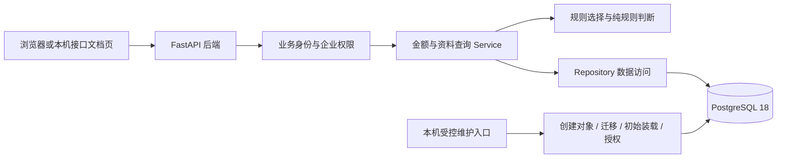

# 财税 Harness 开发者指南

本文面向会写 Python、但还不熟悉前后端工程和数据库协作的同学。目标是帮助你把“目录里有很多文件”连接成一个能理解的系统。

**分工：本文解释原理与代码；安装、配置、初始化和启动只按[根 README](../README.md)操作；测试结果以[阶段报告](development/reports/2026-11-04_D1.md)和[progress](development/progress.md)为准。** 本文不维护第二套可执行命令，也不改变技术契约。D1 已于 2026-11-05 通过真实 PostgreSQL 测试和开发库只读检查，见[最终报告](development/reports/2026-11-05_D1.md)。下面用请求过程讲解现有代码；实际 HTTP 记录另见报告，不把示意流程当作证据。

建议依次阅读：先理解一次请求，再理解组件和数据库对象，最后沿代码与测试建立验证意识。

## 1. 先看系统整体

系统目前采用模块化单体：业务分成清楚的模块，但都运行在同一个后端应用进程中，不是多个微服务。前端是浏览器页面，后端是 Python 服务，PostgreSQL 是独立的数据库服务。后续模型通过专门适配器接入，D1 不调用模型。

为什么要分这些部分？网页负责交互，业务程序负责权限和规则，数据库负责持久保存与约束。这样网页即使传错参数，也不能越过后端检查直接访问其他企业。维护入口单独存在，避免日常网页拿着能建表的账号运行。

对应代码是[后端组合入口](../backend/app/main.py)、[HTTP 依赖装配](../backend/app/api/dependencies.py)和[维护 CLI](../backend/app/cli.py)。验证时按[README 功能验证](../README.md#9-功能验证)逐层确认；不要从“页面出现了”直接推导“整套系统已通过”。当前 [App.vue](../frontend/src/App.vue)仍只显示静态准备页，尚未提供聊天或 D1 查询界面。

## 2. 一次 HTTP 请求怎样走完

HTTP 是浏览器等客户端与后端交换请求和响应的协议。API 是后端公开的调用入口；例如查询甲企业九月金额，调用的是 GET `/api/v1/companies/C001/totals`，并提供 business_month=2026-09。GET 在这里表示读取，不修改业务数据。

下面按逻辑职责解释代码路径；框架可能在依赖处理过程中交错执行身份和参数校验，不能把此表当作所有错误情况下的固定执行时序。

| 环节 | 本项目具体做什么 | 对应位置 |
| --- | --- | --- |
| 接收请求 | 应用中间件生成 request_id，便于把响应和相关记录关联起来 | [main.py](../backend/app/main.py) |
| 校验访问凭证 | 从 Authorization 头读取 Bearer，将本机配置的随机 token 映射为 U001 或 U002 | [dependencies.py](../backend/app/api/dependencies.py)、[identity.py](../backend/app/core/identity.py) |
| 选择路由与验证参数 | totals 路由接收企业、年月和可选金额口径；非法参数进入统一错误处理 | [ledger 路由](../backend/app/api/routers/ledger.py)、[contracts.py](../backend/app/core/contracts.py) |
| 执行业务 | totals 服务检查当前业务用户是否可读目标企业，确定月初到下月初的日期区间，选择金额依据 | [LedgerService](../backend/app/modules/ledger/service.py)、[policies.py](../backend/app/modules/ledger/policies.py) |
| 查询数据库 | Repository 在企业、日期和收支方向限制内执行数据库查询；金额来源是当前表，不是说明页预存答案 | [ledger/repository.py](../backend/app/modules/ledger/repository.py) |
| 整理结果 | 将整数分格式化为两位小数的元字符串，组织 Totals DTO（数据传输对象）和外层 request_id | [contracts.py](../backend/app/core/contracts.py)、[Service](../backend/app/modules/ledger/service.py) |
| 返回响应 | 成功返回 data；权限不足返回 403，读取不可用返回 503 等结构化错误 | [errors.py](../backend/app/api/errors.py) |

这里有两道不同的安全检查：**数据库连接**要确认目标实例、数据库和数据库角色正确；**业务请求**要确认 U001/U002 可以访问哪个企业。连接正确不等于某个业务用户有权读取全部企业。

本项目不会把“查询失败”包装成金额 0。只有查询成功、确实没有记录，才能返回 0.00 并说明 empty；U002 查乙企业应被拒绝。验证入口在[README 业务接口验证](../README.md#92-数据库准备后再验证业务接口)，自动检查代码在[API 测试](../backend/tests/api/test_read_acl.py)；这些依赖真实 PG 的用例已实际通过，见[本轮汇总](development/reports/2026-11-05_D1_credentials/summary.json)。

## 3. 四个后端组件如何配合

### 3.1 FastAPI：把 HTTP 连接到 Python 函数

**是什么：** FastAPI 是后端 Web 框架，负责路由、请求参数处理、依赖调用和响应生成。Uvicorn 是运行这个应用的 ASGI 服务器，可以理解为接收网络连接、把请求交给应用的运行入口。

**为什么需要：** 普通 Python 函数不能仅靠定义就让浏览器调用；需要服务器与框架处理 URL、请求头、参数及 HTTP 状态码。

**项目怎么用：** [main.py](../backend/app/main.py)创建应用并安装路由；[ledger.py](../backend/app/api/routers/ledger.py)把 GET 路径映射到函数；依赖函数提供可信业务身份和服务实例。Router 不直接写 SQL。

**如何验证：** [README 健康检查](../README.md#91-分层确认不只看网页)区分服务存活、数据库准备和接口说明页。打开 `/docs` 只说明接口描述能生成；真正读取数据库还要配置凭证并运行对应测试。

### 3.2 Pydantic：明确数据应该长什么样

**是什么：** Pydantic 根据 Python 类型与校验规则验证数据，生成有明确字段的数据对象。本项目把跨 HTTP/模块共享的对象称作 DTO（Data Transfer Object，数据传输对象）。DTO 不是数据库中的表。

**为什么需要：** 若随处传任意字典，很容易出现字段拼错、金额类型不一致或非法年月流入业务。统一对象让接口双方对“字段叫什么、允许什么值”有共同依据。

**项目怎么用：** [contracts.py](../backend/app/core/contracts.py)定义 Principal、Invoice、Totals、Check 等已实施 DTO。共享 DTO 开启严格校验并拒绝额外字段；HTTP 查询参数还经过 FastAPI 的解析，不能把查询字符串解析与 DTO 严格模式混为一谈。精确对外格式以[JSON Schema](architecture/contracts/contracts.schema.json)和[HTTP 映射](architecture/contracts/http-operations.json)为准。

例如 amount 在接口里是 `"800.00"` 这样的元字符串；business_month 是 `"2026-09"`；Check 在不支持检查时 missing/count 必须为 null，不能假装为“0 项缺失”。

**如何验证：** [DTO 与机器契约测试](../backend/tests/unit/test_read_contracts.py)、[基础契约测试](../backend/tests/unit/test_contracts.py)核对有效/无效数据。它们可以不连接 PostgreSQL，所以通过不等于数据已经入库。Pydantic 也不会替你自动判断“这个用户有权访问乙企业”，权限仍由业务服务检查。

### 3.3 SQLAlchemy：组织数据访问和事务

**是什么：** SQLAlchemy 是 Python 数据库工具库。本项目使用 2.0 系列的同步 Session，并通过 psycopg 3 驱动连接 PostgreSQL。表模型描述列和约束，查询构造描述“查什么”，Session 管理一次数据库工作的事务边界。

**为什么需要：** 程序既要访问数据库，也要正确绑定参数、管理连接和事务，而不是把用户输入直接拼成 SQL。连接池会复用已建立的连接；它不等于把业务结果缓存成固定答案。

**项目怎么用：**

- [engine.py](../backend/app/infrastructure/database/engine.py)创建连接池和 Session 工厂，并在取出连接时核验实际目标与身份。
- [models.py](../backend/app/infrastructure/database/models.py)集中定义 SQLAlchemy 表模型及映射。
- [ledger Repository](../backend/app/modules/ledger/repository.py)组织发票和流水查询；[knowledge Repository](../backend/app/modules/knowledge/repository.py)读取规则。
- [unit_of_work.py](../backend/app/infrastructure/database/unit_of_work.py)提供短只读事务，让一次用途检查的规则和票据共享 REPEATABLE READ 快照。

事务是一组有共同完成边界的数据库操作。REPEATABLE READ 在这里让同一次短检查中的读取使用一致快照，避免“规则读的是前一刻、票据读的是另一刻”的不一致。它不表示以后请求仍应沿用旧数据，也不保证所有查询自动正确。

**如何验证：** [金额/日期测试](../backend/tests/integration/test_totals.py)、[规则测试](../backend/tests/integration/test_rules.py)需要真实 PostgreSQL。后续写入还必须在提交后使用新的 Session/事务回读；D1 的相关测试只是直接构造测试数据，不能据此说受控写对话已经实现。

### 3.4 Alembic：记录表结构如何演进

**是什么：** Alembic 是数据库结构迁移工具。迁移版本记录需要执行的建表或结构变更步骤，而不是让每个开发者在图形界面逐张建表。

**为什么需要：** 代码版本更新后，数据库也要到对应结构版本；只有源码更新、表没更新，查询仍可能失败。可追踪的迁移能明确“这次结构变化是什么”。

**项目怎么用：** [alembic.ini](../backend/alembic.ini)和[migrations/env.py](../backend/migrations/env.py)指定迁移环境；[0001_initial.py](../backend/migrations/versions/0001_initial.py)执行[冻结首迁移 SQL](../backend/migrations/versions/0001_initial.sql)，把版本记到 harness.alembic_version。旧迁移不直接导入未来可变模型，避免将来改 models.py 后，历史迁移内容也跟着变。

**如何验证：** 正式恢复 D1 时经 README 的 Init 入口，再核对[结构测试](../backend/tests/integration/test_schema.py)和 Inspect 结果。本轮首迁移已在真实 PostgreSQL 成功执行，见[迁移记录](development/reports/2026-11-05_D1_credentials/migrate-test-retry.json)；仅文件存在本身仍不能证明迁移成功。网页启动不会自动做迁移。

### 3.5 它们的关系

FastAPI 接请求，Pydantic 约束传输数据；Service 决定合法业务步骤，Repository 通过 SQLAlchemy/psycopg 访问 PostgreSQL；Alembic 在显式维护时准备表结构。**Pydantic 不负责建表，SQLAlchemy 模型存在也不会自动完成本项目初始化，Alembic 不负责生成网页。** 可以结合[首迁移、装载和读取职责](architecture/05_数据库与数据架构设计.md#10-初始化迁移与备份)核对这些边界。

## 4. PostgreSQL 里的四种对象

先区分 PostgreSQL 服务实例与数据库：同一个正在运行的 PostgreSQL 实例可以管理多个数据库，也可以定义多个可登录角色。项目不会因为发现一个服务在运行，就认为登录身份、对象归属和权限都正确。

| 概念 | 是什么、为什么需要 | 本项目怎么使用 | 对应代码与验证 |
| --- | --- | --- | --- |
| 数据库 database | 一个独立命名的持久数据目标；连接时明确选择它 | finance_tax_dev 用于日常开发，finance_tax_test 用于串行测试 | [targets.py](../backend/app/infrastructure/database/targets.py)在连接前检查名字，认证后再次核对实际数据库 |
| schema | 数据库内部的命名空间，用于组织表等对象；不是另一个数据库 | 两个库各有一个 harness schema；完整表名如 harness.invoices | [models.py](../backend/app/infrastructure/database/models.py)固定 schema；[维护代码](../backend/app/infrastructure/database/maintenance.py)检查结构版本与表集合 |
| 角色 role | PostgreSQL 的身份和权限载体；可登录角色可作为连接用户名 | finance_tax_app 日常运行；finance_tax_migrator 维护；postgres 只是管理员候选 | [bootstrap.py](../backend/app/infrastructure/database/bootstrap.py)检查/创建，运行连接再核验 session_user/current_user 与属性 |
| 数据表 table | 按列保存一类记录，并用主键、外键等约束数据 | invoices 发票、bank_transactions 流水、rules 规则等 | [models.py](../backend/app/infrastructure/database/models.py)、[结构/权限测试](../backend/tests/integration/test_schema.py) |

一个角色可连接两个获准数据库，不需要在每个库里新建一个同名角色。但每个数据库各自有 harness schema 和表，不能因为 schema 名相同就把两库数据看作同一份。

主键用于唯一标识记录。发票在本项目用 **company_id + invoice_id** 复合主键：C001/F002 和 C002/F002 是两张不同的票，单独的 F002 不够。外键表达“被引用的记录必须存在”；例如发票所属企业必须能在 companies 中找到。金额保存为 BIGINT 整数分，API 再转成元字符串，避免浮点累计误差；初始装载边界还用 Decimal 检查原始金额精度。

这些设计的原始字段与约束见[数据库设计](architecture/05_数据库与数据架构设计.md#3-基础与业务表)。[准备脚本](../scripts/prepare_seed.py)与[纯规则测试](../backend/tests/unit/test_ledger_policies.py)能验证转换和纯函数，但数据库原生约束、身份与权限必须由真实 PG 测试证明，当前还没有通过证据。

## 5. 为什么分库，也分角色

### 5.1 开发库与测试库

**是什么：** 开发库承载日常试用的当前数据；测试库承载可重复准备的测试数据。fixture 指一项测试所需的已知初始状态，例如 B0 是官方基准资料，B2 增加专门用于验证日期边界的记录。

**为什么分开：** 测试为复现边界，需要修改数据，有些还需要真实提交和重新连接。若拿日常库运行这些测试，可能抹去当前试用状态。数据隔离不能只靠“我记得这次在测试”。

**项目怎么用：** 仅精确允许 finance_tax_test，必须 APP_ENV=test，明确提供两类测试连接，按实例/角色/认证后目标校验；首轮串行，不自动接受其他数据库名、worker 后缀或开发连接回落。来源回执还用于防止擅自采纳既有同名对象。tax_db 完全不作为项目操作目标。

**代码与验证：** [targets.py](../backend/app/infrastructure/database/targets.py)、[maintenance.py](../backend/app/infrastructure/database/maintenance.py)实现保护，[目标保护单测](../backend/tests/unit/test_targets.py)验证拒绝路径；[conftest.py](../backend/tests/conftest.py)只有通过检查后才准备真实 fixture。测试环境的 schema 重建可能清掉测试数据，因此实际执行只按[README 测试库验收](../README.md#74-运行测试库验收)。改 APP_ENV 本身不会让开发库变成获准测试库。

### 5.2 app 角色与 migrator 角色

**是什么：** finance_tax_app 是应用运行账号，finance_tax_migrator 是显式维护账号；两者都不是超级用户，后者负责本项目数据库/schema 内的维护，不能据此任意建库或管理整个实例。

**为什么分开：** 后端日常请求不需要建表或改金额、银行数据的能力。数据库层少给权限，能给程序错误增加一道限制；同时 Service 还得检查业务用户权限，不能只依赖数据库账号。

**项目怎么用：** app 可以读取需要的表；发票更新只准 purpose、note 及 row_version、updated_at 这些必要技术列，users 仅可更新 memory_revision，其他服务表按明确白名单授权。**这只是数据库权限准备，不表示 D1 已开放发票写接口。** migrator 执行结构迁移、seed 和 GrantRuntime，管理员候选只在核验后创建缺失新对象。

**代码与验证：** [grant_runtime.sql](../backend/app/infrastructure/database/grant_runtime.sql)先撤掉过宽的表级和历史列级权限再重授，[permissions.py](../backend/app/infrastructure/database/permissions.py)检查实际有效权限；[权限集成测试](../backend/tests/integration/test_roles.py)要求 PostgreSQL 真正拒绝越权语句。SQLSTATE 是 PostgreSQL 的错误分类码，这里预期的权限拒绝为 42501；本轮 JUnit 已记录真实拒绝 42501，见[测试证据](development/reports/2026-11-05_D1_credentials/attempt1/pytest.xml)的 denied_sqlstate/regrant_sqlstate；授权 SQL 本身不能替代它。

## 6. 首次准备流程为什么分成这些步骤

这是一条受控维护链，和普通用户请求是两个入口。实际操作只用[README 首次初始化](../README.md#7-首次初始化)，下面解释每一步的输入、产物和验证意义。

当前两库两角色已由操作者预建，按后续明确推进 D1 的[恢复决定](../Documentation.md#d1-既有项目对象准备恢复--2026-11-04)，使用显式 PrepareExistingTest/PrepareExistingDev，而不是重新建库的 Bootstrap。新入口先验证审批来源、实际身份、对象 OID/owner 和空集合，再补缺失 schema/基础权限，回执如实标记 operator_precreated；不改既有密码/owner，不伪装成本程序新建。当前五类登录已成功，但 app 与 migrator 共用口令仍被拒绝，见[恢复记录](development/reports/2026-11-04_D1_真实验收恢复.md)。入口概念与边界由[preparation.py](../backend/app/infrastructure/database/preparation.py)实现，操作仍只在 README。

| 步骤 | 是什么、为什么需要 | 项目输入与产物 | 代码在哪里、怎样确认 |
| --- | --- | --- | --- |
| InspectAdmin | 创建前只读核验管理员、实例和同名对象，先确定“准备操作哪里” | 管理员受控连接；输出身份及项目对象目录信息 | [bootstrap.py](../backend/app/infrastructure/database/bootstrap.py)的 inspect_admin；有冲突报告就暂停，不能据连接成功自动创建 |
| BootstrapTest | 创建缺失的初始数据库/角色/schema，使维护账号有自己的工作范围 | 本机选定的两角色独立口令；产物为两角色、测试库、harness schema、基础权限和来源回执 | 同文件的 bootstrap；读取名称与回执核验。未创建业务表，也未装业务数据 |
| Init | 执行 Alembic 结构迁移 | 维护连接和冻结迁移；产物为表、约束、索引及版本记录 | [maintenance.py](../backend/app/infrastructure/database/maintenance.py)的 migrate；[schema 测试](../backend/tests/integration/test_schema.py)验证实际结构 |
| Seed | 一次装入已整理的初始资料，避免手工录入和启动重复覆盖 | [business.json](../data/seed/business.json)、[rules.json](../data/seed/rules.json)、[manifest.json](../data/seed/manifest.json)；产物为初始行与 seed_meta 标记 | [seed.py](../backend/app/infrastructure/database/seed.py)；核对数量、来源 hash 和同/异 hash 保护，见[seed 测试](../backend/tests/integration/test_seed.py) |
| GrantRuntime | 为正常应用收敛最小权限 | 结构已经建立；产物为 app 的白名单权限 | [grant_runtime.sql](../backend/app/infrastructure/database/grant_runtime.sql)、[permissions.py](../backend/app/infrastructure/database/permissions.py)；核验有效权限及实际拒绝 |
| Inspect | 只读检查当前准备结果，便于在启动前发现缺项 | 当前版本、seed 指纹/基础键和权限；产物为检查结果 | [inspect_prepared](../backend/app/infrastructure/database/maintenance.py)；不是仅执行一次连接检查，也不是完整验收 |
| 测试库验收 | 用指定 fixture 覆盖正常、边界、失败和拒绝路径 | 真实 app/维护测试连接；产物为日志、JUnit 与 summary | [verify_d1.py](../scripts/verify_d1.py)与[测试规范](development/04_测试与验收规范.md#4-运行记录与通过条件)；看是否真的执行、是否存在 blocked |
| BootstrapDev 及开发库准备 | 测试先证明维护链，再将同样维护步骤用于获准开发库 | 本项目回执、通过的测试 summary、同实例同角色开发连接 | [bootstrap.py](../backend/app/infrastructure/database/bootstrap.py)检查前置证据，再按 README 准备和验证；当前仍不满足进入条件 |

hash 是由文件内容计算出的指纹，用于比较内容是否一致。本项目的规范化 manifest 保存来源与规范化内容指纹；它不能证明这些行已经进了数据库。seed_meta 是数据库内的初次装载记录，也不能仅凭一行标记证明全部数据正确，因此还要查基础键、数量及业务结果。

同 hash 重复 Seed 会校验已有装载而不覆盖当前用途；异 hash 或无标记的部分库会拒绝，不能把“恢复初始数据”当作普通启动。初始化中途失败可能留有已经成功的对象；需要检查具体状态，而不是删除库或卷后重试。出处是[生命周期设计](architecture/05_数据库与数据架构设计.md#9-数据生命周期与血缘)和[本轮批准边界](../Documentation.md#d1-正式实施批准--2026-11-04)。

## 7. Router、Service、Repository 与 DTO

如果所有逻辑挤在一个路由函数里，HTTP、权限、金额、SQL 和错误处理会纠缠在一起。本项目用 Router → Service → Repository 分层，让每层承担明确职责。

| 概念 | 是什么、为什么需要 | 本项目例子与代码 | 怎样验证 |
| --- | --- | --- | --- |
| Router 路由层 | HTTP 与业务调用之间的边界；处理路径、参数和响应，不组织 SQL | [ledger 路由](../backend/app/api/routers/ledger.py)接收 company_id/business_month，把请求交给 service.totals | 路由描述与[HTTP 映射](architecture/contracts/http-operations.json)核对，再看 API 响应测试 |
| Service 应用服务层 | 组织一个业务用例，知道权限和业务步骤，避免 Router 自行决定规则 | [LedgerService](../backend/app/modules/ledger/service.py)检查企业访问、组织三口径金额及用途检查 | 纯规则可单测；实际组合结果要用真实数据库和 API 测试 |
| Repository 仓储层 | 封装具体数据读写；让上层不必到处知道表名和 SQL 细节 | [LedgerRepository](../backend/app/modules/ledger/repository.py)限制企业/日期查询、绑定参数；[KnowledgeRepository](../backend/app/modules/knowledge/repository.py)取规则候选 | 真 PG 上核对筛选、汇总、搜索转义与权限；函数能导入不代表 SQL 已运行 |
| DTO 数据传输对象 | 定义跨层/接口共享的数据，防止同一字段出现不同含义 | [contracts.py](../backend/app/core/contracts.py)的 Totals、Invoice、RuleResolution、Check | Pydantic 校验及机器契约回归；不等于数据库表结构测试 |
| Policy 纯规则 | 无数据库、网络或文件 I/O 的确定性函数，便于独立核对 | [ledger/policies.py](../backend/app/modules/ledger/policies.py)判空白、年月和门槛；[knowledge/policies.py](../backend/app/modules/knowledge/policies.py)判规则缺失/冲突 | 参数化单测；通过只能证明这些给定输入下的程序逻辑 |
| TransactionPort / 只读事务边界 | 提供受控数据访问能力，让跨模块协作不必传递 HTTP Request 或让各模块各开快照 | [ReadTransaction](../backend/app/infrastructure/database/unit_of_work.py)装配同一 Session 中的 Ledger/Knowledge Repository | 用同一检查中的规则和票据结果验证，不能以不同事务的巧合结果替代 |

Repository 不是数据副本，DTO 不是持久存储，Service 也不是一个额外服务器。它们是同一个 Python 后端里的代码职责。D1 的用途检查在一个短只读事务内同时读取规则和当前发票；程序不会把旧任务快照当当前缺填清单。

## 8. D1 接口与代码阅读路线

当前已提供代码的业务接口如下；均为 GET、均需要可信业务身份，**真实 PostgreSQL 运行仍待验证**。路径列包含完整 `/api/v1` 前缀，便于与源码对照；操作方法统一在[README](../README.md#92-数据库准备后再验证业务接口)。

| 功能 | 路径与主要输入 | 阅读入口与需理解的边界 |
| --- | --- | --- |
| 当前业务用户 | `/api/v1/me` | [identity 路由](../backend/app/api/routers/identity.py)及 Service.me，只列当前可读企业 |
| 发票搜索 | `/api/v1/invoices/search`；q、可选 company_id/business_month、cursor/limit | [Service.search](../backend/app/modules/ledger/service.py)、[Repository](../backend/app/modules/ledger/repository.py)，只查授权企业，并转义 `%`、`_` 等搜索字符 |
| 发票详情 | `/api/v1/companies/{company_id}/invoices/{invoice_id}` | [ledger 路由](../backend/app/api/routers/ledger.py)，必须使用复合标识；详情来自当前行 |
| 银行流水 | `/api/v1/companies/{company_id}/bank-transactions`；必需 business_month，可分页 | Service.banks；收入/支出均以正数金额保存，银行没有写入口 |
| 三种金额 | `/api/v1/companies/{company_id}/totals`；必需 business_month，可选 metrics | Service.totals；发票、银行支出、银行收入独立合计，不用收入减支出代替支出 |
| 用途检查 | `/api/v1/companies/{company_id}/purpose-check`；必需 business_month | Service.check；仅 2026-09，甲全部必填，乙单张 ≥1000 元必填，备注不替代用途 |
| 适用规则 | `/api/v1/companies/{company_id}/rules`；必需 business_month/topic | Service.rules 与 [resolve](../backend/app/modules/knowledge/policies.py)；按企业、业务时间、状态选择，不自行取“版本字符串最大”的一条 |

cursor 是分页游标，记录下一页从哪里继续；它绑定用户、资源和筛选条件，不授予任何额外企业权限。实现见[pagination.py](../backend/app/core/pagination.py)。不存在规则、规则冲突或月中生效无法覆盖整月时，要返回不足/冲突/不支持状态，不能推断“全部已齐”。

推荐阅读顺序是：先看一条 totals 路由，再跟到 Service.totals，接着看 Repository.metric，最后看 DTO Totals 和对应测试。这样比从所有表定义开始更容易看清“一个参数如何变成一次可信查询”。精确字段以[机器契约](architecture/contracts/contracts.schema.json)为准，本指南的说明不扩展接口范围。

## 9. 测试与真实验收有什么区别

测试是对指定输入和可观察结果做核对；验收则要判断本阶段所有必需条件是否都有证据。程序输出绿色或某个命令退出 0，不能自动回答“测试是否真的覆盖了数据库”。

| 层次 | 验证什么 | 本项目在哪里 | 当前能得出什么结论 |
| --- | --- | --- | --- |
| 静态检查 | 文件/链接/锚点、语法、约定或结构是否符合要求，不一定执行业务 | [历史交接验证](development/reports/2026-11-04_D1/handoff-validation.json)与本轮文档检查 | 文档或结构检查通过不能证明数据库可用 |
| 单元测试 | 小范围函数/组件在已知输入下的行为，可隔离外部依赖 | [tests/unit](../backend/tests/unit)中的金额精度、月份、空白、目标拒绝和 DTO 等 | 历史 106 项通过不需要真实 PG；包括配置/健康等无数据库检查，不是 106 项业务用例全部验收 |
| 集成测试 | 多个模块与真实外部组件一起工作的行为 | [tests/integration](../backend/tests/integration)的迁移、seed、约束、权限、金额等 | 必须真实 PG18；本轮实际通过，见[汇总](development/reports/2026-11-05_D1_credentials/summary.json) |
| API 测试 | HTTP 参数、身份、状态码、响应契约及后端组合行为 | [tests/api/test_read_acl.py](../backend/tests/api/test_read_acl.py) | 本项目这些业务 API 测试依赖真实 PG fixture；不能仅模拟返回值后声称数据库通过 |
| 真实环境验收 | 核验目标实例/角色、维护链、当前业务结果、拒绝和回读证据，满足任务卡全部要求 | [D1 卡](development/tasks/D1_PostgreSQL与只读业务.md#本地验收标准)、[阶段报告](development/reports/2026-11-04_D1.md) | D1 已完成，见[最终交接](development/reports/2026-11-05_D1.md)；连接成功、安装成功、表文件存在各自都不足以证明最终通过 |

“API 测试”按调用边界分类，“集成测试”按组合程度分类，两者可以重叠，不是互斥等级。本项目 API 用例直接使用真实 PG fixture，正是重叠的例子。

状态词也要区分：passed 是实际执行且满足断言；failed 是执行后出现失败；blocked 是所需外部条件不足；not_run 是未执行。pytest 可以把缺数据库的用例记为 skipped，项目汇总必须把这类真实门明确记为 blocked。当前历史全套记录为 **106 passed、47 blocked**，另外 55 项是相关保护子集的复验，不应再相加成 161 个不同测试。[summary](development/reports/2026-11-04_D1/summary.json)、[完整日志](development/reports/2026-11-04_D1/attempt2/backend-tests.log)和[保护子集日志](development/reports/2026-11-04_D1/post-check-guards.log)记录了这个区别。

涉及保存/回读的测试必须真实 COMMIT，再从新的连接或 Session 读取；不能只在同一 Session 看缓存，也不能用外层回滚假装已持久化。缺少真实数据库时，允许继续做纯函数与 DTO 检查，但不能用替代数据库关闭 PostgreSQL 验收门。[测试规范](development/04_测试与验收规范.md#2-可复现fixture)定义了这些要求。

## 10. 负责人现在怎样继续

当前不是需要模型 Key，而是需要本机 PostgreSQL 的受控连接。先由操作者在本机提供管理员候选连接、两类明确的测试连接及独立角色密码；确认同名对象和实例归属。真实测试通过后，再配置同实例同角色的开发连接并完成开发库准备。手工验证受保护 API 还需要两份独立随机演示 token。

详细字段和唯一操作顺序在[README 环境变量](../README.md#6-环境变量配置)与[首次初始化](../README.md#7-首次初始化)。本次文档任务不会执行这些数据库动作。D1 的代码实现、静态检查和无数据库测试已有相应证据；真实 PostgreSQL 门仍未通过，因此 D1 最终验收不能写 passed。

D1 验收和交接完成后，计划上的下一阶段才是 D2 的只读模型 Harness 与网页；仍需后续明确开发范围。本次到文档交接为止，不能因为指南解释了 D2 的背景就开始实现它。
